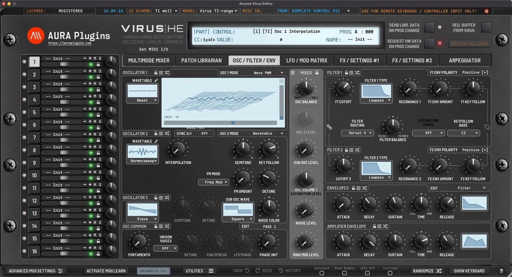

# Access Virus Editor – Product Capabilities

## Introduction

Document date: 29 September 2026

https://auraplugins.com/kb/user-guide/access-virus-editor-user-manual/

This manual is based on version 25-01-24

This printable file follows the online Knowledge Base. Numbered markers like [1] and [2] in the text match the callouts in the screenshots.

*Figure: oscillator displays*

Thank you for your interest towards our Editor & Librarian software.

We built our Access Virus Editor to control Virus A, Virus B, Virus Rack, Virus C, Virus Rack XL, Virus TI, Virus TI Snow and Virus TI2 models over MIDI or USB. Connect MIDI input & output, Audio jack cables to the mixing console / sound card and fire up your Computer to get started! You can also use the USB even if you are using macOS 10.12 or greater! Editor works both as Plug-in and Standalone Application.

Access Virus Editor User Manual contains instructions to get the Editor installed and configured. Please read this manual carefully. Any feedback with comments on how to improve the documentation is welcomed.

Let's dig in!

***DISCLAIMER:*** *Our company & product has nothing to do with Access Music GmbH. If there is an issue with our product, open a support ticket from my account page. You can find support details at the end of this document.*

## What you can do with Access Virus Editor?

- Control your Access Virus hardware synthesizer from your DAW over MIDI or USB.
- Connect your Virus TI with USB to macOS 10.12 or greater to establish the long gone connection – Our Editor adds Apple Silicon support! More information here: https://auraplugins.com/kb/product/access-virus-editor/user-guides/
- Edit almost every parameter of your synthesizer with our Editor.
- We added a bit more than 5600 parameters to the Editor (16 parts) so the sound editing should be painless and a quick task.
- Automate almost every parameter in your DAW.
- Easier to handle automations than trying to remember hundreds of #CC’s.
- Mute, adjust levels, panning, outputs and such from the Editor, per channel.
- Parameters that are available for automation will be listed on your DAW. (Ableton Live can’t see our parameters by default, so you have to teach it).
- Total Recall of the sounds used up on project reload.
- All of the current parameters from the Editor will be sent to the hardware memory buffer up on project reload! Time saver when thinking about storing, naming and loading data from multiple hardwares per project.
- Editor reacts to hardware knob movements and displays knob, slider, menu and button values within the Editor display.
- Model selector in the top bar defines which parameters are shown and available to your specific Virus model.
- Store banks to your Virus from the librarian.
- Store patches to your Virus from the librarian.
- Request banks from your Virus to the librarian.
- Request patches from your Virus to the librarian.
- Store requested or modified bank data to your own library (on your HDD).
- View & edit patch names in Editor user interface.
- Librarian supports MIDI and SysEx soundset formats across all Virus models.
- Select next or previous librarian patch from hardware.
- Select next or previous hardware patch from the librarian.
- Move patches from one bank to another and save as you like.
- Send data from the Editor to your synthesizers Part buffer OR write RAM slots through our Editor.
- Download and put all of the Virus soundsets in one folder for quick access through the Editor.
- Each part can have its own patch.
- Each part patch name can be set from the Editor window.
- Each part has its own parameters which you can automate from your DAW.
- Changing part from Editor changes part in hardware and vice versa.
- Layer multiple patches to create massive leads or such.

## What you CANNOT do with Access Virus Editor?

- Transmit any audio. You have to plug your Synthesizers audio jacks into your mixer in order to hear the sound. macOS users can use USB to transmit audio from Virus TI to DAW with instructions found here: https://auraplugins.com/kb/product/access-virus-editor/user-guides/
- You can not remotely start and / or shut down your synthesizer.
