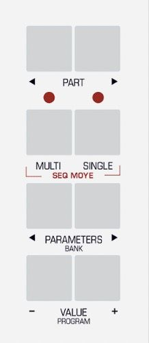
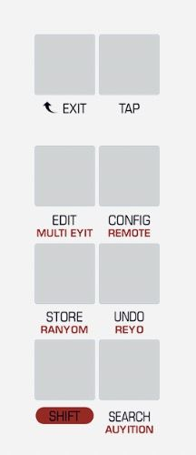
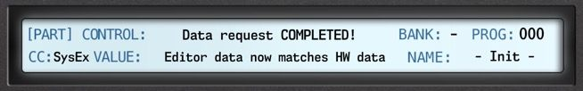
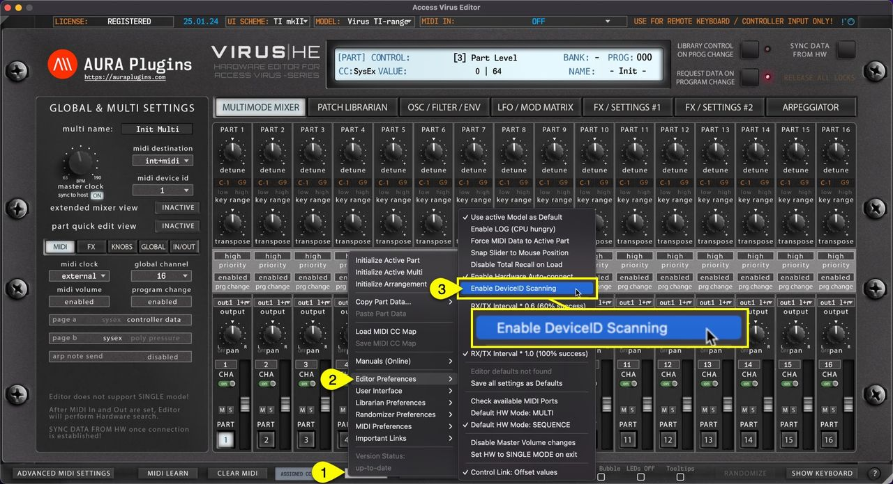
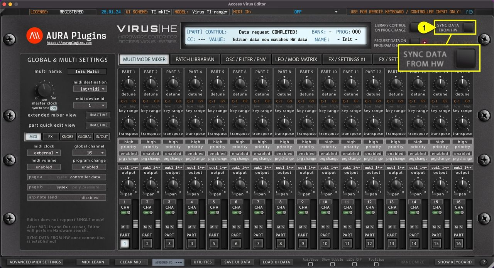

# Make The Connection

## Prepare your Hardware

Connect the MIDI cables from your synthesizer to the MIDI interface and Audio Jacks to your console / sound card. MIDI out from synth to MIDI interface IN and vice versa. MIDI thru connections will not work.

- MIDI Out from MIDI interface to Virus MIDI In port.
- MIDI Out from Virus to MIDI interface MIDI In port.
    - double check your cables!
- Audio from Virus Out1 L&R to console or sound card inputs.
    - Add more outputs if needed.
- Virus TI users can use USB along with Analog outputs to get 6 stereo pairs / 12 mono tracks of Audio from the Virus.

### Wiring diagram example


*Figure: Screenshot*

Power up your Virus. Our editor is designed to work “out of the box” and control all parameters from a single application instance.

**NOTE:** Our Editor is designed to work in MULTISINGLE / SEQUENCER-mode.

### Using Virus TI with and without USB connection

This is a raw example of how to route your Virus TI with macOS 10.12 or greater – even on Apple Silicon macs! Note that our Editor requires a Metal compatible graphics processor.

CONNECT VIRUS TI WITH USB

In the sample below, you can see how simple setup works with minimal effort. USB from Virus TI is connected to the USB 3 hub. This hub is then connected to Apple Silicon mac with USB-C cable. Audio and MIDI is passed to and from Virus TI with the single USB cable.

setup guide: https://auraplugins.com/kb/product/access-virus-editor/user-guides/


*Figure: access virus ti with usb connection up*


*Figure: access virus ti with usb connection perspective*

**NOTE:** IF Virus TI is connected to computer with USB cable, then Virus TI MIDI input and output will act as a MIDI port to your DAW. All MIDI data in and out from Virus TI MIDI ports will bypass the Virus TI engine!

CONNECT VIRUS TI WITHOUT USB

This is the classic guide to route Audio and MIDI with Virus TI and previous Virus models. Audio outputs from Virus connected to Soundcard inputs, MIDI in and out from Virus connected to MIDI interface in and out ports.

MIDI interface and soundcard are both connected to USB 3 hub and the hub is connected to Apple Silicon mac with USB-C cable.


*Figure: access virus ti without usb connection up*


*Figure: access virus ti without usb connection perspective*

**NOTE:** If you need more audio outputs from the Virus TI, just plug in the USB cable from Virus TI to your USB hub and you’ll gain 3 stereo / 6 mono outputs to your setup. See NOTE above about Virus TI USB & MIDI input / output ports!

## Configure Virus A, B, C, Rack and Rack XL

**NOTE:** Menu and Button examples from Virus C user manual.


*Figure: access virus config 1*

Enter MULTI mode


*Figure: access virus config 2*

Enter GLOBAL settings -> Use PARAMETER buttons to navigate settings pages and VALUE buttons or VALUE knob to adjust following parameters:

```
MIDI DUMP RX        = Enable
Global Channel      = 16
Panel               = Int+Midi
SoftThru            = Off
ProgChange          = Ena
DeviceId            = 1
MIDI Control LoPage = Contr
MIDI Control HiPage = SysEx
System MemProtect   = Off
```

All set! We are now ready to open our plug-in in DAW or Standalone Application!

To get more information about how to adjust your synth, read the Access Virus User Manual.

**External Clock Note** : Arpeggiator will not play unless your DAW is able to provide a MIDI Clock. Windows: Check our method of using MIDI OX and LoopBe together to provide MIDI clock from DAW to your synth.

## Configure Virus TI and TI Snow series

After Virus is powered up, enter System settings and apply the following settings.

**NOTE:** Menu and Button examples from Virus TI Desktop user manual.



*Figure: access virus ti config 1*

Enter MULTI mode



*Figure: access virus ti config 2*

Enter GLOBAL settings -> Use PARAMETER buttons to navigate settings pages and VALUE buttons or VALUE knob to adjust following parameters:

```
Knob Behavior     | Target         | Internal+MIDI
System 4/5        | Mem Protect    | Disabled
MIDI 1/3          | Global Channel | 16
MIDI 1/3          | MIDI Device ID | 1
MIDI 1/3          | Soft Thru      | Off
MIDI 3/3          | Program Change | Enabled
Receive MIDI Dump | Receive Dump   | Enable
MIDI Control      | Page A         | Controller Data
MIDI Control      | Page B         | SysEx
```

All set! We are now ready to open our plug-in in DAW or Standalone Application!

To get more information about how to adjust your synth, read the Access Virus User Manual.

**External Clock Note** : Arpeggiator will not play unless your DAW is able to provide a MIDI Clock. Windows: Check our method of using MIDI OX and LoopBe together to provide MIDI clock from DAW to your synth.

## Virus TI USB Audio connection

### Access Virus TI USB Audio connection

You’ll find links in this article for User Guides to connect your Virus TI USB Audio back into your DAW – macOS and Windows.

The first method is Native macOS way (yes, even on M-chip macs), then we will check how to connect the Virus TI USB Audio with 3rd party Apps & Plugins (paid software).

OK, let’s get into it. What do you need? **Natively** on macOS:

- Access Virus TI and/or Access Virus TI Snow (obviously)….
- USB cable.
- USB-C to USB 2 or USB 3 Hub.
- Access Virus Editor.

With 3rd party Applications we are using **Audiomovers** [Omnibus](https://audiomovers.com/products/omnibus) and [Inject](https://audiomovers.com/products/inject) , both macOS and Windows compatible software we use daily in our operations!

And the big question: Why?

Since macOS Catalina (10.15) came out, Apple did change up their OS quite a bit. It is a struggle with developers trying to keep up the pace with Apple and their recent changes. Now with Apple Silicon (m-chip) machines things took another turn. But luckily this fairly simple method will solve the issue. But only partially, since this method brings the audio to your DAW instead of the plugin itself.

Enough of talking technical stuff, let’s connect the Virus TI to your DAW!

**NOTE:** These articles are mainly written to work with our Access Virus Editor!

Install our Access Virus Editor from the [downloads](https://auraplugins.com/downloads/access-virus-editor/) page. The demo version works too, but you are missing a lot of features with it ($69.95 is a very small fee for a fully working editor)!

## macOS MIDI Configuration

This setup **is not mandatory if you remember** all of your port numbers & routings out of your head. This guide will help you, if your setup is anything like ours: dozens and dozens of ports in use!

### Virus TI and USB on macOS

If you are using USB with Virus TI, check the previous article here: https://auraplugins.com/kb/article/access-virus-editor-virus-ti-usb-audio-with-macos/

**HEADS UP :** This is usually the step which is skipped and then you get connection timed out errors and such. Read the guide, it will help you to succeed with the setup in the long run!

### Audio MIDI Setup.app

Start by opening **Audio MIDI Setup.app [1]** – You can find the app from `/Applications/Utilities`


*Figure: Open Audio MIDI Setup app*

Next we want to view MIDI devices and to do that, click **Window [1]** and select **Show MIDI-Studio [2]**


*Figure: Open MIDI-Studio*

And this is what you get (contents of the window will vary depending what your setup has configured already!):


*Figure: macos midi configuration start*

### Creating new Devices

If you haven’t added the Virus to your MIDI-studio yet, here is how to do it:

**Click + -sign [1]** from the top right corner (add external midi-device)


*Figure: macos midi configuration new device*

The newly added device will pop somewhere in the window (without any logical placement!)


*Figure: macos midi configuration device created*

Double click the newly added **device [1]** so we can start to modify its properties


*Figure: macos midi configuration open device*

In this example, I am gonna add a Virus Rack (classic 1U rack unit) to my rig. Lets update the properties:

- **Device Name [1]** = Virus Rack
- **Manufacturer [2]** = Access
- **Model [3]** = Virus Rack
- **Check MIDI clock [4]** if you want your Virus model to receive MIDI clock information. Some DAWs require additional steps to transmit the MIDI clock.

You can update the **device color [5]** if you want, but it is only visual feedback to find the device from the jungle.

Once all fields are good to go, hit **Apply [6]** and you can see the device name and color gets updated **[7]** .


*Figure: macos midi configuration update device*

If you have multiple Viruses in your setup, add more devices and make sure each of the devices have individual **Device Name [1]** as set above. Like Virus Rack #1 and Virus Rack #2 etc. This helps you down the road when we connect the hardware to the Editor.

### Connecting Device to MIDI-interface (virtually)

Making virtual connections within MIDI-studio helps us later down the line when we connect the hardware to the Editor and when we make external connections from DAW to hardware. Some DAWs like Logic Pro can see the Device Name created here in MIDI-studio.

Start by drawing the connection points from your external device output port to your MIDI-interface input port. Click and hold down the mouse button from **output port [1]** , start dragging the **cable [2]** towards your MIDI-interface **input port [3]** .


*Figure: macos midi configuration connect device*

Apply the same procedure for the MIDI input port from your device towards your MIDI-interface output port. The final result should have both cables connected as seen below. I have highlighted Virus Rack, Virus C Desktop and Virus TI2 Desktop and their cables from the spaghetti. (Keep in mind, this is our studio, yours can look a lot different).


*Figure: macos midi configuration all connected*

These settings are stored within macOS so you don’t have to re-do these settings unless you change your MIDI-interface.

## Windows MIDI Configuration

**HEADS UP :** Windows 11 with multiclient MIDI drivers will enable MIDI devices to be shared between applications - If you are on Windows 11, you can skip creating Virtual paths if you don’t have use for them.

If you plan to route MIDI messages from your DAW to the plug-in channel and send it to the synthesizer from there, then you don’t need to read this, and you can proceed with the DAW guide that is relevant to you.

However, if you use the synth as a master keyboard in your rig or you want to delay compensate the MIDI output with the DAW, then check the advanced procedure below.

Windows **CAN NOT** share MIDI devices between applications (DAW & Editor), therefore virtual ports are the only way to to use the hardware within the DAW and the Editor at the same time.

**ATTENTION** : This is usually the step which is skipped and then you get connection timed out errors and such. Read the guide, it will save our time, your time and you will succeed with the setup!

### Additional Applications needed

Before we jump ahead to launch our DAW, let's do some tweaks in our system to ensure the plug-in can work with maximum efficiency. For that, we are going to need some additional tools.

- MIDI-OX for making routings behind the scenes and
- loopMIDI to create virtual MIDI ports.

We recommend installing an old but trusty MIDI-OX application for Windows to make some virtual routings behind the scenes.

You can download MIDI-OX from here: http://www.midiox.com/zip/midioxse.exe

OR go to MIDI-OX website http://www.midiox.com and download the installer there.

The second application is loopMIDI by Tobias Erichsen which is perfect for creating Virtual MIDI cables inside your workstation.

You can download loopMIDI from here: https://www.tobias-erichsen.de/software/loopmidi.html

**NOTE:** Windows remembers loopMIDI and MIDI-OX settings during each launch. If you do this once, that's all it takes!

### Install MIDI-OX and loopMIDI

Install both MIDI-OX and loopMIDI.

This will allow us to clone the MIDI data from the physical MIDI interface ports to virtual ports and then later on route it inside MIDI-OX back to your DAW while the main port is assigned to the plug-in.

**Example**: MIDI out from Virus -> Roland UM-ONE MIDI input -> MIDI-OX -> loopMIDI virtual port.

This configuration allows us to open the loopMIDI virtual port in the DAW while we use the Roland UM-ONE MIDI port with the plug-in itself. This way there won’t be a crash!

### Configure loopMIDI

Now that loopMIDI is installed, we can configure the ports. The reason why we are installing loopMIDI is so that we can loop back (clone) the MIDI data from the hardware MIDI port to the DAW via MIDI-OX.

*In the example below, we will add Virtual Ports for* ***Virus TI Keyboard*** *and* ***Virus C Desktop*** *. This is pretty straight forward, but we will guide you through.*

Open loopMIDI settings dialog from the Windows menu bar with right clicking the **loopMIDI icon [1]** and then choose **Configure loopMIDI [2]** .


*Figure: Right Click and choose Configure loopMIDI*

Once loopMIDI opens up, it should look something like the image below.


*Figure: loopMIDI initial view*

### Create Virtual Ports (Virus TI Keyboard)

In the example below, we are gonna add our Virus TI Keyboard and Virus C Desktop ports to loopMIDI. Click the **New port name: field [1]** and type in “VirusTI vIn”. Click the **+ -sign [2]** to actually add it in.


*Figure: win midi configuration vinput 1*

Next up we will add another port for output connection. Click the **New port name: field [1]** and type in your Virtual MIDI port connection name. Type in “VirusTI vOut” and click the **+ -sign [2]** to actually add it in.


*Figure: win midi configuration vout*

### Create Virtual Ports (Virus C Desktop)

Since we have Virus C in our setup as well, we are going to add the virtual port for it. Click the **New port name: field [1]** and type in “Virus C vOut” and click the **+ -sign [2]** to actually add it in.


*Figure: win midi configuration vinput 2*

Since we are not using our Virus C to trigger notes or any other CC data to our DAW, we are only adding a virtual output port. There is no point in adding a virtual input port because it is not used in our case.

**NOTE:** If you have multiple Viruses in your setup, add ports accordingly. We have Virus TI Keyboard and Virus C Desktop, so we added both.

If you have two or more Virus Keyboards with same model, ie Virus TI Keyboards, then make the virtual ports naming obvious to yourself i.e. VirusTI #1 vIn, VirusTI #2 vIn etc.

### Advanced Settings

**Open the Advanced [1]** settings tab and change the **SysEx Buffer [2]** size to 512. This will ensure there is enough buffer for incoming data flow.


*Figure: Adjust SysEx buffer size*

### Finalize Setup

Right click on the **loopMIDI icon [1]** in the menu bar and toggle on “ **Start minimized** ” & “ **Autostart loopMIDI** ” **[2]** so you don’t have to worry about it during the next boot.


*Figure: Finishing touches to loopMIDI setup*

You can now close [1] loopMIDI configuration window.


*Figure: win midi configuration done*

### Configure MIDI-OX

MIDI-OX is the second application needed in order to loop back the MIDI data to the DAW without crashing it. Windows / your DAW will crash if you try to open the MIDI ports twice since most MIDI devices don’t have multicast drivers available.

There are few steps to take in with MIDI-OX, but it will be worth the hassle to get data passing from the synthesizer to your DAW as well as in the plug-in without **crashing** your session.

**Search MIDI-OX [1]** from the Windows startup menu and **open [2]** the application.


*Figure: Search MIDI-OX and open it*

The default view of MIDI-OX setup should look like this when you first open it. If not, close all the windows inside MIDI-OX to follow the guide.


*Figure: MIDI-OX Initial state*

Click **View [1]** menu item and choose **Port Routings… [2]** . This should open a blank routing sheet where we will make our connections.


*Figure: Open Port Routings View*

After the Port Routings is opened, we need to open the **Physical** and **Virtual** MIDI ports for the MIDI-OX.

Click **Options [1]** and then choose **MIDI Devices… [2]** .


*Figure: Select MIDI Devices from the menu*

**NOTE:** There are no Input Ports and Output Ports defined yet in the MIDI Port Routing Window!

Now that the MIDI Devices config window is open, we can see all of your Physical and Virtual MIDI ports which are in our disposal. Before selecting any ports, **uncheck [1]** “ *Automatically attach Inputs to Outputs during selection.* ” or you will end up with a massive connection spaghetti which isn’t what we are making here!


*Figure: midi-ox disable automatic connections*

### Open MIDI Inputs

Since we have a Virus TI Keyboard and Virus C Desktop in our setup, this is very simple.

**UM-ONE [1]** is where our Virus TI Keyboard is connected. **VirusTI KBD vOut [2]** connects to Virus TI via DAW and **Virus C vOut [3]** connects to Virus C via DAW.


*Figure: midi-ox select input devices*

You might wonder why the “vOut” ports are opened in the INPUT area.. Once we do the routing in MIDI-OX, the port names will appear in opposite order, making it odd to choose VirusTI vOut in our DAW as a MIDI Input. That might not make sense at this point, but trust me, we’ve done this quite a few times now so follow along.

### Open MIDI Outputs

Now opening output ports is where this might get tricky. **UM-ONE [1]** is where our Virus TI Keyboard is connected. **VirusTI KBD vIn [3]** connects our Virus TI Keyboard to the DAW.

**ESI Midimate eX 2 [2]** is where your Virus C Desktop is connected.

Same rule applies here for vIn ports being opened on the opposite side. More details in the port routing section below.


*Figure: midi-ox select output devices*

Click **OK [1]** after you have verified your port selections.


*Figure: midi-ox all done*

**NOTE:** Your MIDI input and MIDI output ports for your synth might be different to our example so we are only using them to refer where our Virus is connected.

Once the MIDI ports are defined, MIDI-OX might automatically assign “MIDI-OX Event Port” to any of the Output Ports chosen.

In case there are pre-made connections in the window, right click one of the **gray nodes [1]** in the wire and choose **Disconnect All [2]** . This will clear all the pre-made connections so we can start from fresh!


*Figure: midi-ox disconnect nodes*

### Cloning Devices (virtually)

Start by drawing the connection points from your vOut device input port to your MIDI-interface output port. Click and hold down the mouse button from **VirusTI KBD vOut port [1]** , start dragging the **cable [2]** towards your **MIDI-interface output port [3]** .


*Figure: midi-ox routing 1*

Apply the same procedure for the MIDI input port from your device towards your VirusTI KBD vIn output port. The final result should have both cables connected as seen below.


*Figure: midi-ox routing 2*

**NOTE:** In order to establish the connection, you must drag the wire on top of the MIDI plug icon!

### Filtering Virtual connection data

Next up, we will modify the connection properties so that we will block unnecessary data flow. Right click on the **gray dot [1]** at the connection to reveal the menu and choose **Properties… [2]** . You should apply this only for the physical hardware **input port [3]** .


*Figure: midi-ox properties*

From the Properties window, let’s block **Common (MTC …)** , **Realtime (Clock, AS …)** and **Exclusive (SysEx)** message by unchecking the boxes in **System [1]** section.

We simply don’t need this data **unless** you send realtime clock info from your Synthesizer to the DAW!


*Figure: midi-ox filters*

Click **OK [1]** to apply and close the properties window.


*Figure: midi-ox properties done*

### Finalize Setup

Here is our final connections:

1. VirusTI KBD vOut routed to Hardware port.
2. Virus C vOut routed to Hardware port.
3. UM-ONE routed to VirusTI KBD vIn port. (with data filter applied).


*Figure: midi-ox connections*

Now after all of the connections are done and we are ready to proceed, click the **traffic light [1]** icon in the MIDI-OX tool bar to toggle MIDI-OX in the taskbar tray.


*Figure: midi-ox send to taskbar*

You can now **minimize [1]** the window so it is out of the way!


*Figure: midi-ox minimize*


*Figure: MIDI-OX sent to taskbar tray*

**TIP** : You should be able to add MIDI-OX in the Windows start up menu so that it will launch automatically when you boot your OS. All the connections will remain, IF the MIDI Devices are connected as they were while making this guide.

## Configure Standalone APP

If DAW is not your thing and you just want to edit Virus right from your computer, you can use the standalone application. Below is a guide to connect the Editor to the Virus and do all the fun stuff DAW users do (without automation).

### Select MIDI ports with Standalone Application

If you use the Standalone Application, click “ **Access Virus Editor [1]** ” from the top bar and choose **Preferences [2]** . This will open **Preferences dialog [3]** where you can set **MIDI Input Device** and **MIDI Output Device** .

On Windows machines, the same dialog can be opened from the File menu.


*Figure: application setup*

### Remote Keyboard MIDI Input

If you have an external MIDI controller you want to use with the Editor to trigger notes and tweak knobs with, you can select **MIDI IN** from the Editor top bar. This port won’t work with the synth itself and is only used for triggering MIDI events.


*Figure: Remote Keyboard Input available in Standalone App only!*

**NOTE #1** : Audio Device Settings in the preferences dialog does not have capability to transmit audio in this stage. Choose Audio Drivers, but keep in mind that audio has to go through Audio Jacks to console or sound card inputs.

**NOTE #2** : Virus TI users can use Audiomovers Omnibus, Audiomovers Inject or macOS Native USB connection to establish audio connection to computer.

### Hardware Check / Ping

After setting MIDI OUT, our Editor will start scanning for the hardware. If there is no immediate response, the Editor will attempt 3 more times. If there is no response, you might get a “ **Connection Timed Out** ” message. If so, double check your hardware settings and make sure your cables are good!

**NOTE:** MIDI ports for plug-in are set from the main window while Standalone Application MIDI ports are set from the Editor Preferences.

Editor **Control Display** will say “ **Editor is ready to go!** ” when response is received from the Virus.



*Figure: application setup ready*

You can optionally enable Device ID probing function, which will check for the Device ID for you. This is good IF you have only one Virus model in your setup. Function can be enabled from **Utilities [1]** menu -> **Editor Preferences [2]** -> **Enable DeviceID Scanning [3]** .



*Figure: application setup device id scan*

Check Main Functions and Librarian guides to learn more about the Editor usage.

**NOTE:** If you have Device ID set to 1 on the Virus and 1 on the Editor, our Editor will find and establish connection to your Virus if everything else is configured properly.

## Configure DAW and Plug-in

In the guide series below, we are going to use **Ableton Live in Windows** to demonstrate how to configure your DAW audio ports, midi ports and how to insert the Editor into your project + apply all the settings needed.

If you are not using Ableton Live, check the configuration guide for your system below.

**ATTENTION** : We expect you’ve done Hardware and MIDI port configuration steps from the previous section – They are mandatory to understand what is going on in the guides below!

```
Config Guide           | Availability
Apple Logic Pro        | Online
AVID Pro Tools         | Online
Bitwig Studio          | Online
Cockos Reaper          | Online
Image-Line FL Studio   | Online
MOTU Digital Performer | Online
PreSonus Studio One    | Online
Reason Studios Reason  | Online
Renoise                | Online
Steinberg Cubase Pro   | Online
Universal Audio LUNA   | n/a
```

## Ableton Live

DISCLAIMER

*Our company & product has nothing to do with Ableton AG. If there is an issue with our product, open a support ticket in your account page. You can find support details at the end of this document. Support and updates are free to anyone who has bought the license from our store*

### Audio Configuration

First, open **Ableton Live** , click **Options [1]** from the top bar and select **Preferences… [2]** – We are making adjustments to Audio and MIDI settings which are crucial for our Editor to work flawlessly.


*Figure: access virus ableton live preferences*

**Open Audio [1]** tab and select your **Audio device [2]** you use for your setup (if not set already). We are going to use **Focusrite USB ASIO [3]** .


*Figure: access virus ableton live pref audio driver*

After the Audio engine is initialized, click **Input Config [1]** . This will open a **new window [2]** with all inputs listed. **Enable input ports [3]** you use with your setup .


*Figure: access virus ableton live pref input config*

Our **input ports [1]** are now renamed accordingly. **Click OK [2]** to close the input config.


*Figure: access virus ableton live pref input rename*

Finally, adjust your **Sample Rate [1]** if needed. We are using 48000 for all projects.


*Figure: access virus ableton live pref sample rate*

### MIDI Configuration

Next we want to adjust MIDI ports and how they are shown in Live. Click on **LINK / TEMPO & MIDI [1]** to open it. Check and make sure that the hardware ports you want to use with the Editor are NOT enabled in the **MIDI Control Surfaces / Input / Output [2]** area.

Then move onto **Input Ports [3]** , **Output Ports [4]** and **disable all boxes [5]** that are directly connected to the hardware. In our case that is ESI Midimate eX and UM-ONE ports.


*Figure: access virus ableton live pref midi config*

**ATTENTION** : Our Editor uses DIRECT connection from MIDI interface to the hardware. Therefore the hardware ports need to be disabled from the DAW settings!

While we are at it, let's **enable virtual input ports [1]** created in loopMIDI / MIDI-OX guide for the Virus TI Keyboard so we can play any MIDI track in Live.


*Figure: access virus ableton live pref midi inputs*

Lets do the Output Ports: We are going to **enable virtual output ports [1]** assigned to Virus TI Keyboard and Virus C Desktop. Check “**tracking**” and “**sync**” . With sync toggled on, you can pass MIDI clock information from DAW to your hardware which is used when LFOs or Effects are clocked to incoming MIDI clock status.

Once these settings are dialed in, you can **close [2]** the preferences.


*Figure: access virus ableton live pref midi outputs*

**NOTE:** Virus TI is known to have ARP sync issues / notes drifting – This is something we can’t fix as it is a hardware issue out of our reach!

## Creating Tracks

Before we add the Editor to the session, let's add AUDIO tracks and MIDI tracks for the Virus TI.

### Creating Audio track(s)

**Right click [1]** on the session view and select **Insert Audio Track** or use key command Ctrl+T.


*Figure: access virus ableton live add audio tracks*

I’ve added two Audio tracks since my Analog outputs 1 & 2 are routed to my soundcard inputs 1-4. Assign **input [1]** accordingly so that you get the Virus signal into Live.


*Figure: access virus ableton live select inputs*

Now you can enable **Input Monitoring [1]** to hear the Virus via Live. If you play any keys and you have your **inputs [2 & 3]** configured properly, you should get Audio in!


*Figure: access virus ableton live enable monitoring*

### Creating MIDI tracks

Now we are ready to create MIDI tracks which we are going to use for making sequences

**Right click [1]** on the session background and select **Insert MIDI Track** to create MIDI tracks or use Ctrl+Shift+T key combination.


*Figure: access virus ableton live add midi tracks*

I have added 4 MIDI tracks to my session for the Virus. Assign MIDI output port to **virtual Virus port [1]** for all MIDI tracks just created. Make sure each of the MIDI tracks have a unique **MIDI channel [2]** so that you don’t get double events.


*Figure: access virus ableton live midi channels*

### Renaming tracks for clarity

To finalize this part of configuration, rename tracks as you prefer. Here is a screenshot how we’ve done it


*Figure: access virus ableton live rename tracks*

Now we are ready to add the Editor (finally huh?!)

## Insert Plug-in in Live

### VST2 (legacy)

You have the option to use the legacy VST2 format if you wish to do so. We would recommend using VST3 for parameter automation simplicity and it has a modern SDK (developer framework) under the hood. VST3 MIDI integration isn’t that great, but we can’t fix that.

You can find the VST2 version from the **VST -> AURA Plugins** folder.


*Figure: access virus ableton live vst2 plugin*

### VST3

You can find the VST3 version from **VST3 -> AURA Plugins** folder. In this guide, we are using VST3


*Figure: access virus ableton live vst3 plugin*

### Insert the plug-in to Empty track

Drag the Editor to the **empty area** in your Live session view.


*Figure: access virus ableton live add vst2*

Once the Editor is added to Live, the User Interface will open with Default settings. You should **disable arm record [1]** toggle, before you start messing around with the Editor!


*Figure: access virus ableton live disable arm record*

### Configuring Editor

BEFORE setting the MIDI ports, **double check the DeviceID** setting in your Virus and make sure it matches with the **Editor DeviceID [1]** . Next you can choose a different **User Interface scheme [2]** and your **hardware model [3]** .

**Set MIDI IN [4]** and **MIDI OUT [5]** ports to match the ones used with your MIDI Interface. In our example Virus TI is connected to the Roland UM-ONE mkII MIDI interface.


*Figure: access virus ableton live configure editor*

### Data request COMPLETED

If everything was set up correctly, you should see the **Data request COMPLETED! [1]** text in the Editor User Interface.

This means our Editor has requested global settings and 16 individual parts from the Virus hardware to the User Interface.


*Figure: access virus ableton live data request completed*

Check Main Functions and Librarian guides to learn more about the Editor usage.

## Automation in Live

### Learning Parameters for Automation

You can automate almost every parameter of your Virus with our Editor in DAW without having to remember CC numbers or have spread sheets constantly open on your screen.

**Click toggle [1]** to view the arrangement view. Now click the **Unfold Device Parameters [2]** button and enable **Configure [3]** so we can map the parameters we want for automation.


*Figure: access virus ableton live automation config*

**NOTE:** Parameters sent as **MIDI CC** can be automated smoothly. Automating **SysEx**-based parameters may make the Editor user interface or your DAW sluggish. We are looking into the cause. If you need to automate a SysEx parameter, automate a MIDI controller that the Virus accepts as a modulation source instead (for example Mod Wheel, Breath, Expression or Controller 12–16), and route it to that parameter in the Virus Mod Matrix (ASSIGN slots on Virus A, B and C; Matrix slots on Virus TI). See your Virus hardware User Manual for the Mod Matrix steps.

Now if you move parameters from the **Editor User Interface [1]** or Hardware, Live will register the **parameters [2]** .


*Figure: access virus ableton live learn parameters*

Once you have all the parameters learned that you need, click **Configure [1]** again to finish parameter assignments. Now if you toggle on **Automation [2]** , all of the parameters you assigned in Configuration mode will be shown in the **Editor track [3]** in Live.


*Figure: access virus ableton live view automation*

### Closure

Here is a summary of what is happening in Live now that everything is configured as they should be!

- **[1]** Track hosting our Editor.
    - Ideal for automation,
    - Patch change and value edits per layer,
    - Librarian Edits,
    - and Total Recall : Data is sent to hardware automatically when the project is loaded.
- **[2 & 3]** Stereo Audio tracks.
    - Audio Inputs from Virus out1 **L&R [2]** selected as source of audio.
    - Audio Inputs from Virus out2 **L&R [3]** selected as source of audio.
    - Input Monitoring is toggled on so that we can hear everything happening with the Virus.
- **[4 – 7]** MIDI tracks assigned to VirusTI KBD vOut Port.
    - MIDI channel is set to 1 **[4]** .
    - MIDI channel is set to 2 **[5]** .
    - MIDI channel is set to 3 **[6]** .
    - MIDI channel is set to 4 **[7]** . Now if we take a look at the Editor MIDI channels in the MULTIMODE MIXER area, we can see that channel 1 is assigned to Part 1 etc.
    - Best use for sending DAW clocked / timed MIDI notes to hardware.


*Figure: access virus ableton live summarum*

Check the rest of the Editor Functions from the Main Functions and Librarian sections.

If you have trouble with the Editor setup / configuration, check the troubleshooting section.

## Sync Data From HW

This is the final step before you can start making your own adjustments IF “ **Enable Hardware Auto-connect** ” is disabled from the Utilities menu as explained in the previous section! Click **Sync Data From HW [1]** button to synchronize active MULTI data and individual PARTS from your Virus to the Editor user interface. This needs to be done only when a new instance is loaded so that the Editor and you know what was set in the hardware already.



*Figure: sync data from hw*

After the **“Sync data from HW**” process is completed, you should check the **MULTIMODE MIXER [1]** view. Verify part settings are what you expect them to be. Key range, outputs, midi channels etc.

Also check **GLOBAL** & **MULTI SETTINGS [2]** area for **Device ID** and **MIDI Destination**. Finally, check **MIDI**, **FX**, **KNOBS**, **GLOBAL and IN/OUT [3]** tabs for their settings.


*Figure: multi and global settings*

You can now pursue your own editing tasks, patch manipulations and experiments as you wish!

**NOTE #1** : Be patient and do not disturb the data flow with any knob movements or so. This will ensure the data packages are being sent and received as expected and you are not going to receive any SysEx error messages!

**NOTE #2** : All layers should ideally have individual MIDI channels to avoid control change conflicts. You can stack sounds together by setting the MIDI channel to the same value, just keep in mind that control changes affect both layers!

Issues with hardware data sync? Check our FAQ before opening a ticket.
