# Basic Functions

## Functions

Our Editor includes a lot of custom added functions as requested by our users.

In this part we will walk you through each of the functions, explain how they work and maybe you can find a way they improve your workflow.

If you are looking for a specific function, search bar is your friend. We are quite sure that the right document will pop up!

## Model Comparison Chart

### HARDWARE DIFFERENCES

To understand how the menus work in Access Virus Editor, you need to understand the differences between the hardware models. Virus A – B/C – TI each have a unique sound.

Here are the key differences:

```
Spec         | A   | B/KB/Indigo/Classic | Rack | C/KC/Indigo2 | RackXL | TI/TI2-series | TI Snow
Polyphony    | 12  | 24                  | 16   | 32           | 32     | ~80/80+       | ~50
Parts        | 16  | 16                  | 16   | 16           | 16     | 16            | 4
Oscillators  | 2   | 3                   | 2    | 3            | 3      | 3             | 3
Envelopes    | 2   | 2                   | 2    | 2            | 2      | 4             | 4
LFOs         | 2   | 3                   | 3    | 3            | 3      | 3             | 3
FM Modes     | 1   | 5                   | 1    | 5            | 5      | 5             | 5
Mod
Sources      | 3   | 3                   | 3    | 6            | 6      | 6             | 6
Mod
Destinations | 6   | 6                   | 6    | 9            | 9      | 18            | 18
EFFECTS
EQ           | –   | –                   | –    | +            | +      | +             | +
Phaser       | –   | +                   | +    | +            | +      | +             | +
Chorus       | 4   | 16                  | 16   | 16           | 16     | 16            | 16
Analog Boost | 16  | 16                  | 16   | 16           | 16     | 16            | 16
Ring Mod     | –   | +                   | +    | +            | +      | +             | +
Rvb / Dly    | –/+ | +/+                 | +/+  | +/+          | +/+    | -/-           | -/-
Part Delay   | –   | –                   | –    | -            | -      | +             | +
Part Reverb  | –   | –                   | –    | -            | -      | +             | +
Filter Bank  | –   | –                   | –    | -            | -      | +             | +
Atomizer     | –   | –                   | –    | -            | -      | +             | +
HARDWARE
Outputs      | 6   | 6                   | 4    | 6            | 6      | 6+USB         | 2+USB
Inputs       | +   | +                   | +    | +            | +      | +             | +
Keyboard     | –   | KB, Indigo          | –    | KC, Indigo2  | –      | TI Kbd, Polar | –
```

### ADDITIONAL VIRUS TI MENUS, BUTTONS AND FUNCTIONS

When you have Virus TI synth in use, there are extra menus, buttons and features shown in the user interface. Select **Virus TI [1]** as your model and **new items [2]** will be updated to the user interface.


*Figure: oscillators tab*

### Mod Matrix

LFO / Mod Matrix tab has all the mod matrix destinations enabled for TI models.


*Figure: matrix tab*

### Effects 1

FX / Settings #1 tab has few changes: Character has different types, Chorus has different types and Delay area is dedicated only for Delay with different delay types.


*Figure: effects 1 tab*

### Effects 2

FX / Settings #2 tab has Reverb, Filter Bank and Atomizer enabled.


*Figure: effects 2 tab*

### Arpeggiator

The Arpeggiator tab has USER ARP editor functioning.


*Figure: arpeggiator tab*

### Loading patches between different models?

You can load single patches created on either model. When Virus TI patches are loaded to older Virus models, special features like OSC MODEs, FX and ARPs are adjusted to comply with pre-TI model specs.

## How To Resize User Interface

### Real-time Resize

You can resize the Editor user interface in real time by clicking and dragging the **gray triangle [1]** in the bottom right corner. Double click will revert the scaling level back to 100%. This setting is saved with DAW project data, but Standalone Application always reverts to “zero” resize stage when Application is launched again.

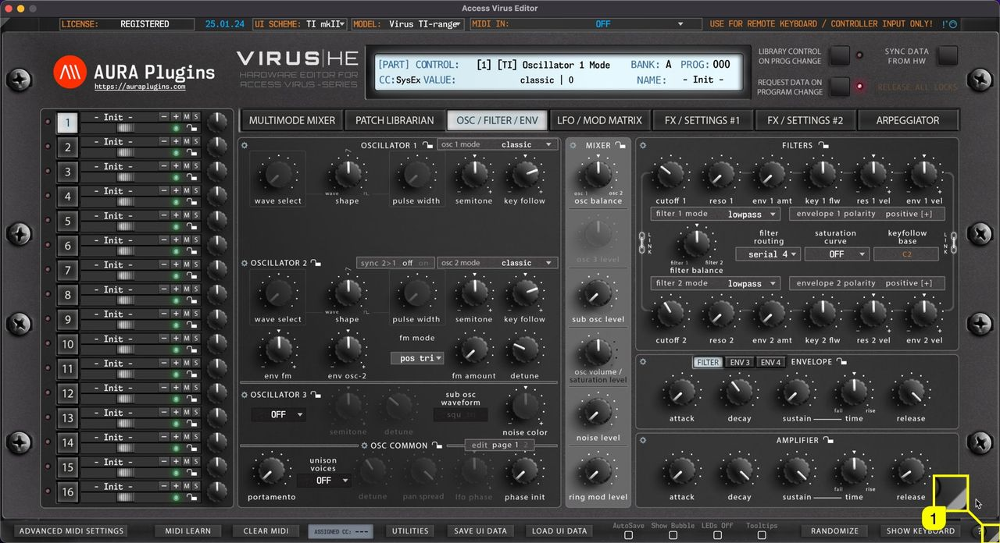

*Figure: resize ui freely*

### Minimize View

If the user interface is too big for your screen for some reason, a single click **gray triangle [1]** in the top left corner resizes the user interface to 50% of its size. Double click sets the view back to 100%.


*Figure: minimize ui*

### Setting Default Scaling Level

You can also set the “default” scaling level by opening the Utilities **[1]** menu -> **User Interface [2]** and **selecting the size [3]** that fits your setup the best.


*Figure: set ui defaults*

**NOTE:** If your display cannot handle HD graphics and / or you have not enabled use of hi-res graphics, scaling results might look unpleasant. Adjust settings to your likings. Loading hi-res graphics takes longer for the Editor view to open.

## How To Check License Status

Displays current state of the Editor license. If DEMO version is installed, then display will show \*\*DEMO VERSION\*\*.

If the Full version is installed, then you will see RELOAD LICENSE or REGISTERED if license is applied. To learn more about registering our Editor, please use search above to find what you’re looking for.


*Figure: how to check license status from the top bar*

Editor license status is also shown in the PATCH LIBRARIAN tab if you click **Bank Edit [1]** menu. **Status [2]** is shown here.


*Figure: how to check license status from bank edit menu*

## How To Register our Editor

If you made the decision to purchase the license for our Editor, you are the best! Just wanted to thank YOU.

License owners can enjoy the full advantages of the Editor, like:

- Plug-in parameters can be automated directly from your DAW.
- Librarian is fully functional and allows full editing capabilities.
- You can save your UI Data (full performance) to HDD.
- You can save your custom MIDI CC maps to HDD.
- Total Recall: Once you open your project after your last session, all the data used in your previous session will be automatically sent to your synthesizer.
- Get tech support and updates for the current major version for free!
- version information: yy(year/major).mm(month).dd(date)

If you purchased the Editor license from our store, download the license and the full installer from https://auraplugins.com/downloads/access-virus-editor/ after you login.

### Manually placing the license file

If you have a plug-in inserted to your project, now it is time to delete the track / plug-in instance from your DAW.

**Rename** license.key manually as “Access Virus Editor.license” and copy it to the Editor **data** folder (see location mentioned earlier). If all is good, you can now re-insert your plug-in to your DAW.

**NOTE:** Right click the license file on macOS and select “show info”. After that make sure the file name is shown as above. If it has a .key or .txt extension in it, remove it!


*Figure: how to register our editor - license location*

### Register product from User Interface

### Method #1

Open the Editor Standalone Application and click the top left corner of the user interface where the Editor says, “ **RELOAD LICENSE [1]** ”. A new window will open to **prompt for license [2]** . Locate the **license [3]** and hit OK to register.


*Figure: how to register our editor - license display load*

### Method #2

Open the Editor Standalone Application and enter **PATCH LIBRARIAN [1]** , click **Bank Edit [2]** and choose **Register Editor… [3]** . A file prompt dialog will pop up just like in the image above.

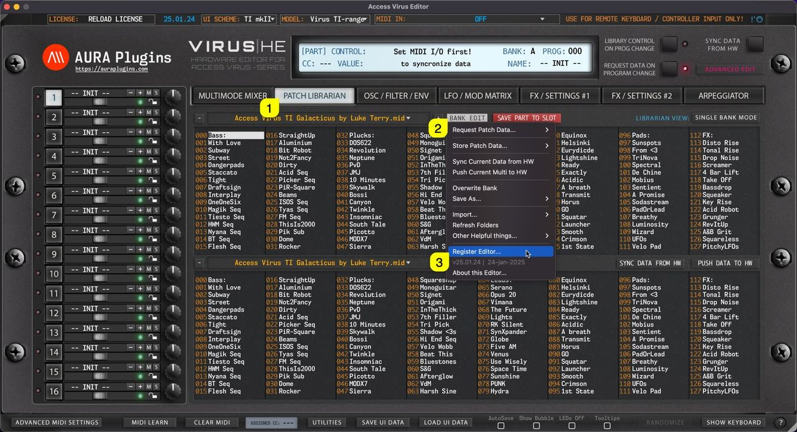

*Figure: how to register our editor - license load bank edit menu*

After you have chosen the license file, close the application and reopen it. The editor display should now indicate “ **REGISTERED** ” in the top left corner.

IF the Editor shows “ **\*\* DEMO VERSION \*\*** ” you haven’t installed the FULL version yet or you might have the plug-in installed in several locations! Check the solution from the FAQ before you submit a ticket. You can submit ticket from My Account page once logged in

## How To Set MIDI Input and MIDI Output ports

### Virus TI: MIDI DIN vs USB

**USB** can be used to establish connection with our Editor. In such case, use ports:

- **Virus TI USB Plugin I/O** on macOS
- **Virus TI Synth** on Windows

USB Audio has to be routed to your DAW with 3rd party software like Audiomovers Inject, Omnibus or something similar. On macOS you can achieve this without 3rd party applications.

**MIDI DIN** cables are good if you need rock solid connection with your Virus and your DAW (with all Virus models). Audio has to be routed with Audio Jacks.

### Set MIDI ports with Standalone Application

If you use the Standalone Application, click “ **Access Virus Editor [1]** ” from the top bar and choose **Preferences [2]** . This will open **Preferences dialog [3]** where you can set MIDI Input Device and MIDI Output Device .

On Windows machines, the same dialog can be opened from the File menu.


*Figure: application setup*

### Remote Keyboard Input

If you have an external MIDI controller you want to use with the Editor to trigger notes and tweak knobs with, you can select **MIDI IN** from the Editor top bar. This port won’t work with the synth itself and is only used for triggering MIDI events.


*Figure: Remote Keyboard Input available in Standalone App only!*

This port is only visible with Standalone Application.

**NOTE:** Audio Device Settings in the preferences dialog does not have capability to transmit audio in this stage. Choose Audio Drivers, but keep in mind that audio has to go through Audio Jacks to console or sound card inputs.

### Set MIDI ports with the Plug-in

**Select MIDI IN [1]** , where your Virus MIDI Out is connected in at.

**Select MIDI OUT [2]** port which will send data to your Virus MIDI Input.


*Figure: how to set midi input and midi output ports - plugin i/o*

### Hardware Check / Ping

After setting MIDI OUT, our Editor will start scanning for the hardware. If there is no immediate response, the Editor will attempt 3 more times. If there is no response, you might get a “ **Connection Timed Out** ” message. If so, double check your hardware settings and make sure your cables are good!

**NOTE:** MIDI ports for plug-in are set from the main window while Standalone Application MIDI ports are set from the Editor Preferences.

You can optionally enable Device ID probing function, which will check for the Device ID for you. This is good IF you have only one Virus model in your setup. Function can be enabled from **Utilities [1]** menu -> **Editor Preferences [2]** -> **Enable DeviceID Scanning [3]** .

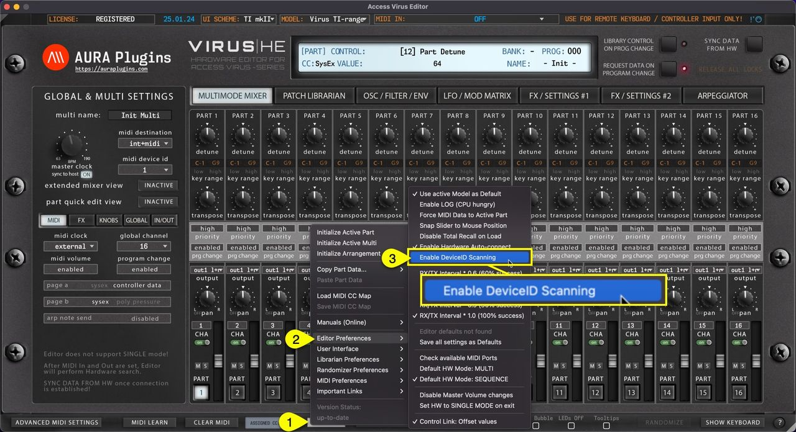

*Figure: how to set midi input and midi output ports - device id scanning*

**NOTE:** If you have Device ID set to 1 on the Virus and 1 on the Editor, our Editor will find and establish connection to your Virus if everything else is configured properly.

## How To Reset Stuck Notes (MIDI Panic)

If you get stuck notes or if you need to initiate a full MIDI reset, click the **MIDI Panic [1]** button. This function will send all notes off the MIDI message to the Virus.

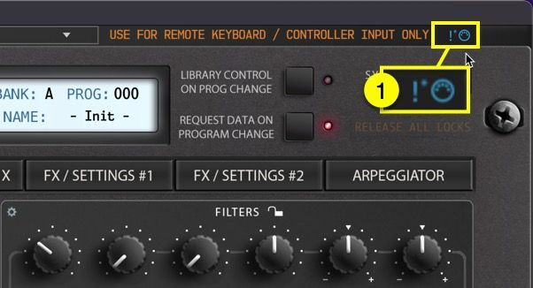

*Figure: how to reset stuck notes midi panic*

## How To Adjust Advanced MIDI Settings

You can control which messages get processed and which do not. Open the Advanced MIDI Settings window by clicking **ADVANCED MIDI SETTINGS** button in the Editor user interface.


*Figure: how to adjust advanced midi settings - open filters page*

You can block messages being processed from DAW or from the Synthesizer itself. Settings seen in the image below are default values.


*Figure: how to adjust advanced midi settings - default settings*

### Advanced Incoming MIDI Settings

Allow certain MIDI messages to pass into the Editor processor within the Incoming MIDI setting section. Green check mark means it will be processed and when there is no check mark, it will be bypassed. **Process DAW messages [1]** and **Process Hardware messages [2]** has their own set of data “filters” **[3-9]** available as follows:

- **[3]** Control Changes
- **[4]** Program Changes
- **[5]** Note Messages
- **[6]** Pitch Bend
- **[7]** Poly Aftertouch
- **[8]** Channel Aftertouch
- **[9]** System Exclusive
- **[10]** Part LEDs tracks incoming MIDI and SysEx messages\
  When the green check mark is on, incoming data from DAW and Hardware ports is monitored and an LED indicator will flash when data is coming in. When the check mark is off, outgoing data is being monitored. Check LEDs Off function to disable.

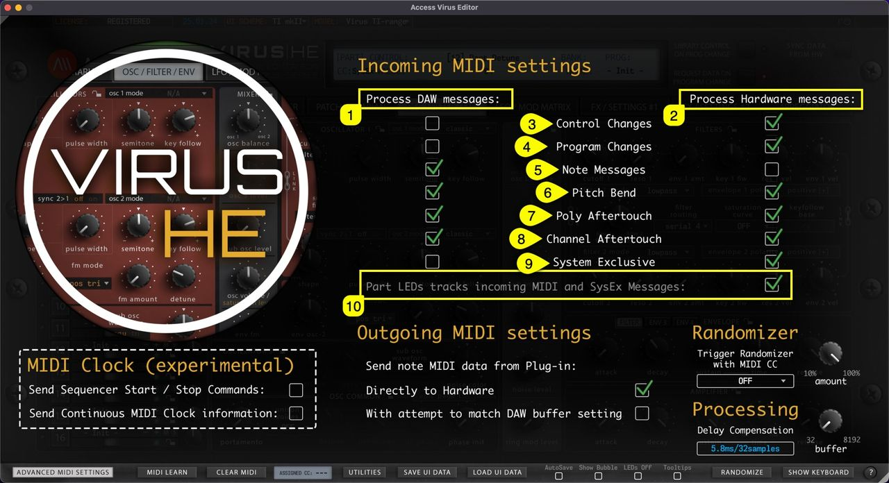

*Figure: how to adjust advanced midi settings - details*

**Note #1** : If you disable Control Changes and System Exclusive messages from the Hardware port, the Editor might stop responding to hardware knob movements completely.

**Note #2** : In Standalone Application use, Remote Keyboard MIDI Input data is handled in the Process DAW messages section.

### Advanced Outgoing MIDI Settings

In the Outgoing MIDI settings section, you can adjust a few options to fine tune the Editor behavior.

Send note MIDI data from Plug-in:

- **Directly to Hardware [1]** = Send all MIDI related commands directly to hardware from the MIDI output port.
- **With attempt to match DAW buffer setting [2]** = experimental attempt to sync with DAW time.

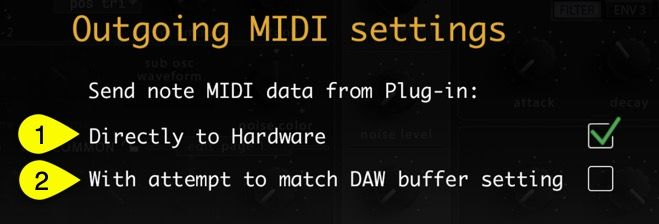

*Figure: how to adjust advanced midi settings - midi out*

**NOTE:** If the Editor MIDI note handling is out of time, we would advise NOT to adjust these settings at all. Check your DAW user guide to figure out how to delay or advance your MIDI note timing / delay compensation.

### MIDI Clock (experimental)

We are experimenting to add a general MIDI clock to the Editor by standard feature. This might crash on some systems on a specific setup, so be cautious when experimenting with it.

Check **Send Sequencer Start / Stop Commands [1]** if you want to send MTC start and stop commands.

Check **Send Continuous MIDI Clock information [2]** if you want to sync MIDI clocked Effects and Arpeggiator to the Editor tempo information.


*Figure: how to adjust advanced midi settings - experimental clock*

**NOTE:** The clock with the Editor might be inaccurate, so if you have another solution to sync clock information from your DAW to the hardware, use that instead.

## How To Use MIDI Learn

### MIDI LEARN (Map External Controller)

**MIDI LEARN [1]** allows you to map incoming MIDI CC control messages to certain controls of the Editor.

To activate MIDI LEARN, toggle on the button and follow instructions given in the Editor display.

- Move a knob or button on the Editor user interface.
- Move your remote controller slider, knob or button to assign CC.
- Toggle off **MIDI LEARN [1]** once completed.

Use the **Clear MIDI [3]** button to remove assignments. More details below.

The editor has an **Assigned CC [3]** display in the bottom bar to help you see what controller has been assigned to a selected parameter.


*Figure: how to use midi learn - toggles*

### CLEAR MIDI (mappings)

**CLEAR MIDI [1]** opens a popup menu, where you can choose to **Clear All Assignments** at once, or **Clear Active Parameter** to remove assignment for set parameter. Active parameter is the knob / button / menu you have last clicked from the Editor user interface.


*Figure: how to use midi learn - clear mappings*

Both options are greyed out in the sample, because there are no assignments for set parameter.

## How To Save and Load UI Data

**Save UI Data** saves all the Editor settings in a single file, including global, multi and individual part settings.

This is the best option to back up your favorite settings per project and it gives you portability to share your settings with someone else, or use the saved data in other projects.


*Figure: how to save and load ui data 1*

**Load UI Data** loads all the Editor settings from a single file, including global, multi and individual part settings.

Once loading is completed, data will be automatically transmitted over to the Virus temp buffer. You can load any UI Data saved with previous sessions.


*Figure: how to save and load ui data 2*

## How To AutoSave Librarian Edits

When **AutoSave** is toggled on, any changes made in the librarian left bank view will be automatically saved. This is a dangerous function, but as per request, we included this feature.

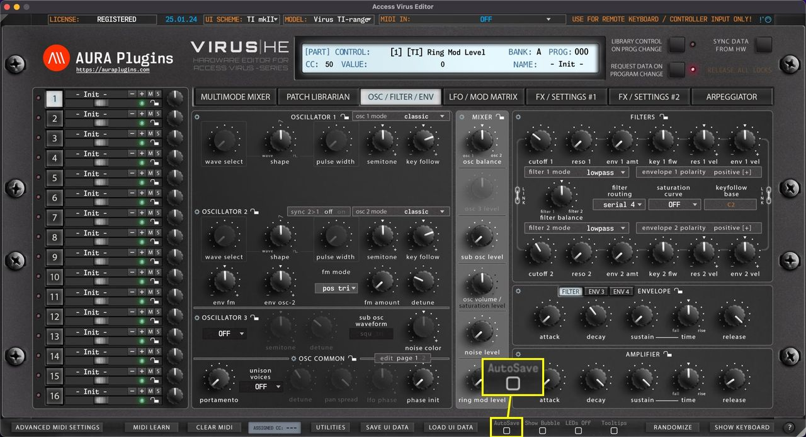

*Figure: how to autosave librarian edits*

**NOTE:** Be aware that there is **NO** UNDO function, so you cannot revert to the previous state if you make a mistake. We would advise to make a copy of the original bank (if needed) before making changes to the bank with autosave on. Defaults to off state.

## How To Use Show Bubble Function

**Show Bubble [1]** does what it says, when the parameter is adjusted with the mouse, a **bubble [2]** will pop up above the parameter displaying the parameter value as you change it. You can also see the parameter name and value in the **Editor control display [3]** .


*Figure: how to use show bubble function*

## How To Disable Editor LEDs

If you don’t like or need to see the **LEDs [2]** blinking, you can toggle **LEDs Off [1]** with once click.

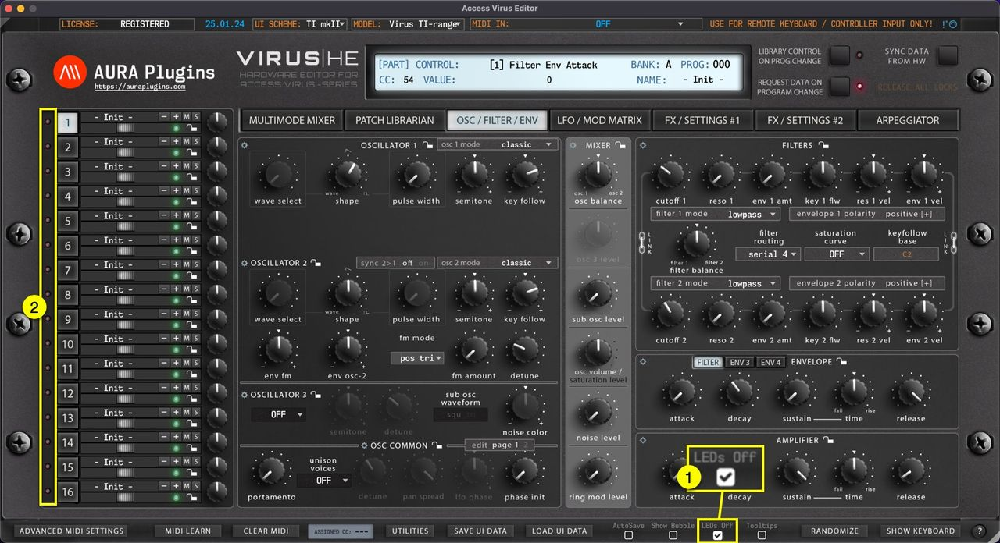

*Figure: how to disable editor leds toggle*

**TIP** : Open ADVANCED MIDI SETTINGS page you can define if LEDs will blink when MIDI is being received or when it is being transmitted. Default value is set to follow incoming MIDI data.

## How To Display Parameter Tooltips

**When Tooltips [1]** is toggled on, **tooltip text [2]** will appear if you hold your mouse cursor steadily over the parameter. You also get parameter info displayed in the **Editor control display [3]** while hovering over parameters, like CC number assigned by default, parameter name and the current value.

*Tooltips are courtesy of Access Music GmbH and more details can be found from the Virus User Manual.*


*Figure: how to display parameter tooltips*

## How To Use Randomizer

With the **RANDOMIZE [1]** button, you can trigger randomization on the currently active part. **Different Sections [2]** can be locked individually to prevent changes during randomize / patch change process. More about Section Locks further below.

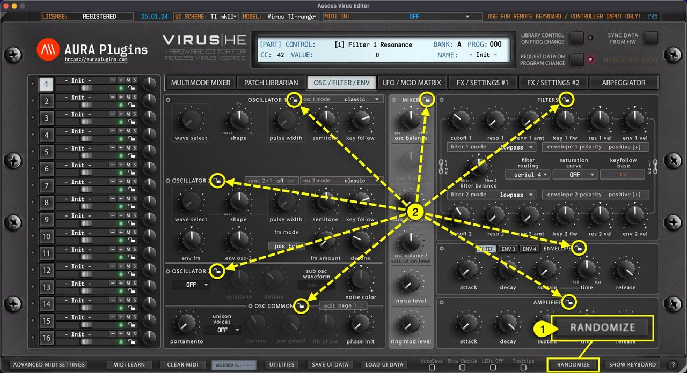

*Figure: how to use randomizer - action toggle and section locks*

By default, Randomize will take effect on the active edit tab. If you want to randomize the whole patch at once, open **Utilities [1]** menu -> **Randomizer Preferences [2]** and uncheck **Focus on Active TAB content**. You can further fine-tune your randomization process by unchecking excluded options below that or then check them if they are off.

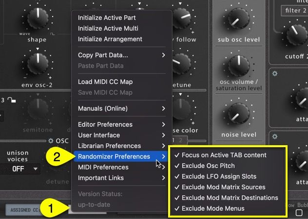

*Figure: how to use randomizer - settings menu*

Open **Advanced MIDI Settings [1]** view to further adjust Randomizer settings. You can set **MIDI CC [2]** from the menu which will trigger the randomization, and the **randomizer amount [3]** in percentages to get more subtle randomization or turn it all the way for maximum effect.

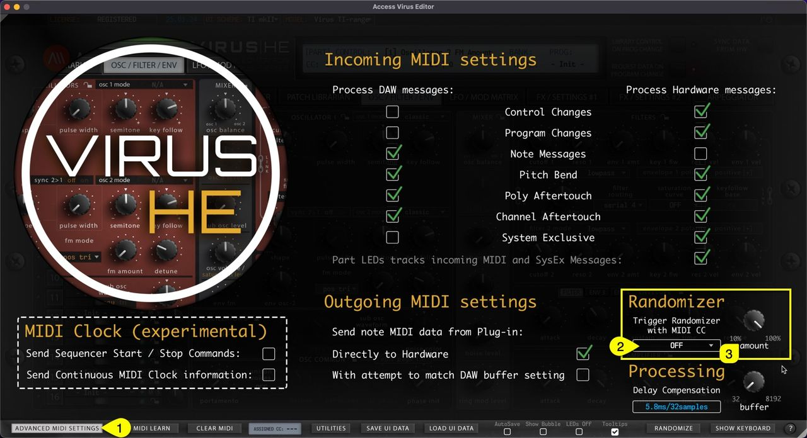

*Figure: how to use randomizer - randomizer adjustments*

## How To Show Keyboard (Part Focus)

Toggle on **SHOW KEYBOARD [1]** to display “on-screen” keyboard, **Pitch Wheel [2]** and **Modulation wheel [3]** . You can play individual keys with mouse click or you can use your computer “QWERTY”-keyboard, in other words: normal typing keyboard to play in notes.

Keyboard also features velocity sensitivity when played with a mouse.

- If you click closer to the “root” **[4]** of the key, the lower velocity input is given.
- If you click closer to the “end” **[5]** of the key, the higher velocity input is given.


*Figure: Screenshot*

Use keys **A, W, S, E, F, T, G, Y, H, U, J, K, O, L** to play the keyboard.

Use keys **Z** and **X** to adjust the octave range.

### SHOW KEYBOARD & PART FOCUS

When **SHOW KEYBOARD [1]** is toggled on, the Editor will focus all incoming MIDI data to the currently selected Part. Now when Part 4 is selected you see a **DIN indicator [2]** in set part warning that all MIDI is routed to part 4. You can also see a **text entry [3]** indicating that part focus is on!


*Figure: how to show keyboard (part focus)*

**NOTE:** When DAW playback is on, MIDI data is transmitted normally per part.

## How To Show Quick Help

Get quick tips of the bottom bar functions when you click the **? [1]** mark in the bottom bar.


*Figure: how to show quick help - action toggle*

Use the same button to close the quick tips view.


*Figure: how to show quick help - quick tips*

## How To Sync Data From Hardware

### Multi data and individual parts

### Method #1

If **MULTIMODE MIXER [1]** view is toggled on, **Sync Data from HW [2]** button will request **MULTI** data and individual parts to the user interface like discussed earlier. This will take some time depending on the selected Virus model. Virus TI and Virus TI Snow requests take a bit longer due to differences in the data package. Virus TI USB sync is much slower than DIN sync.


*Figure: how to sync data from hardware - multi and parts*

### Method #2

If **PATCH LIBRARIAN [1]** view is toggled on, **Sync Data from HW [2]** button will request MULTI data and individual parts to the user interface just like the previous method. Data mode change doesn’t have a play here. **Sync Data From HW [3]** button will request single data to the selected part.


*Figure: how to sync data from hardware - data request via librarian*

### Individual Parts

You can also make a quick request for individual parts when the **TAB [1]** button is toggled between PATCH LIBRARIAN -> ARPEGGIATOR**. Sync Data from HW [2]** will request data from the currently selected part.


*Figure: how to sync data from hardware - sync single parts*

**TIP** : Be patient and do not disturb the data flow with any knob movements or so. This will ensure the data packages are being sent and received as expected and you are not going to receive any SysEx error messages!

If you feel like your MIDI device can do faster requests than what we have set, you can try to play around with the Request Interval multiplier. **Open Utilities [1]** menu, select **Editor Preferences [2]** and select first value from the **options [3]** available. The editor will automatically increase the value if it experiences drop-outs during the request process.


*Figure: how to sync data from hardware - sync settings*

## How To Push Data To Hardware

Another great feature we added is the ability to force data being sent to your synthesizer if needed. This could happen for couple of reasons:

1. MIDI interface ports are no longer available, and you have assigned new MIDI ports manually.
2. You open your session in a studio, where the studio Virus is connected to a different port.
3. Failure of Total Recall function.

Open **PATCH BROWSER [1]** tab and click **PUSH DATA TO HW [2]**. This will send current MULTI data and each individual parts data to the Virus.


*Figure: how to push data to hardware*

**NOTE:** Data sending takes time depending which model you have in question. Let the Editor do its thing and don’t tweak any parameters during this time. It could potentially disturb the SysEx data sending process and you need to start again.

## How To Abort Processes

Cancel current request / writing task by clicking **ABORT PROCESS** button, if the process is taking too long, or if you get constant Device ID checks while any data request is active.


*Figure: how to abort processes*

The Abort Process button will disappear after the Editor has scanned Device IDs and/or if the request process has timed out.

## How To Use Section Locks

We added a Section Lock function to lock certain sections of the Editor to prevent changes up on part program changes or when a randomizer is triggered. This is great when you find a perfectly adjusted filter or oscillator: lock the section to keep those settings locked in.

You can lock any of the sections which have the **LOCK [1]** symbol in it – There are more locks available in the other tabs too!

When **LOCK [1]** is toggled on at any section, **RELEASE ALL LOCKS [2]** button will allow you to release all locks with one click. This is ideal if you have overlooked your layers and data is being transmitted back and forth even if you don’t want that.

**LOCKS [3]** on the “ **QUICK MIXER** ” view locks or unlocks the entire part at once. There are individual locks for each part.

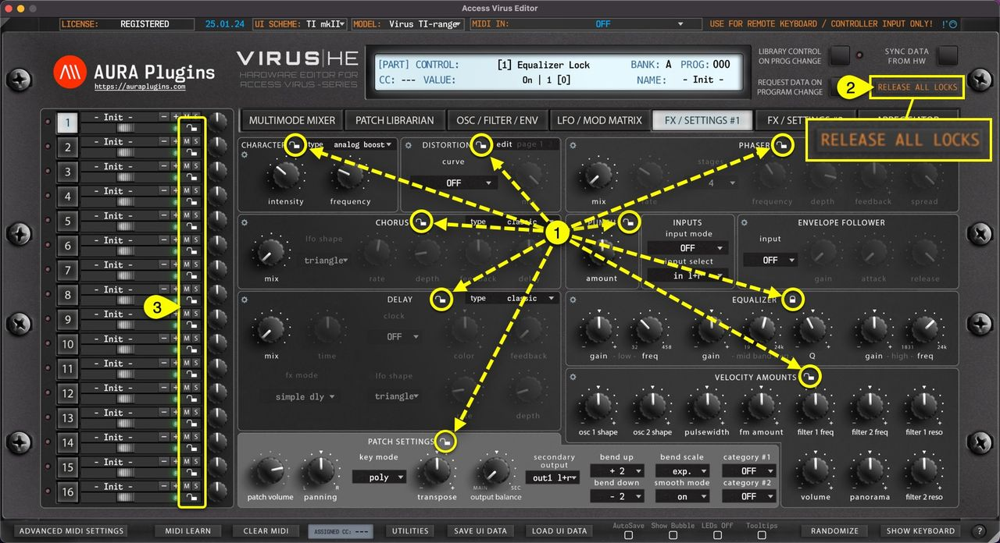

*Figure: how to use section locks*

**NOTE:** When you have sections locked, there will double the amount of SysEx traffic in the MIDI stream due to the fact that the Editor has to send the ”locked” info back to the hardware after the patch is changed. If you scroll patches from the librarian, then the data stream is normal.

## How To Use Section Menus

We added a Section Menu function to aid with creating sounds, recalling favorite section settings or saving your own as you go. You can even Randomize a single section to create exciting new textures! Section Menu opens when you click any of the “ **gears** ” **[1]** icon in the user interface.

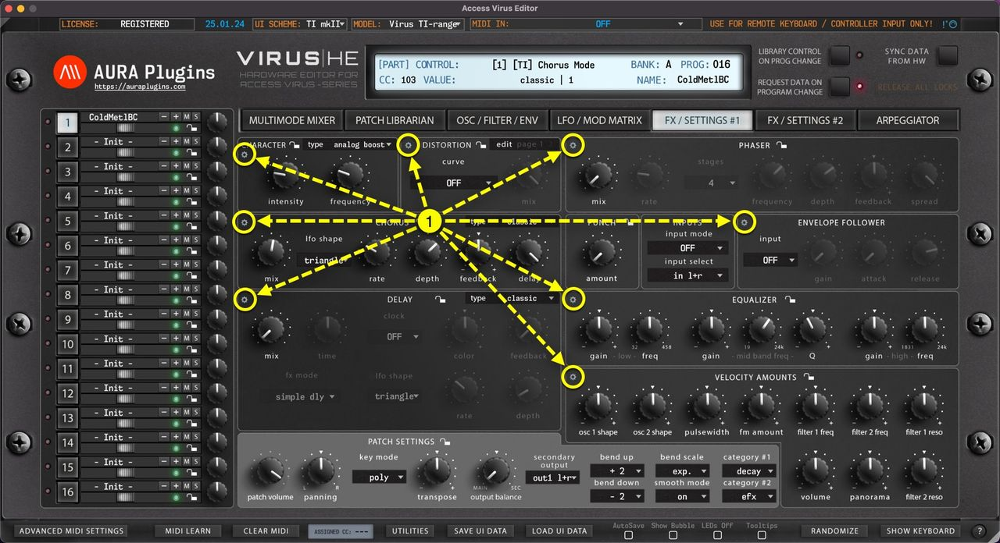

*Figure: how to use section menus - triggers*

### Section Menu Items

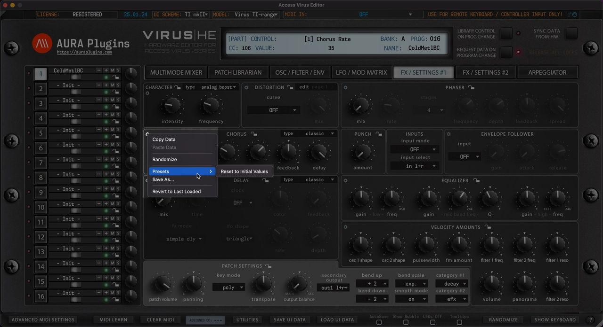

*Figure: how to use section menu - menu content*

- **Copy Data**\
  Copy Section Data to clipboard.
- **Paste Data**\
  Paste Section Data from clipboard.
- **Randomize**\
  Randomize Section Data with Randomizer settings applied from Utilities Menu & Advance MIDI Settings page.
- **Presets**\
  Load a preset saved for the set Section. The first item on the list is always “ **Set to Initial Values** ” which loads Section default settings.
- **Save As…**\
  You have a great Filter setup you want to use in later sound design? No problem, just save your Filter or any other section data to HDD for later use.

Data is stored in

*~/Music/AURA Plugins/Access Virus Editor/UI DATA/Section Presets/(section name)*

## How To Change Programs

### PROGRAM CHANGE BUTTONS

**– [1]** button will change to previous program.

**+ [2]** button will change to the next program.

This will trigger a MIDI Out message with appropriate program number based on the PROG Display value. Each part has its own set of Program Change buttons.

See below how it will behave when **Request Data on Program Change** is toggled on / off.


*Figure: how to change programs with - / + buttons*

### REQUEST DATA ON PROGRAM CHANGE

**REQUEST DATA ON PROGRAM CHANGE** means that if the Editor receives a program and/or bank change message from MIDI input, our Editor will initiate a Data request from the Virus to the Editor user interface.

Inputs valid for this function:

- MIDI In port (Plug-in).
- DAW gateway (Plug-in).
- Remote Keyboard MIDI In port (Standalone Application).
- Editor Program Change buttons (per part) (\*1).
- Editor Program Number display (per part) (\*2).
- Editor Bank Number display (per part) (\*3).

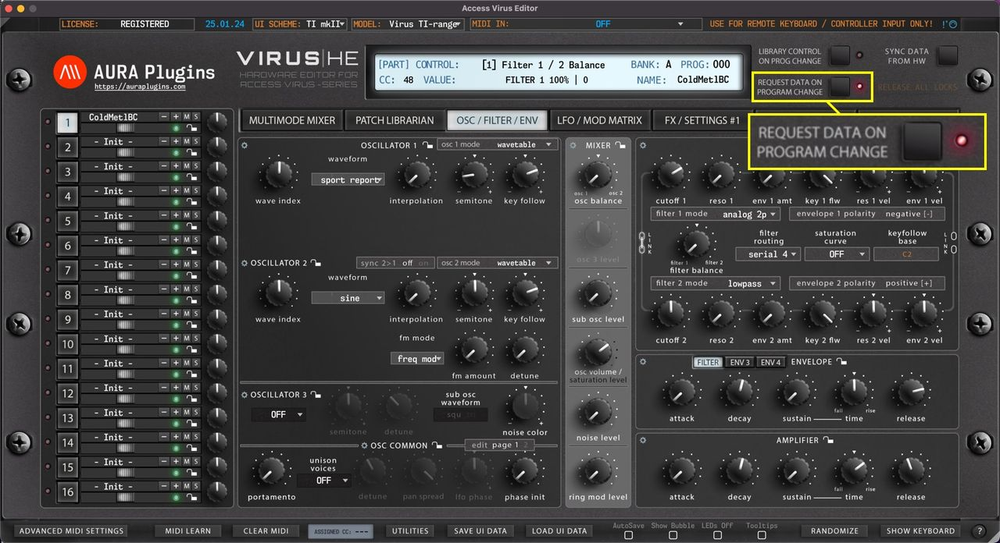

*Figure: how to change programs while request data on program change is on*

If this switch is toggled off, our Editor will only send the program change messages to the hardware but won’t be requesting any data back. This is good in some cases where you might want to quickly browse hardware patches.

(\*1 See above for Program Change Buttons).

(\*2 See below for Program Number Display).

(\*3 See next page for Bank Number Display).

**TIP**: Turn off Request Data On Program Change and Library Control On Prog Change to quickly browse through the hardware presets. Once you hit a sound you want to work on, click Sync Data from HW button to request the data to the Editor user interface and work it from there!

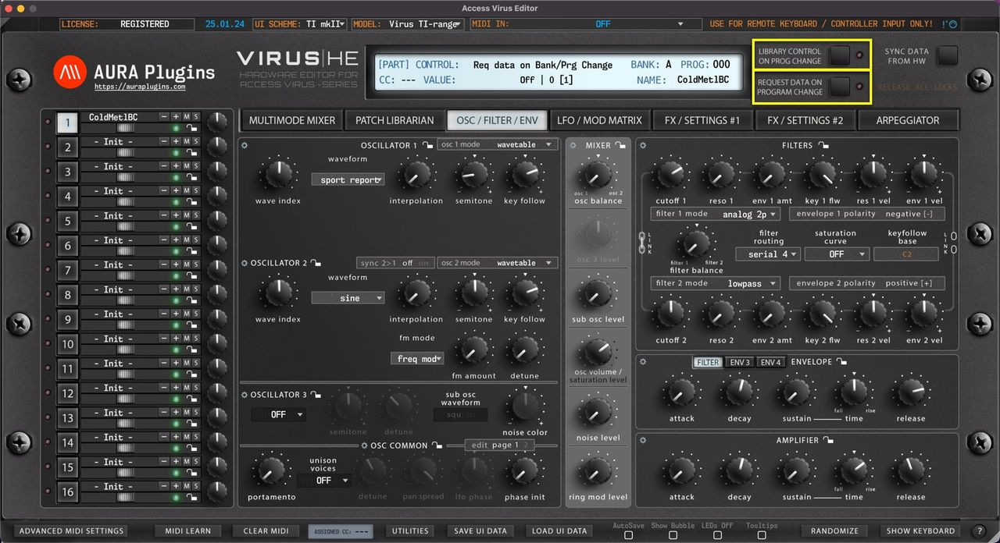

*Figure: how to change programs while request / transmit toggles are off*

### LIBRARY CONTROL ON PROGRAM CHANGE

**Library Control On Prog Change** switch allows you to take control of your library patches with incoming program changes via MIDI or with the Editor user interface – / + buttons and Bank Number Display / Program Number Display menus.

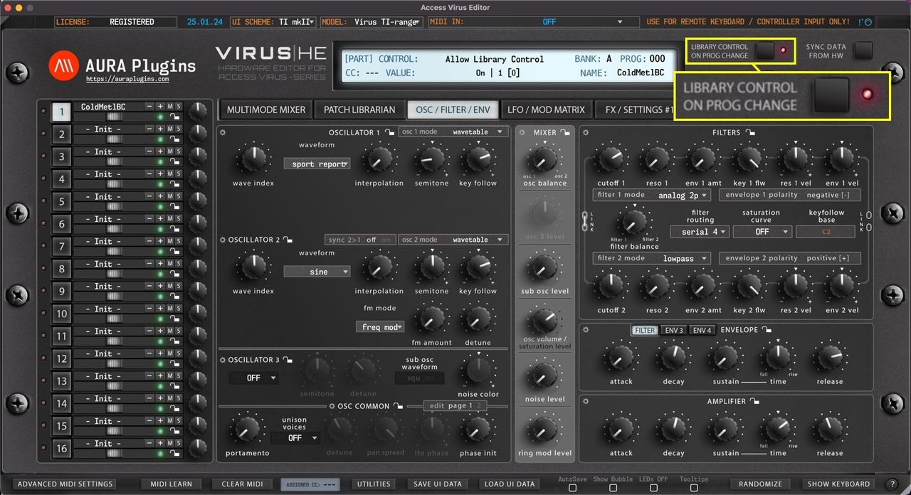

*Figure: how to change programs while library control on program change is on*

**Note #1** : Patches are sent to the hardware on the currently selected part when the menu is used to change programs.

**Note #2** : If the program change message is received from MIDI channel 4 and none of your layers are set to channel 4, no action will be taken.

**Note #3** : If the program change message is received from MIDI channel 1 and both layers are set to channel 1, no action will be taken. Change the MIDI channel temporarily to a different channel.

### PROGRAM NUMBER DISPLAY / SELECTION MENU (\*3)

**PROG Display [1]** acts as a menu as well as a display to show the current Part Patch program number. You can quickly navigate to different banks of programs without having to click Program Change buttons like crazy.


*Figure: how to change programs - menu trigger*

In default status ( **REQUEST DATA ON PROGRAM CHANGE** ), this popup menu will display program numbers in different banks of programs. See image below.


*Figure: how to change programs from menu while pc is on*

But things get exciting when you toggle on **LIBRARY CONTROL ON PROG CHANGE [1]** switch: You can now view currently active Librarian Bank patches on the menu and browse them directly from the main user interface!


*Figure: how to change programs while lc is on*

Check above for further details about the Library Control function.

## How To Change Banks

**BANK Display [1]** acts as a menu as well as a display to show the active Part Patch bank number. You can navigate to different banks based on your selected Virus model.

If your model is set to Virus TI, the bank menu does not have as many options as when Virus C is set as a current model. This is because Virus TI has a bigger memory capacity. When **REQUEST DATA ON PROGRAM CHANGE [2]** is toggled on, this popup menu will display bank numbers available to browse.

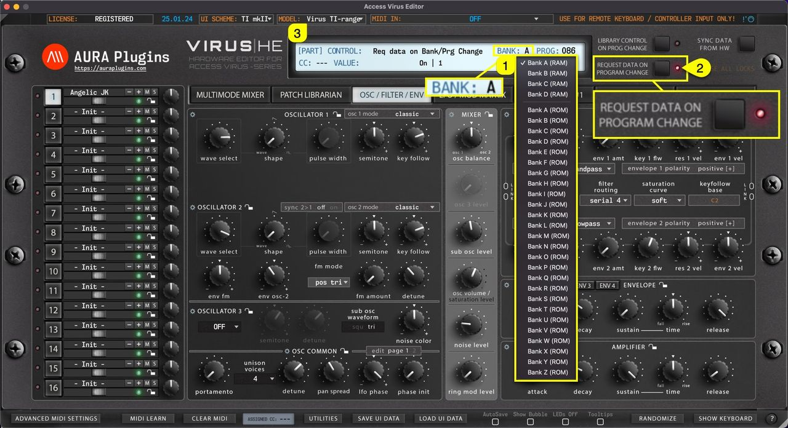

*Figure: how to change banks - request data trigger on*

Like with PROG Display, **BANK Display [1]** will behave completely differently when **LIBRARY CONTROL ON PROG CHANGE [2]** is toggled on. You can now view all available Patch Banks located in the Patches folder.

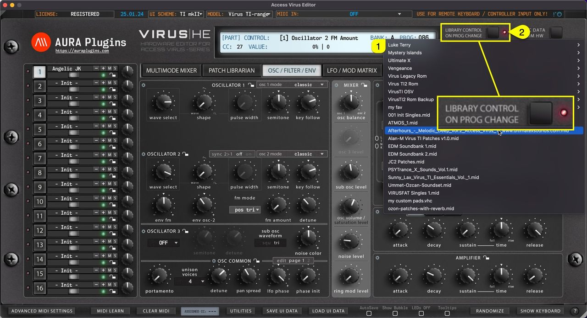

*Figure: how to change banks - send data trigger on*

## How To Change Parts

### PART SELECT

Virus has 16 multitimbral parts (except Virus TI Snow, which has 4). When **MAIN EDIT TAB [1]** is set to PATCH BROWSER -> ARPEGGIATOR, you can select different **PART [2]** by clicking the number toggles.


*Figure: how to change parts from the user interface*

### Main Edit Tab Content

Each edit TAB has a specific set of controls available for sound editing. You can access additional parameters via the highlighted toggles / menus found from each of the tabs. Appearance of these toggles / menus are model specific.

### OSC / FILTER / ENV tab

Contains mostly all of the Oscillator, Mixer, Filter and Envelope related parameters and some common voice parameters.


*Figure: how to change parts osc / filter / env tab content*

### LFO / MOD MATRIX tab

Contains LFO parameters and Modulation Matrix source / destination view.


*Figure: how to change parts lfo and mod matrix views*

### FX / SETTINGS #1 tab

Contains Character, Distortion, Phaser, Chorus, Punch, EQ, Envelope Follower and Velocity Assignment parameters as well as Patch Settings like key mode, patch volume, panning etc.


*Figure: how to change parts fx and settings #1 views*

### FX / SETTINGS #2 tab

Contains some Global parameters, Vocoder and Virus TI specific effects like Reverb, Filter Bank and Atomizer mode toggle.


*Figure: how to change parts fx and settings #2 views*

### ARPEGGIATOR tab

Contains only Arpeggiator related parameters and when you have Virus TI in your setup, you can use the USER ARP to modify the Arp Pattern content.


*Figure: how to change parts arpeggiator views*

### Active Part quick actions menu

With a right mouse click, you can open the Part Quick actions menu for active **part [1]** . Most of these are utilities menu items but they are faster to reach right after selecting a part.


*Figure: how to change parts quick menu*

### MULTI SETTINGS

When **MAIN EDIT TAB [1]** is set to MULTIMODE MIXER, you can view the Multi Mixer. There are additional Multi specific settings when **extended mixer view [2]** is enabled.

**MIDI** – **FX** – **KNOBS** – **GLOBAL** – **IN/OUT [3]** toggles contain mostly Global parameters which change how the hardware behaves.


*Figure: how to change parts multi settings*

## How To View Patch Name

**Single Patch Name [1]** can be viewed and/or set when the Editor **MAIN TAB [2]** is PATCH LIBRARIAN -> ARPEGGIATOR. You can also see the patch name in the Editor Control Display. Patch name is individual per part **[3]** . Rename part by clicking the patch name in the “Quick Mixer” area.


*Figure: how to view patch name*

**NOTE:** Renaming a single patch from the “Quick Mixer” view does not change the name in the librarian. If you want to rename librarian items, check Related Docs below or use search function.

## How To View Multi Name

You can view and Edit **MULTI NAME [1]** when Editor MAIN TAB is set to **MULTIMODE MIXER [2]** .


*Figure: how to view multi name*

**NOTE:** Renaming Multi from the “MULTI SETTINGS” view does not change the name in the librarian. If you want to rename librarian items, check Related Docs below or use search function.

## How Total Recall Works

This is one of the best features we can think about our plug-in, total recall. It does what it says: recalls your saved session data from the plug-in user interface to your synthesizer, without the need of doing it manually! It is all automated, if you have the same MIDI device hooked into your setup as it was when saving the project.

If there are any trouble with the total recall, please check below for further instructions on how to Push Data to HW manually.

Possible reasons for failure of total recall are:

1. Your MIDI interface is no longer in the system, or it is hooked into a different USB port.
2. Plug-in update does not fully support the previous version data package.

There is a work-around for that as well, so be sure to check out our knowledge base for more details about that.

If you don’t need the Total Recall function, click **Utilities [1]** menu -> **Editor Preferences [2]** and check **Disable Total Recall on Load [3]** .

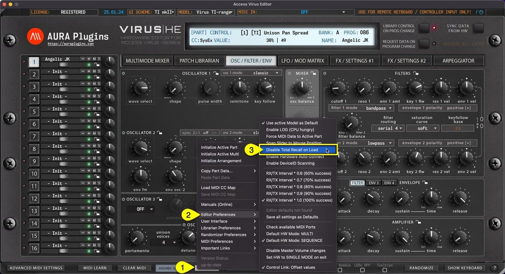

*Figure: how total recall works and how to disable it*
