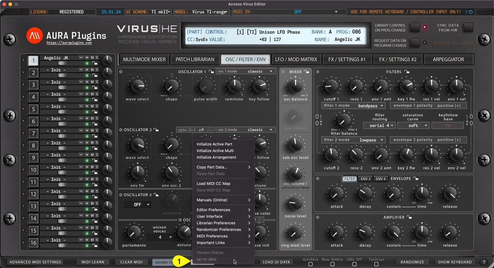
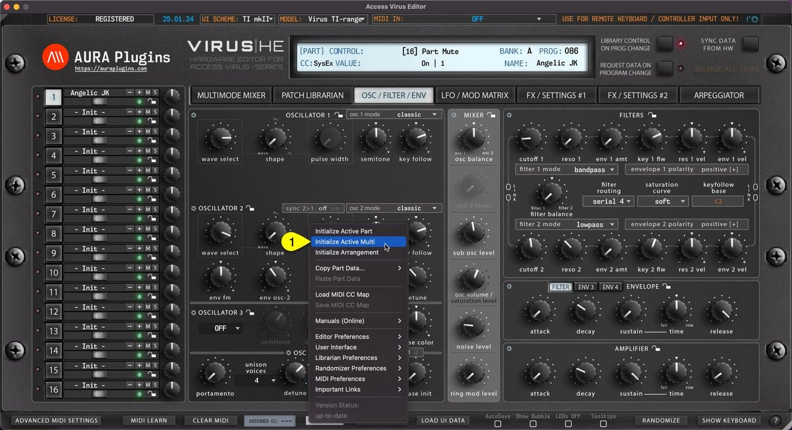
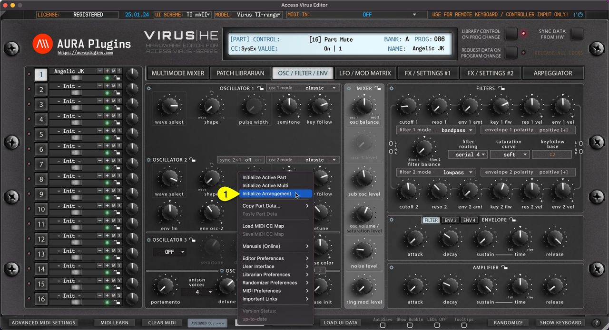
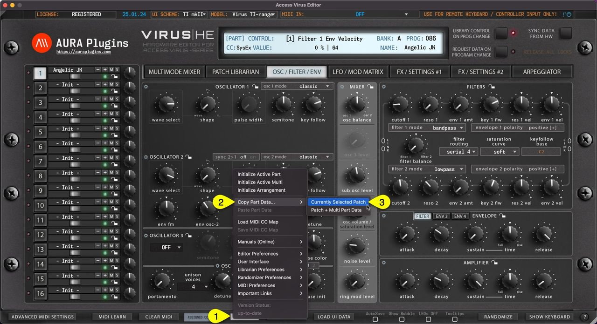
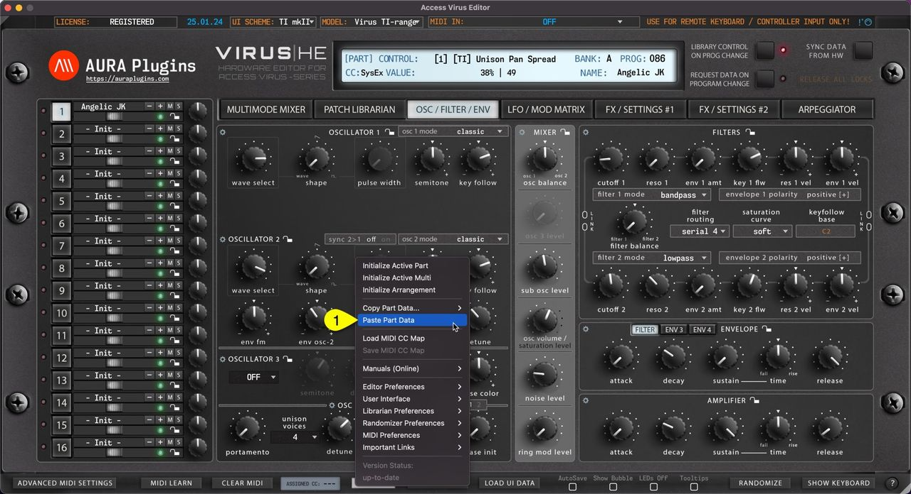
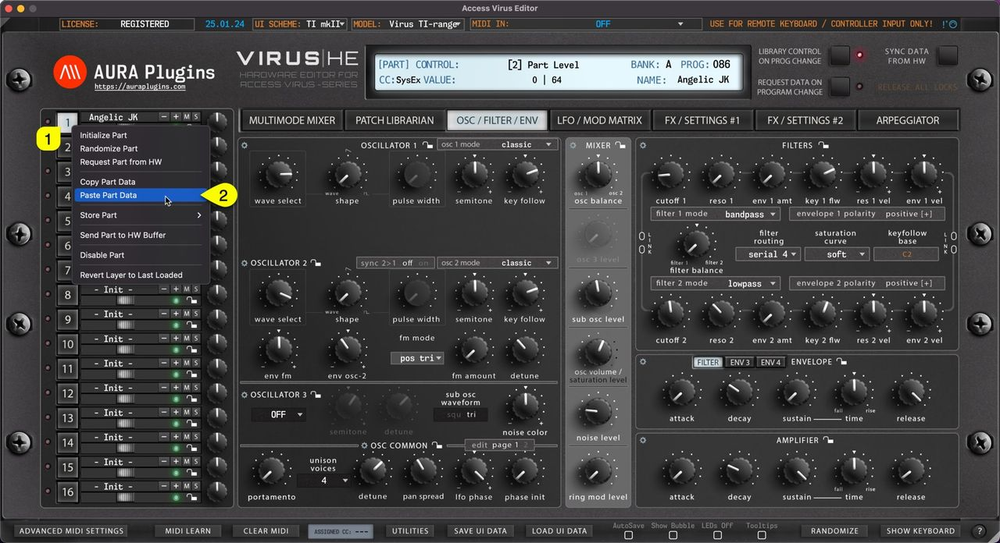
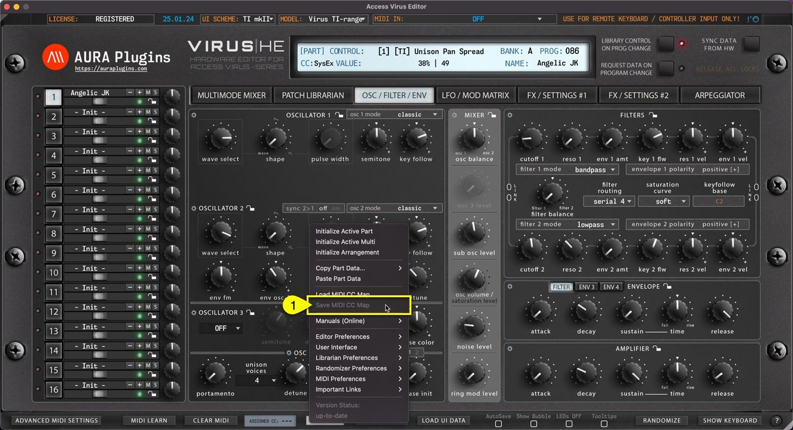
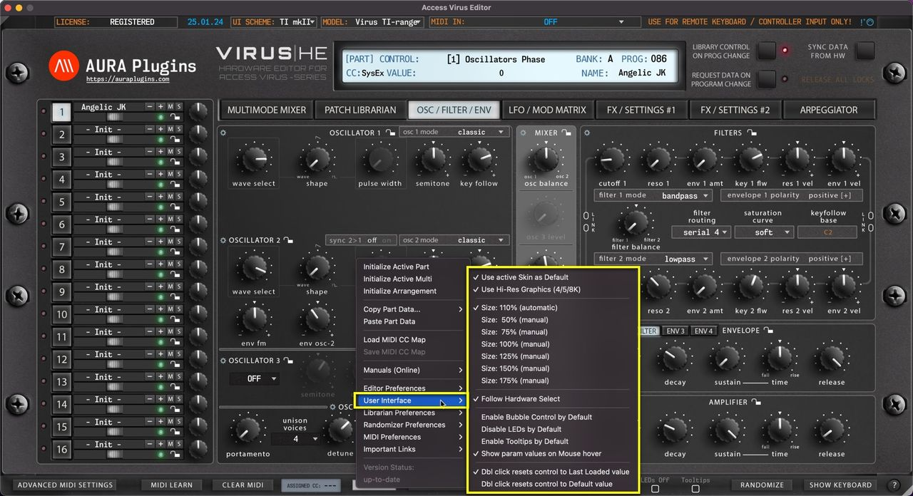
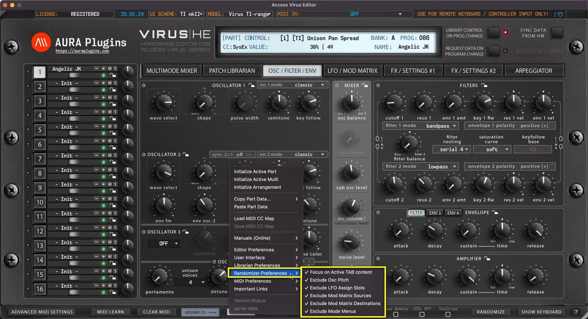
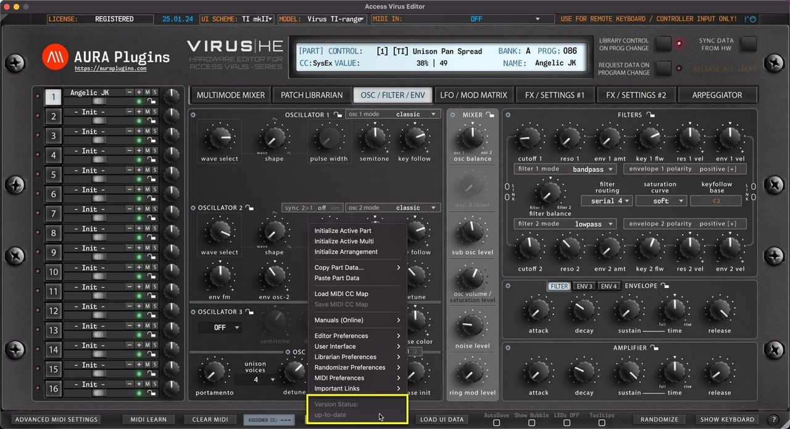

# Utilities Menu

## Utilities Menu

**UTILITIES [1]** menu can be found from the bottom bar of the Editor. Once you click the UTILITIES button, a popup menu will appear giving you a lot of different utilities. We will go through these one by one.

*Figure: utilities menu*

### Utilities menu items

- **Initialize Active Part**
- **Initialize Active Multi**
- **Initialize Arrangement**
- **Copy Part Data…**
    - Currently Selected Patch
    - Patch + Multi Part Data
- **Paste Part Data**
- **Load MIDI CC Map**
- **Save MIDI CC Map**
- **Manuals (Online) These are obvious, so not covering these..**
- **Editor Preferences**
    - Use active Model as Default
    - Enable LOG (CPU hungry)
    - Force MIDI Data to Active Part
    - Snap Slider to Mouse Position
    - Disable Total Recall on Load
    - Enable Hardware Auto-connect
    - Enable DeviceID Scanning
    - RX/TX Interval \* 0.6 -> \* 1.0
    - Save all settings as Defaults
    - Check available MIDI Ports
    - Default HW Mode: …
    - Disable Master Volume changes
    - Set HW to SINGLE MODE on exit
    - Control Link: Offset values
- **User Interface**
    - Use active Skin as Default
    - Use Hi-Res Graphics (4/5/8K)
    - Size: Auto (default)
    - Size: 50% – 175%
    - Follow Hardware Select
    - Enable Bubble Control by Default
    - Disable LEDs by Default
    - Enable Tooltips by Default
    - Show param values on Mouse over
    - Double Click resets control to…
- **Librarian Preferences**
    - Limit Search to Active Bank
    - Search results Containing…
    - Limit Categories to Active Bank
    - Enable AutoSave by Default
    - Show Quick Edit by Default
- **Randomizer Preferences**
    - Focus on Active TAB content
    - Exclude Osc Pitch
    - Exclude LFO Assign Slots
    - Exclude Mod Matrix Sources
    - Exclude Mod Matrix Destinations
    - Exclude Mode Menus
- **MIDI Preferences**
    - Enable KBD Local by Default
    - Advanced MIDI Settings default overwrites
    - DAW: Bypass Editor MIDI Processor
    - Disable Adv MIDI Settings Warnings
- **Important Links** \
  These are obvious, so not covering these..
- **Version Status**
    - Up-to-date
    - Update available

## Initialize Active Part

You can Initialize Active Part by clicking **Utilities Menu [1]** and then **Initialize Active Part [2]** . This function will initialize whichever Part you have active at the moment.

All current part parameters will be initialized to default “init” patch values.

This is helpful if you load a multi which has a great patch on one layer, but the other one needs crafting from scratch.

*Figure: initialize active part via utilities menu*

You can achieve the same result if you right click on the currently selected **part toggle [1]** and select **Initialize Part [2]** from the menu.

*Figure: initialize active part via right click menu*

## Initialize Active Multi

You can Initialize Active Multi by clicking **Utilities Menu [1]** and then **Initialize Active Multi [2]** . This function will initialize only the multi / sequencer parameters.

All part key ranges, detune settings, output routings etc will be initialized as well as Multi / Sequencer Settings.

*Figure: utilities menu initialize active multi*

## Initialize Arrangement

You can Initialize Arrangement by clicking **Utilities Menu [1]** and then **Initialize Arrangement [2]** . This function will initialize the whole Editor to initial state.

Multi / Seq and each part are set to default values. Start from a clean slate!

*Figure: utilities menu initialize arrangement*

## Copy Part Data

### Currently Selected Patch

You can copy currently selected Part data to clipboard and paste the data to another Part for further processing. Here is how you can do it: Open **Utilities Menu [1]** , select **Copy Part Data… [2]** and then select **Currently Selected Patch [3]** .

This function will only copy the part patch data to clipboard.

*Figure: copy part data via utilities menu*

You can achieve the same result if you right click on the currently selected part **toggle [1]** and select **Copy Part [2]** from the menu.

*Figure: copy part data via right click menu*

### Patch + Multi Part Data

This function works just like the function above but additionally it will copy the Multi Part data in clipboard as well. This data contains MIDI channel, Output routing, Key ranges settings etc. Open **Utilities Menu [1]** , select **Copy Part Data…[2]** and then select **Patch + Multi Part Data [3]** .

*Figure: utilities menu copy part and multi*

## Paste Layer Data

### Paste Part Data

You can paste currently copied Part data from the clipboard. Open Utilities Menu and select **Paste Part Data… [1]** .

*Figure: paste part data via utilities menu*

See previous page for explanation for each copy function and what they include.

You can achieve the same result if you **right click** on the currently selected **part toggle [1]** and select **Paste Part Data [2]** from the menu.

*Figure: paste part data via right click menu*

## Save and Load MIDI CC Maps

### Load MIDI CC Map

This function loads your custom CC mapping to the Editor and over-rides the default CC assignments.

**Utilities** Menu -> **Load MIDI CC Map [1]** to open the file load dialog.

*Figure: save and load cc maps via utils menu*

### Save MIDI CC Map

If you have learned MIDI CC controls from your master controller you can save the mapping to HDD. Say you have General MIDI controls cc #12 assigned to filter cutoff 1 (40) and #13 assigned to filter resonance (41), you can save the current mapping to a file and open it every time you insert a new instance of the Editor.

**Utilities** Menu -> **Save MIDI CC Map [1]** to save the custom mappings. This option is grayed out if no assignments are present.

*Figure: save and load cc maps via utils menu*

**NOTE:** Loading custom CC mappings does not over-ride hardware CC messages. ie. Cutoff 1 from hardware is still assigned to #40, while DAW (midi controller) CC is mapped to #12

## Utilities: Editor Preferences

*Figure: utilities editor preferences*

### Utilities Menu – Editor Preferences Breakdown

### Use active Model as Default

If you have only synth in your setup, you can toggle on “**Use active Model as Default**” AFTER you have chosen your model from the top row dropdown list.

This way each new instance is automatically set to a specific model, ie Virus TI-range.

### Enable LOG

If you have trouble loading the Editor, you enable the LOG function via the Access Virus Editor PREFS.txt file found in:

Change the line “log: no ” to “log: yes ” and the line with “ 0 ” (zero) to “ 9000 “. Save the file, close it and then re-open the Editor.

If any errors occur, open the Access Virus Editor LOG.txt found in the same place as above, see what the last line says. If the last line is saying

“ Loading bank x.mid ” and log ends there, the issue is with that specific bank. Send it over to us for inspection via the ticket form and we will fix it.

### Force MIDI Data to Active Part

This function routes all incoming MIDI CC data to the currently active PART.

This only applies while the DAW playback is OFF. If playback is toggled ON, then MIDI is routed normally from channels received.

Playback OFF: MIDI received from channel 4 is sent to currently active PART channel ie 2. Playback ON: MIDI received from channel 4 is sent to hardware channel 4 (which might be unaddressed).

### Snap Slider to Mouse Position

When toggled on, slider controls will snap to clicked mouse position. Otherwise you can start adjusting the slider control from the current click position (if within control range).

### Disable Total Recall on Load

This is a handy function if you DON’T want to send Editor data to hardware upon project load. You can always manually dump the Editor data to hardware via Patch Librarian -> Push Data to HW toggle.

### Enable Hardware Auto-connect

Allow Editor to automatically connect with the hardware after MIDI in and MIDI out are set. Connection usually succeeds with 100% rate IF Device IDs match in the hardware and in the Editor.

### Enable DeviceID Scanning

If enabled, it will take a bit longer for the Editor to find the hardware IF the hardware Device ID is not 1. Usually when the Editor is opened, we recommend to set Device ID, Model and then MIDI input & output ports.

### Adjust Request Interval

You can manually adjust the Request interval via the menu options as follows:

0.6 (60% success) to 1.0 (100% success). Usually 100% is enough and there is no further action needed from users. Some speedy pants like to experiment with faster rates but there might be errors occurring while experimenting.

### Save all settings as Defaults

Gets all the Editor MIDI I/O, Device ID and global settings and stores them as defaults.

Worth a note, if the MIDI interface is not connected or if the Editor core has changed, then this option is known to cause crashes.

### Check Available MIDI Ports

If you forgot to power on your MIDI device before inserting the Editor, you can rescan the MIDI ports with this function.

### Default HW Mode: MULTI / SEQUENCE

Sets default MODE which the Editor will attempt to set your hardware upon connecting. Sequence Mode has its benefits but it is also a bit limited.

You can learn more about the mode differences from the hardware user manual.

### Disable Master Volume change

Some models don’t have a master volume knob in the hardware, therefore master volume values are sent to hardware upon project load to have the sound coming out on a specific level. In some cases, disabling this function works out better.

### Set HW to SINGLE MODE on exit

Attempts to set the hardware in SINGLE MODE upon exiting Standalone App / DAW.

### Control Link: Offset values

When toggled on, all linked controls follow each other while respecting the offset they have on each other. ie, cutoff 1 is 40 and cutoff 2 is 80. Now if you move cutoff 1 down 20 steps, then cutoff 1 is 20 and cutoff 2 is 60.

When toggled off, linked controls follow the adjusted control value, ie, cutoff 1 is 20 and cutoff 2 is 60, now if you move cutoff 1 up 10 steps, both cutoffs are set to 70.

## Utilities: User Interface

*Figure: utilities user interface*

### Utilities Menu – User Interface Breakdown

### Use active Skin as Default

When you load a new instance and you set a specific UI SCHEME, you can now set this skin as a default for every new instance without having to set it up each time. This is great if you have only one hardware model in your setup.

### Use Hi-Res Graphics (4/5/8K)

Loads a bit better graphics for the end user – recommended if you have a proper display to show more pixels. Sharp graphics!

### Adjust Interface Size

Automatic or manually adjusted User Interface size. Automatic is recommended, but there might be cases where lower or much higher UI size is needed. Then this is your tool for it.

Double click top left corner triangle = adjusts UI to 100%. Single click shrinks the UI to 50%.

### Follow Hardware Select

Some “view” controls send out SysEx commands upon triggering them. When this option is enabled, hardware triggers will make the user interface follow their path.

### Enable Bubble Control by Default

When enabled, Bubble is shown on the control by default when the parameter is adjusted.

### Disable LEDs by Default

Removes all the distraction LED blinks from the user interface and saves a bit of CPU/GPU. If you know what you are doing, then this can be toggled on all the time.

### Enable Tooltips by Default

This will show the tooltip everytime mouse is moved over to a control. Not all controls support tooltip, but when they do, it is shown with a bit of delay.

### Show param values on Mouse over

When enabled, the Editor Control Display area will always show the currently hovered control parameter value.

### Double Click resets control to…

### Last Loaded value

When double clicked, control is “reset” to the last loaded value. ie, when you change a patch, then a new “default” is memorized.

### Default value

If this option is chosen, then Initial Patch value is applied to the double function.

## Utilities: Librarian Preferences

*Figure: utilities menu librarian preferences*

### Utilities Menu – Librarian Preferences Breakdown

### Limit Search to Active Bank

Execute search function to currently active bank only. This narrows down double entries (if any) while keeping the search results contained.

### Search results Containing…

Executes search so that if you type “ **bass** ” in the search field and the patch name is “my **bass** -sound01″, then search picks it up. Unchecking this will execute the search from the beginning of the names instead of containing words.

### Limit Categories to Active Bank

If category browsing is enabled, then this function limits the category filter to the currently visible bank. Otherwise all category results will be shown.

### Enable AutoSave by Default

This will by default write all the bank changes to the HDD up on action. ie if you paste data to the librarian slot, then data gets overwritten in HDD immediately.

**NOTE:** Autosave Doesn’t have UNDO / REDO functions. Everything you do with Autosave toggled on are permanent changes!

### Show Quick Edit by Default

Defines if Quick Edit view is shown by default or not. If you don’t have plans to use search, or limit patches by categories / manipulate banks, then this could be toggled on so you can “quick edit” the patches you are auditioning.

## Utilities: Randomizer Preferences

*Figure: utilities randomizer preferences*

### Utilities Menu – Randomizer Preferences Breakdown

### Focus on Active TAB content

When toggled on, Randomizer focuses on randomizing actions towards the currently selected layer.

### Exclude Osc Pitch

When toggled on, Randomizer will exclude all Pitch related functions such as LFO pitch depth, Osc 1 and Osc 2 Pitch controls, etc.

### Exclude LFO Assign Slots

When toggled on, all LFO assignments will be bypassed when the randomizer is triggered.

### Exclude Mod Matrix Sources

When toggled on, all Mod Matrix Sources will be bypassed when the randomizer is triggered.

### Exclude Mod Matrix Destinations

When toggled on, all Mod Matrix Destinations will be bypassed when the randomizer is triggered.

### Exclude Mode Menus

All MODE menu items will be excluded by the randomizer when this option is toggled on.

## Utilities: MIDI Preferences

*Figure: utilities midi preferences*

### Utilities Menu – MIDI Preferences Breakdown

### Enable KBD Local by Default

Set Local KBD control on by default on new Editor instances – Use case, if you have Virus TI Keyboard in your setup and it is NOT your default MIDI controller, you can keep the local control on to play it “independently”.

### Advanced MIDI Settings Defaults

You can modify default Advanced MIDI Settings defaults here.

### DAW: Bypass Editor MIDI Processor

In case you don’t want certain events to reach the Editor, you can bypass DAW MIDI event processing to Editor with this option.

### Disable Advanced MIDI Settings Warnings

This will MUTE Editor control display messages indicating Advanced MIDI Settings filter actions. ie. If a note is received but events are filtered via Advanced MIDI Settings, then the control display will indicate a warning that the message is filtered.

### Route MIDI via Processor

This function will be deprecated soon, no point in using it.

### Use Automatic msg Offset

This function will be deprecated soon, no point in using it.

## Version Status

*Figure: utilities version status*

### up-to-date

Displays that the current version of the Editor is up-to-date.

### Update Available

If there is an update available, you’ll see “**Update Available**” enabled here. Clicking it will reveal the most recent update changelog.
