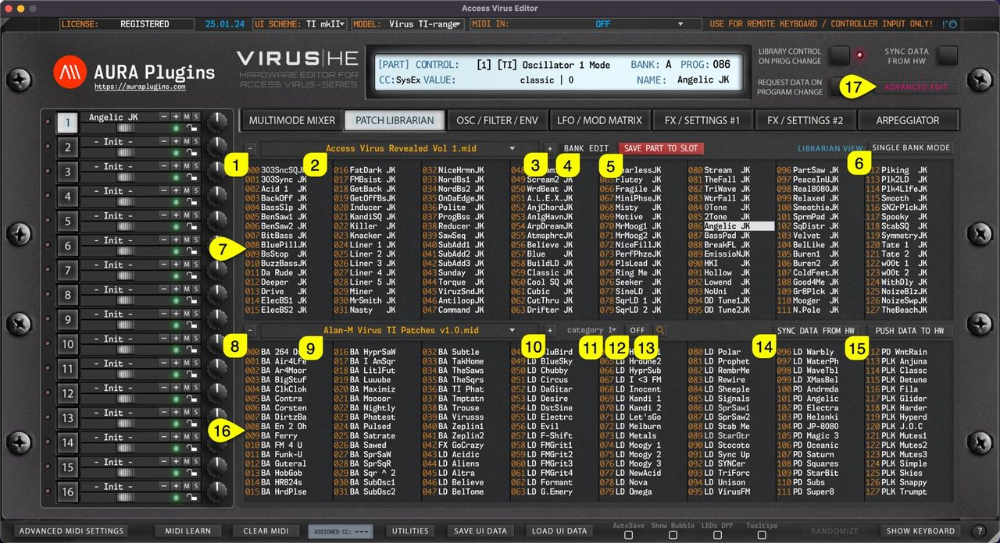
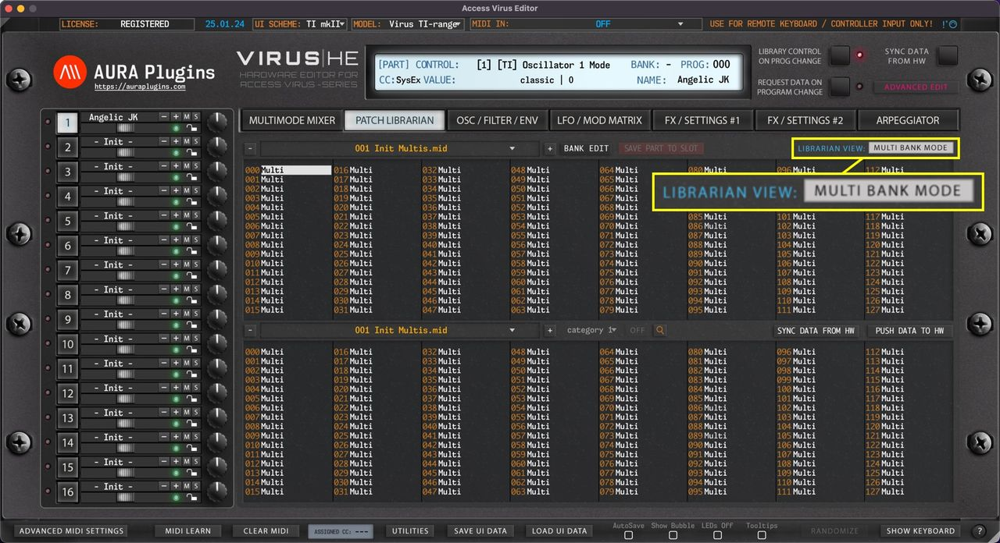
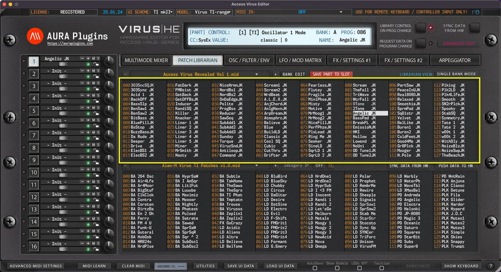
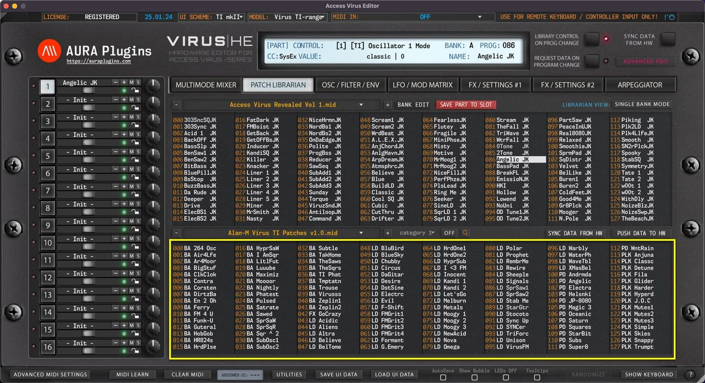
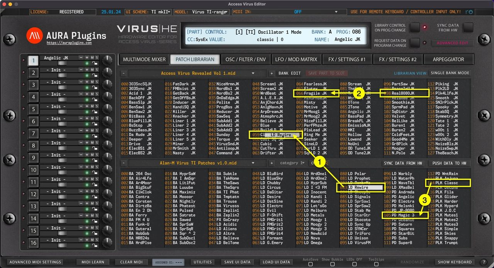
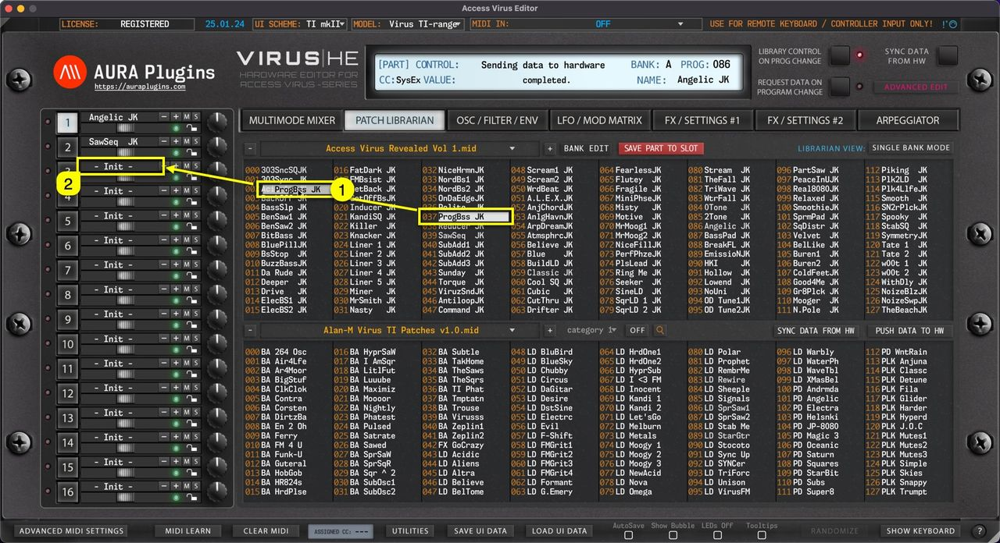
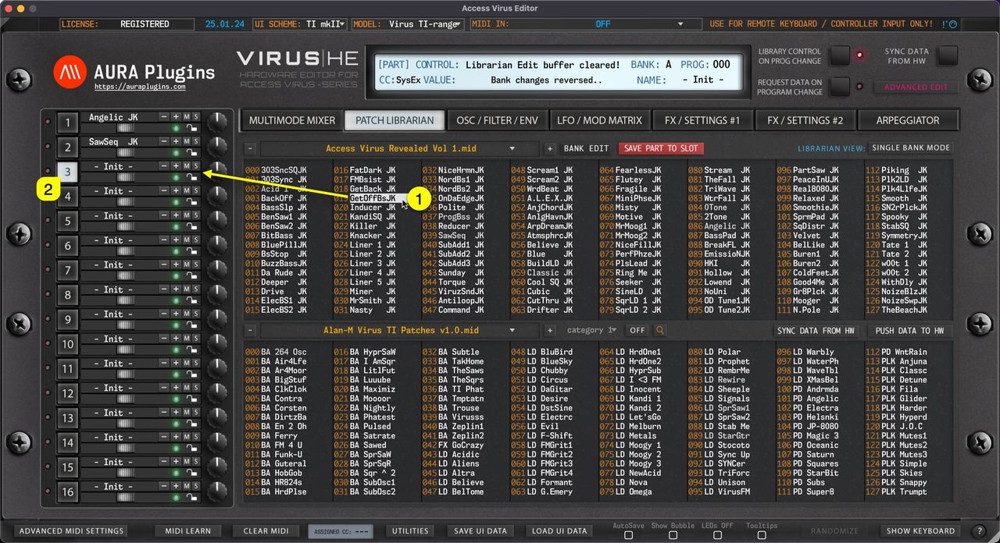
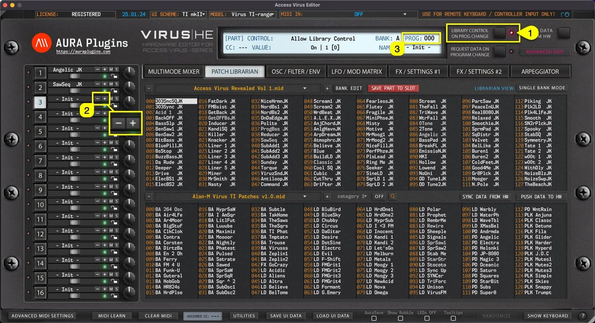
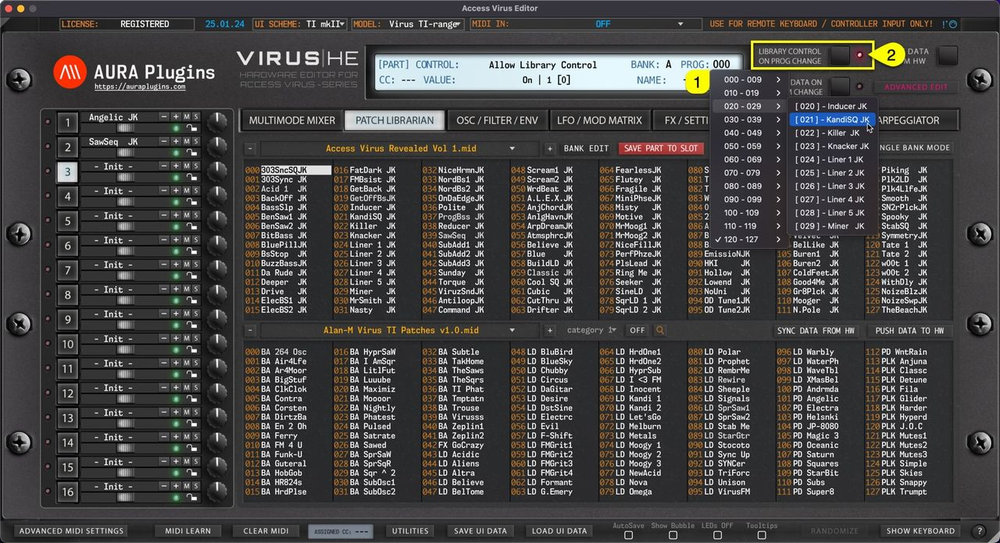
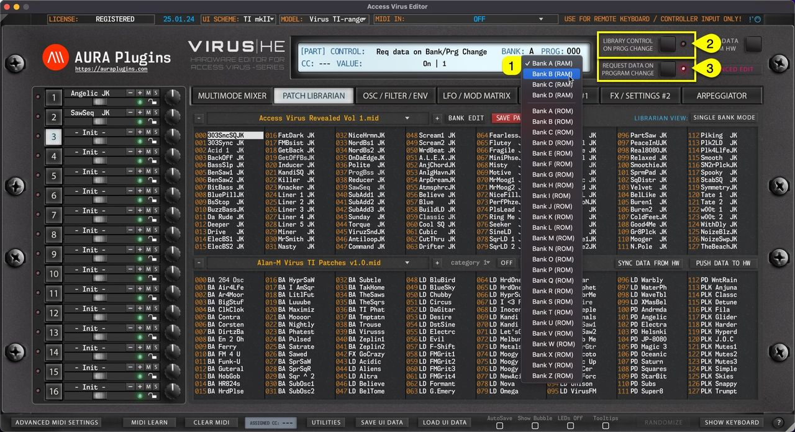

# Patch Librarian

## Patch Librarian

### Patch Librarian View

In this chapter, we are going to walk through the usage of the **Patch Librarian** and all its functions & possibilities. It might take some time to understand how it works, but for those who used **Emagic SoundDiver** in the past, this workflow is pretty much the same.

*Figure: patch librarian*

We have made the librarian look and feel the same across all our products. i.e., Waldorf Blofeld Editor has the same functions in the librarian, but every Editor has their own specialities.

But in general, you can request data from hardware to the librarian, store data from librarian to hardware, store banks to HDD as you make edits etc.

**NOTE:** Librarian view is **not** synchronized with hardware memory. Librarian view displays **SINGLE** or **MULTI** data stored in your HDD ( [data folder]/Patches/ -folder ).

**NOTE:** Keep your banks organized. If you have too many levels in your folder tree, the librarian is not able to solve it. Details below.

- [data folder]/Patches/sub folder 1/sub folder 2/my bank.mid – **this is OK**.
- [data folder]/Patches/sub folder 1/sub folder 2/sub folder 3/my bank.mid – **this is NOT OK**.

There is a lot to cover in this chapter, so it is the perfect time to get some coffee or tea.

### Layout and Functions

Let’s start with the definitions of basic layout and button / menu explanations.

*Figure: patch librarian labelled*

- **[1] & [8]** = Select previous SINGLE or MULTI bank from the bank tree.
- **[2] & [9]** = Display popup menu of SINGLE or MULTI banks. Menu displays banks from the data folder .
- **[3] & [10]** = Select next SINGLE or MULTI bank from the bank tree.
- **[4]** = Bank Edit menu, SINGLE or MULTI request functions, write functions, overwrite & save as functions and import functions.
- **[5]** = Save Data from currently selected PART TO currently selected librarian slot.
- **[6]** = Display SINGLE or MULTI programs in the Librarian View.
- **[7]** = Upper data view, also used as EDIT BUFFER. Data can be edited only in the upper data view.
- **[11]** = Category drop down menu to view patches from certain categories.
- **[12]** = Category browsing toggle. On or Off.
- **[13]** = Toggle on Search function. Search results will be shown in the right data view. Check Utilities menu functions earlier to learn more about Librarian Preferences regarding Search settings.
- **[14]** = Sync Data From Hw toggle to get data from the hardware to the Editor User Interface.
- **[15]** = Push Data To Hw toggle to send Editor User Interface data to the hardware.
- **[16]** = Lower data view. This view can be changed while the upper data view is locked due to unsaved data changes.
- **[17]** = Show Quick Edit View to adjust parameters without leaving the Librarian View.

Now that we understand the basic layout, we can dive into more specific details per function.

## Librarian Data Types

### Single Bank Mode

Editor defaults to **SINGLE BANK MODE** on new instances. Singles from the Patch Librarian can be loaded to any part of your choice.

*Figure: librarian data types multi*

### Multi Bank Mode

When **MULTI MODE** is toggled on, Editor will show the MULTI banks in the Patch Librarian View.

**NOTE:** When MULTI is loaded, it will only assign SINGLES defined in the MULTI itself. In short: MULTI files do not contain any SINGLE patches.

## Librarian Data Views

Our Librarian has two views: primary is “ **Edit Buffer** ” view and secondary is “ **Source** ” view.

This is really straight forward, upper is your Edit Buffer , where you can request, rename, move and paste data. The lower view is your Source of copy / search results view which can be changed once the Edit Buffer is locked due to unsaved changes.

Let's break down how they perform below..

*Figure: data views upper*

### Upper Data View

As mentioned earlier, the UPPER view is your “ **BUFFER** ” view. All bank requests are fetched into this view, where you can store them in your HDD. You can drag’n’drop and paste data to the upper view, rename items in the upper view etc.

*Figure: data views lower*

### Lower Data View

This is our “ **SOURCE** ” view. Going further: Any data from source view can be copied & pasted or dragged over to “BUFFER” view.

If search is triggered, search results will be shown in this view.

You can change the banks in the SOURCE view while the BUFFER view is locked due to unsaved changes.

This is helpful when you want to make a bank of your own from different patches / multis / search results and what not.

Data can not be pasted to any of the slots in this view.

## Librarian Drag and Drop

### Librarian Drag’n’Drop

You can drag’n’drop data from:

- **[1]** SOURCE list slot -> BUFFER list slot.
- **[2]** BUFFER list slot -> BUFFER list slot.

BUT you can NOT drag’n’drop data from **[3]** SOURCE -> SOURCE list. BUFFER -> SOURCE list is also disabled. This is by design explained in the previous article.

*Figure: librarian drag and drop*

**NOTE:** You can also drag’n’drop data from Librarian slots to the PART name field, which will load the PATCH data to the part you drop it on!

### Drag’n’Drop to PART

As the note above states, you can drag’n’drop data from any **Librarian Slot [1]** to any **PART [2]** name field and data is then sent to hardware on that specific part.

*Figure: librarian drag and drop to part*

## Sending Data To Hardware

### Double Click

You can send any **slot data [1]** from the Librarian view to a selected **Part [2]** by **double clicking** the item.

In SINGLE BANK mode this data will be sent to the **currently selected [2]** Part.

In MULTI mode the data will only replace the MULTI settings, not individual parts. When MULTI is sent from the librarian to the hardware, each of the parts will be requested from the hardware to the user interface. This is because the MULTI data only holds reference to Bank and Program from the hardware, not the actual part data. If you want to send specific parts with MULTI, use our Save / Load UI Data function to achieve this.

*Figure: sending data to hardware with double click*

### Arrow Keys

You can use the computer keyboard arrow up, down, left and right keys to navigate librarian slot content as long as the mouse cursor is above the librarian view.

Data is sent to the currently active part in the hardware while Librarian View is in SINGLE BANK mode.

*Figure: sending data to hardware with arrow keys*

### Program Change Buttons

Program Change – / + buttons have two functions:

1. If **LIBRARY CONTROL ON PROG CHANGE [1]** is toggled on, then data from the Librarian View is sent to currently active part on **Program – / + [2]** trigger, ie. – is clicked, then TheBeachJK is sent to the currently active slot.
2. If **LIBRARY CONTROL ON PROG CHANGE [1]** is toggled off, then Program Change command is sent to hardware based on **BANK and PROG menu [3]** values, ie. if PROG is 11 and 14 is clicked, then PROG 14 is requested from hardware to the currently active part.

*Figure: sending data to hardware with program - / + buttons*

### MIDI Program Change

Similar to User Interface Program Change – / + buttons, incoming MIDI Program Change has the same effect. You can optionally disable incoming MIDI Program Change commands from the Advanced MIDI Settings view.

Data is either sent to hardware from the Librarian View based on the incoming Program Change value or requested from the hardware to the Editor User Interface based on the same Program Change value.

**NOTE:** When user toggles between LIBRARY CONTROL ON PROG CHANGE states, REQUEST DATA ON PROGRAM CHANGE button gets disabled. Engage the button again if you want to request hardware programs to the Editor User Interface after MIDI Program Change is sent. See image below.

*Figure: sending data to hardware with midi pc*

### PROG menu

Users can also send Programs to the hardware by clicking the **PROG [1]** menu and selecting an item from the list. Note that **LIBRARY CONTROL ON PROG CHANGE [2]** is on, so data is sent to hardware from the Librarian View and PROG menu items are populated with the currently active Librarian View program names.

*Figure: sending data to hardware via program menu*

### and BANK menu…

Another option is to change BANK via the **BANK [1]** menu. Note that in this case the **LIBRARY CONTROL ON PROG CHANGE [2]** is toggled off, which results in renaming menu items with hardware bank locations. Also, **REQUEST DATA ON PROGRAM CHANGE [3]** is on, which means data is requested to the User Interface instead of sending it to the hardware.

*Figure: sending data to hardware via bank menu*

## Browsing Banks

### Single Bank mode

When **SINGLE BANK MODE [1]** is selected, users can open a drop down menu by clicking the **bank name [2]** area with mouse click. With this drop down list, users can see all of the available banks detected by the Editor.

*Figure: browsing banks in single mode*

### Multi Bank mode

Same applies to Multi files when **MULTI BANK MODE [1]** is toggled on. Users can view all of the detected Multi Banks by clicking the **bank name [2]** area.

*Figure: browsing banks in multi mode*

**NOTE:** When a bank is selected, slot names are updated in the list view with corresponding program names.

## Search Filter

Search Filter can be toggled on by clicking the **SEARCH [1]** icon in the Patch Librarian View. Before entering the search term, you can define if search is taking character caps into account by clicking the **“ aa ” [2]** toggle.

Now once the **search term [3]** is input and you hit enter, you’ll see that **Lower (SOURCE) [4]** list view gets updated with all programs containing the search term.

More search results are shown by clicking the **bank name [5]** area to reveal how many banks of search items were found.

*Figure: search filter toggles*

Search follows the current Librarian View mode, ie. SINGLE BANK mode shows results only from Single banks, while MULTI BANK shows only results from Multi banks.

**NOTE:** To adjust how search works, use the Utilities Menu -> Librarian Preferences to determine how search works.

## Category Filter

Category Filter can be toggled on by clicking the **CATEGORY [1]** on / off icon in the Patch Librarian View. You can define Category filtering with **primary filter [2]** and if you need further tuning to category drilling, use **secondary filter [3]** together.

Once filters are set, you’ll see that **Lower (SOURCE) [4]** list view gets updated with all programs containing the filter terms.

More filter results are shown by clicking the **bank name [5]** area to reveal how many banks of filter items were found.

*Figure: category filter toggles*

Filtering only works in SINGLE BANK mode.

**NOTE:** To adjust how category works, use the Utilities Menu -> Librarian Preferences to determine how category sorting works.

## Quick Edit View

Patch Librarian has an additional view to make “ quick ” edits on SINGLE PATCHES while browsing them through the Patch Librarian: Quick Edit Mode.

Once **Quick Edit Mode [1]** is toggled on, LOWER list view is replaced with Quick Edit controls and customizable XY PAD.

You can choose different controls for the X and Y axis by clicking the **control name [2]** on each of the axes.

*Figure: quick edit view*

## Save Part To Slot

Save Part to Slot gets current User Interface data and places it into the currently selected slot in the librarian.

In this case we click the **Save Part To Slot [1]** button while **PART 7 [2]** is selected. This will then get Editor data from Part 7 slot and place it into **Librarian slot 031 [3]** which is currently selected.

You can change the slot to your liking as long as it is in the upper (BUFFER) view. Otherwise the Save Part To Slot button won’t work.

*Figure: save part to slot*

**NOTE:** The user has to **overwrite** or choose a custom bank name via **Bank Edit -> Save As..** function in order to save bank changes. OR click the DISCARD button to cancel all the changes made.
