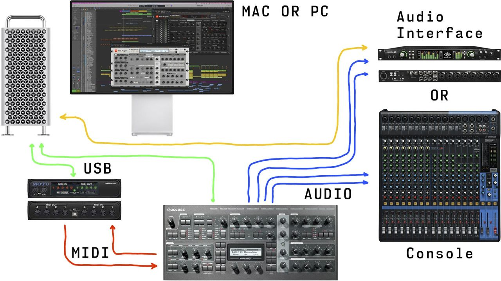
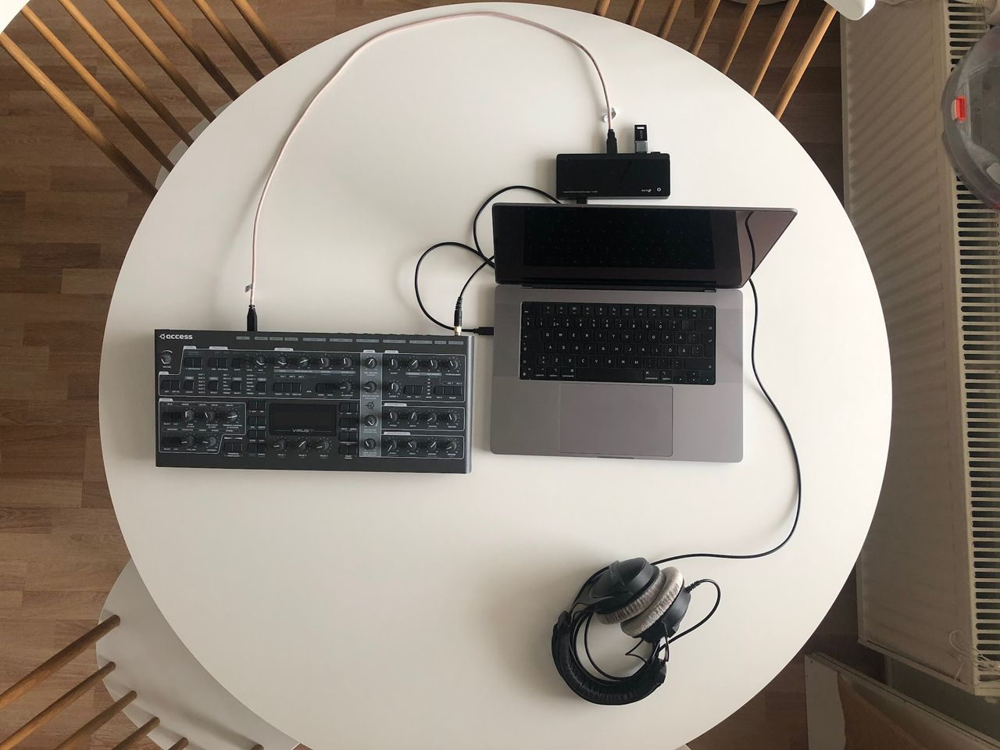
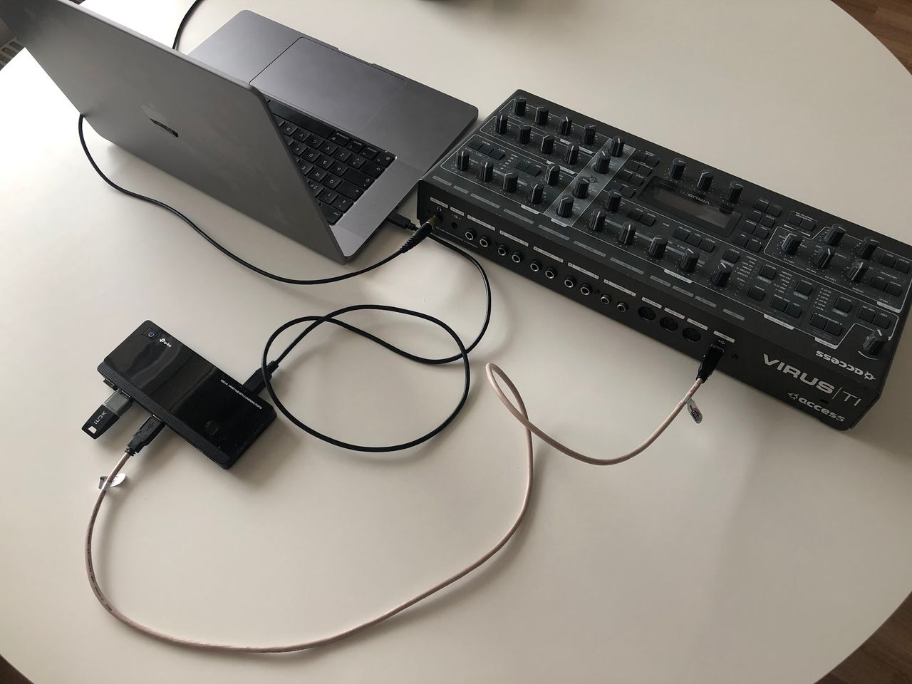
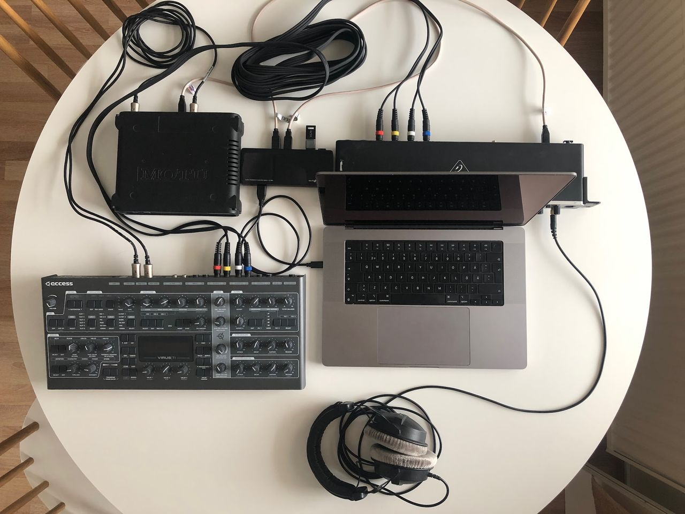
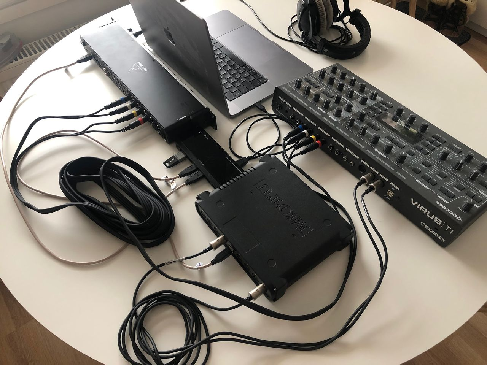

# Access Virus Editor – Prepare your Hardware

Connect the MIDI cables from your synthesizer to the MIDI interface and Audio Jacks to your console / sound card. MIDI out from synth to MIDI interface IN and vice versa. MIDI thru connections will not work.

- MIDI Out from MIDI interface to Virus MIDI In port.
- MIDI Out from Virus to MIDI interface MIDI In port.
    - double check your cables!
- Audio from Virus Out1 L&R to console or sound card inputs.
    - Add more outputs if needed.
- Virus TI users can use USB along with Analog outputs to get 6 stereo pairs / 12 mono tracks of Audio from the Virus.

## Wiring diagram example

*Figure: Screenshot*

Power up your Virus. Our editor is designed to work “out of the box” and control all parameters from a single application instance.

**NOTE:** Our Editor is designed to work in MULTISINGLE / SEQUENCER-mode.

## Using Virus TI with and without USB connection

This is a raw example of how to route your Virus TI with macOS 10.12 or greater – even on Apple Silicon macs! Note that our Editor requires a Metal compatible graphics processor.

CONNECT VIRUS TI WITH USB

In the sample below, you can see how simple setup works with minimal effort. USB from Virus TI is connected to the USB 3 hub. This hub is then connected to Apple Silicon mac with USB-C cable. Audio and MIDI is passed to and from Virus TI with the single USB cable.

setup guide: https://auraplugins.com/kb/product/access-virus-editor/user-guides/

*Figure: access virus ti with usb connection up*

*Figure: access virus ti with usb connection perspective*

**NOTE:** IF Virus TI is connected to computer with USB cable, then Virus TI MIDI input and output will act as a MIDI port to your DAW. All MIDI data in and out from Virus TI MIDI ports will bypass the Virus TI engine!

CONNECT VIRUS TI WITHOUT USB

This is the classic guide to route Audio and MIDI with Virus TI and previous Virus models. Audio outputs from Virus connected to Soundcard inputs, MIDI in and out from Virus connected to MIDI interface in and out ports.

MIDI interface and soundcard are both connected to USB 3 hub and the hub is connected to Apple Silicon mac with USB-C cable.

*Figure: access virus ti without usb connection up*

*Figure: access virus ti without usb connection perspective*

**NOTE:** If you need more audio outputs from the Virus TI, just plug in the USB cable from Virus TI to your USB hub and you’ll gain 3 stereo / 6 mono outputs to your setup. See NOTE above about Virus TI USB & MIDI input / output ports!
