# Librarian Edit Menus

## Librarian Edit Menus

Librarian BANK EDIT menu offers functions to:

- Request Single Patch Data from the hardware to the Librarian.
- Request Multi Data from the hardware to the Librarian.
- Write Single Patch Data to hardware memory slots.
- Write Multi Data to hardware memory slots.
- Overwrite Bank changes.
- Save Bank as a new item in the Data folder if chosen so..
- Import Virus Banks across all models.
- Initialize the entire bank to start working on your own bank.
- And then some functions we’ve covered in previous articles prior to this.

This is a long list of items, but there is even more with…

### Librarian Right Click Menu

… this menu. Librarian **Right click menu [1]** opens additional options to rename entities in the librarian view, copy & paste entities and much more.. So let's start diving into these.

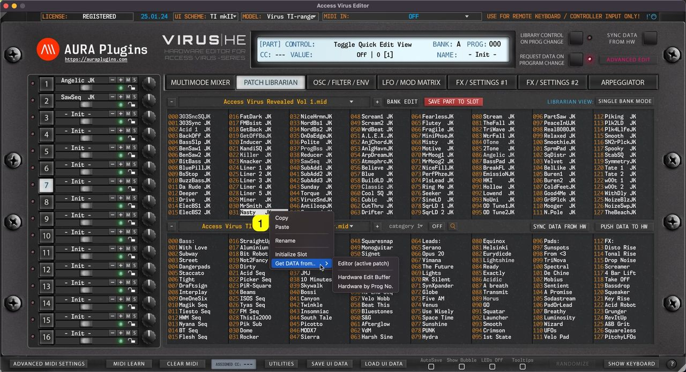

*Figure: librarian edit menus - right click*

## Request Patch Data from Hardware

**NOTE:** To successfully request the patch data from the hardware, STOP all activities on your DAW so that the SysEx data is received as expected!

### from Active Layer to Editor GUI

Open the **BANK EDIT** menu and choose **Request Patch Data … -> from Active Slot to Editor GUI** to get the buffer data from the Hardware to the Editor User Interface. In this case, Librarian will get the data to Editor UI from the currently selected PART.

*Figure: request patch data - from part to user interface*

### from Active Slot to Librarian

Open the **BANK EDIT** menu and choose **Request Patch Data … -> from Active Slot to Librarian** to get the buffer data from the currently selected part to the Librarian. In this case, Part 7 data is requested to the selected slot, which is slot 31.

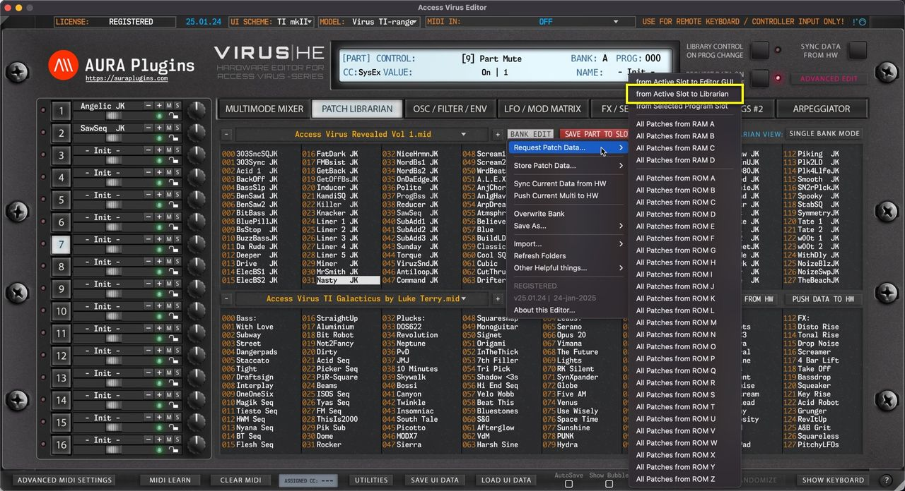

*Figure: request patch data - from part to librarian*

You can achieve the same result with **right mouse click** at the top of any slot and choose **Get DATA from … -> Editor (active patch)** .

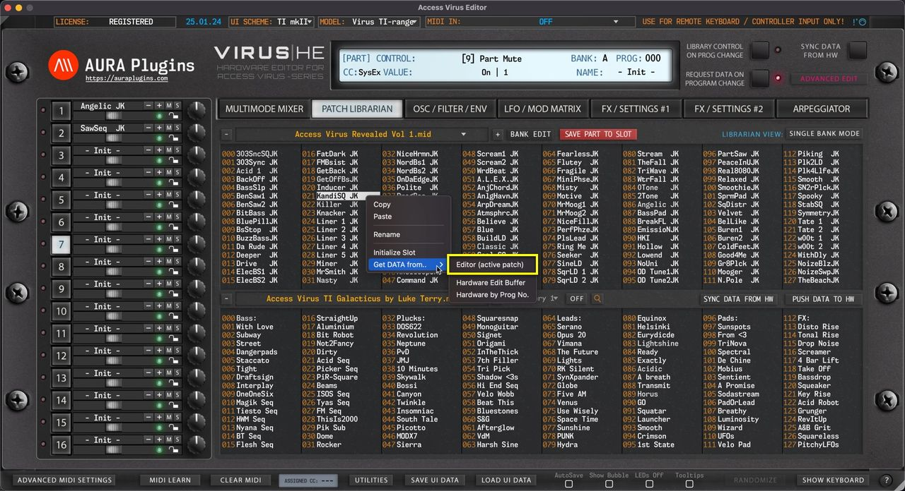

*Figure: request patch data - from part to librarian*

### Hardware Edit Buffer

If the Virus edit buffer differs from the Editor buffer, you can also request the Edit Buffer to the Librarian slot with **right mouse click** at the top of the slot and choose **Get DATA from … -> Hardware Edit Buffer** .

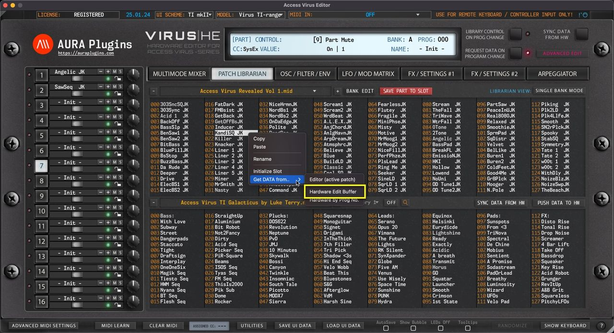

*Figure: request patch data - from edit buffer*

### from Selected Program Slot

Open the **BANK EDIT** menu and choose **Request Patch Data … -> from Selected Program Slot** to get Patch from Bank A prog 31.

Bank A is defined in the BANK menu on the editor control display. Slot is determined by the user selection in the Librarian View.

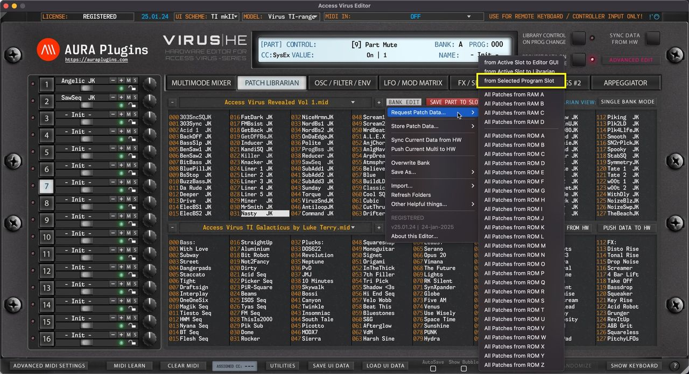

*Figure: request patch data - from program slot*

You can achieve the same result with **right mouse click** at the top of any slot and choose **Get DATA from … -> Hardware by Prog No** .

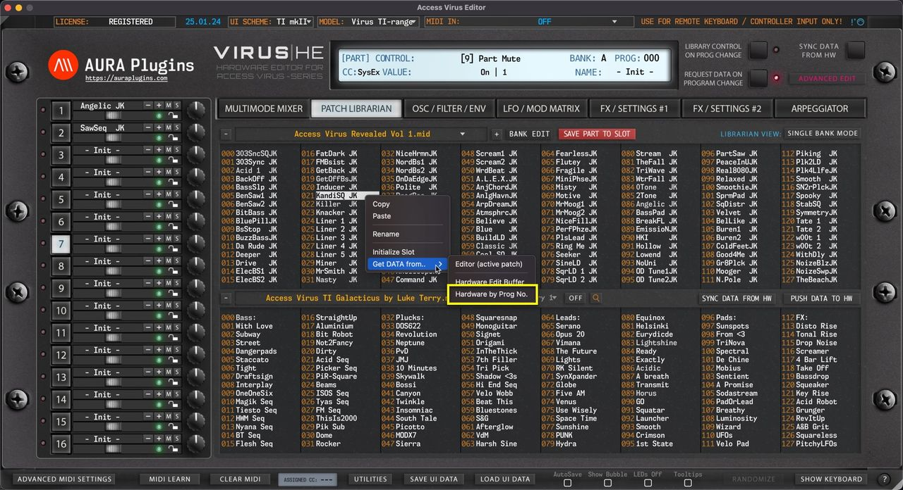

*Figure: request patch data - request from program slot*

**NOTE:** BANK menu selection in **Editor Control Display** defines the Bank Address for hardware requests!

### All Patches from RAM A…D

Open the **BANK EDIT** menu and choose **Request Patch Data … -> All Patches from RAM A … D** of your choice.

This action will request all RAM bank Patches to the Librarian from your hardware.

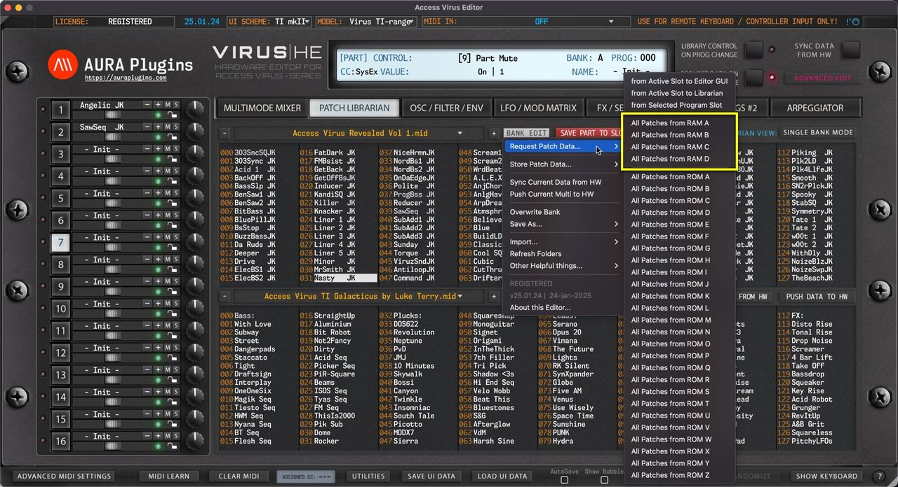

*Figure: request patch data - ram slots*

### All Patches from ROM A…Z

Open the **BANK EDIT** menu and choose **Request Patch Data … -> All Patches from ROM A … Z** of your choice.

This action will request all ROM bank Patches to the Librarian from your hardware.

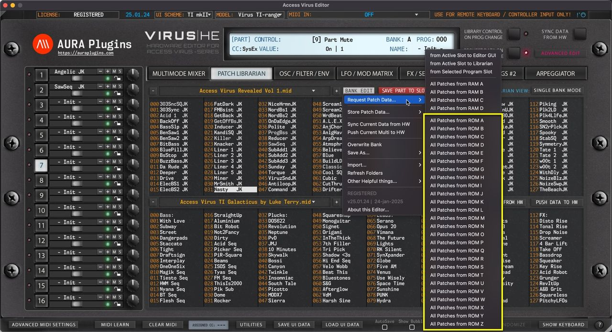

*Figure: request patch data - rom slots*

## Store Patch Data to Hardware

**NOTE** : Before you start data writing to hardware, make sure you know which slot you are overwriting and STOP all activities on your DAW in regards to the hardware to ensure data is written properly!

### To Currently Selected Slot & Bank

Open the **BANK EDIT** menu and choose **Store Patch Data … -> To Currently Selected Slot & Bank** to write currently selected Librarian Slot to hardware. In this case we would overwrite Slot 21 in bank RAM A which is chosen in the BANK menu at Editor Control Display.

*Figure: store patch data to slot*

### from Selected Bank to RAM A … D

Open the **BANK EDIT** menu and choose **Store Patch Data … -> from Selected Bank to RAM A … D** to write the entire USER bank of your choice with the data from Active Librarian View which in this case is UPPER view (slot 21 chosen on UPPER list).

This means, you can select either view (UPPER / LOWER) and write the hardware memory with a bank in question. Extension to this is that you can do search or category filtering, ie, bass and write all the results from the active view to hardware!

*Figure: store patch data to ram*

## Request Multi Data from Hardware

**NOTE:** To successfully request the multi data from the hardware, STOP all activities on your DAW so that the SysEx data is received as expected!

### from Temp Buffer to Editor GUI

Open the **BANK EDIT** menu and choose **Request Multi Data … -> from Temp Buffer to Editor GUI** to get the buffer data from the Hardware to the Editor User Interface. This action will request multi data and individual parts.

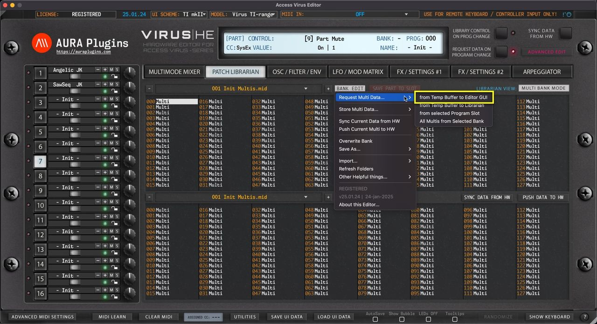

*Figure: request multi data from buffer to user interface*

### from Temp Buffer to Librarian

Open the **BANK EDIT** menu and choose **Request Multi Data … -> from Temp Buffer to Librarian** to get the buffer data from the hardware to the Librarian.

Multi format only includes the Multi – not individual parts.

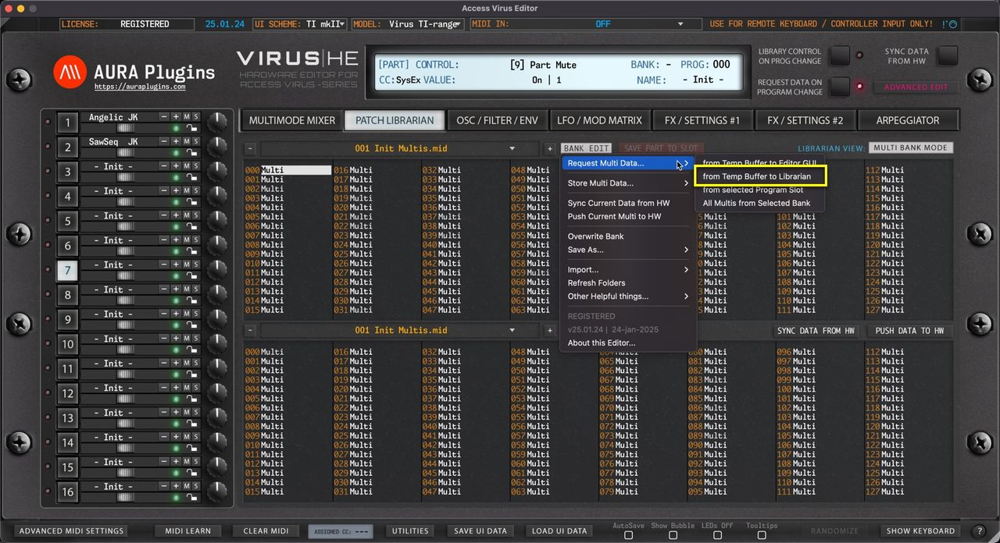

*Figure: request multi data from buffer to library*

### from Selected Program Slot

Open the **BANK EDIT** menu and choose **Request Multi Data … -> from Selected Program Slot** to get Multi from slot 0.

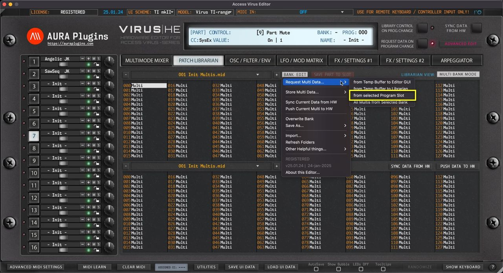

*Figure: request multi data from slot to librarian*

### All Multis from Selected Bank

Open the **BANK EDIT** menu and choose **Request Multi Data ... -> All Multis from Selected Bank**.

This action will request all USER bank Multis to the Librarian from your hardware.

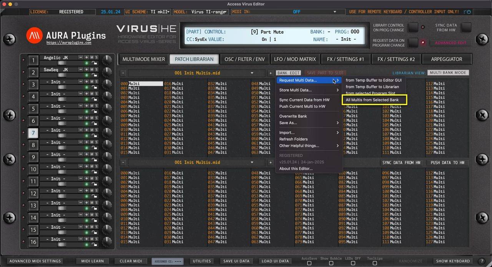

*Figure: request multi data all multi programs*

## Store Multi Data to Hardware

**NOTE** : Before you start data writing to hardware, make sure you know which slot you are overwriting and STOP all activities on your DAW in regards to the hardware to ensure data is written properly!

### To Currently Selected Slot & Bank

Open the **BANK EDIT** menu and choose **Store Multi Data … -> To Currently Selected Slot & Bank** to write currently selected Librarian Slot to hardware. In this case we would overwrite Slot 0.

*Figure: store multi data to selected slot*

### from Selected Bank to USER

Open the **BANK EDIT** menu and choose **Store Multi Data … -> All Multis from Current Bank** to write the entire USER bank with the data from Active Librarian View which in this case is UPPER view (slot 0 chosen on UPPER list).

This means, you can select either view (UPPER / LOWER) and write the hardware memory with a bank in question.

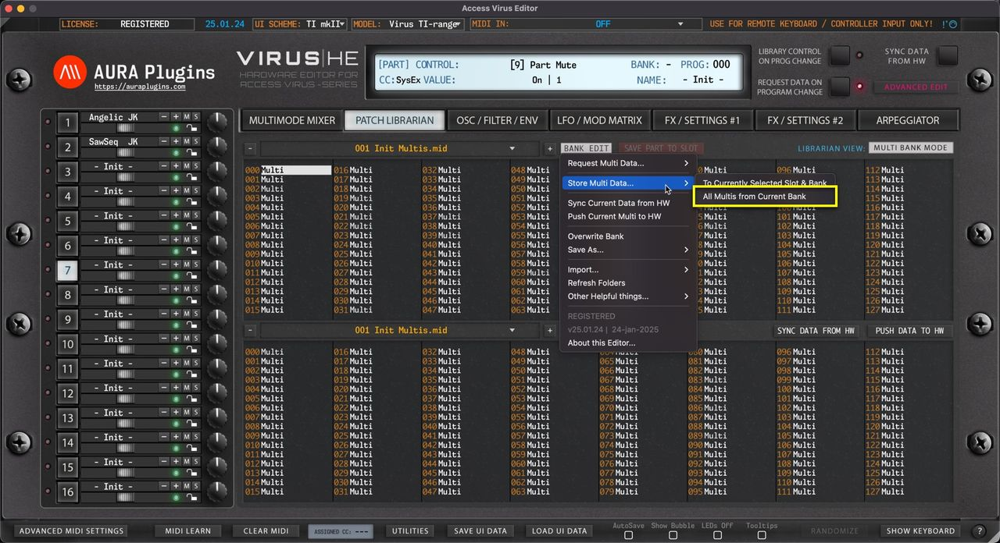

*Figure: store multi data to hardware*

## Sync Current Data from HW

Open the **BANK EDIT** menu and choose **Sync Current Data from HW** to request Global settings, Multi data and data from each Part to the Editor User Interface.

This function extends the basic Sync Data From HW toggle from main User Interface with Global settings request – Therefore this menu option or Sync Data From HW toggle in the Librarian View is the best option to choose after MIDI input and output are set!

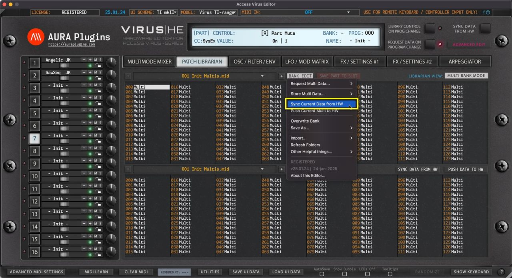

*Figure: sync current data from hw*

## Push Current Data to HW

Open the **BANK EDIT** menu and choose **Push Current Data to HW** to send your Global Settings, Multi and Part settings to your Hardware. This can be used to force the hardware buffer to match with the Editor.

*Figure: push current data to hw*

**NOTE:** With Push Current Data to HW function you can recover your User Interface data back to your Hardware in case your MIDI interface ports are different to previously set ports!

## Saving Banks

### Overwrite Bank

Open the **BANK EDIT** menu and choose **Overwrite Bank** to overwrite any changes you’ve made to the current Bank. This will permanently overwrite the currently selected bank in your HDD which in this case would be 001 Init Multis.mid .

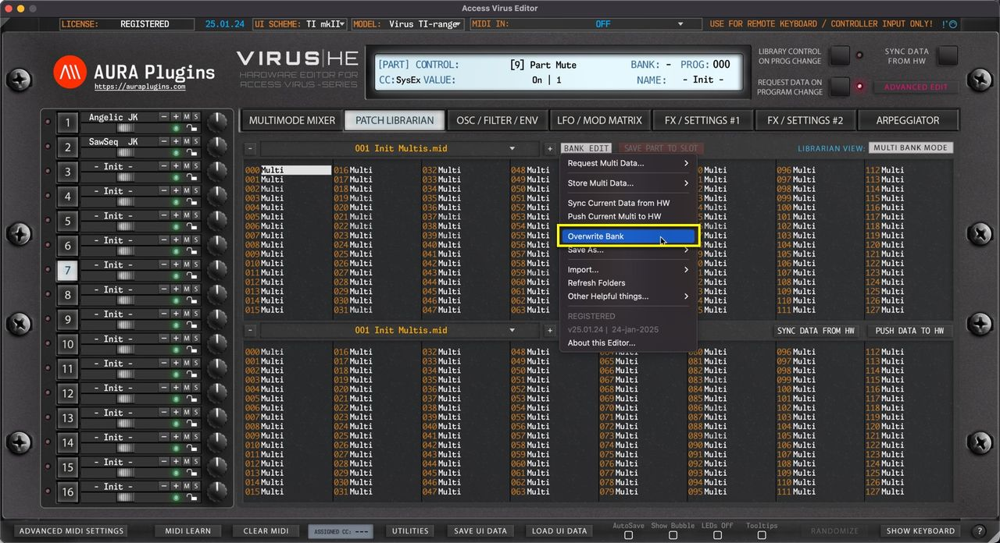

*Figure: saving banks - overwrite bank*

### Save As…

Open the **BANK EDIT** menu and choose **Save As… -> Standard MIDI / Virus HE Format / Virus|Powercore** to save any changes you’ve made to the bank with a new name. This keeps the banks and their edits in good order – And you will always have the original file in hand just in case something goes wrong!

*We recommend vhc format, but standard MIDI works too – it is up to you.*

Saving bank with **Virus|Powercore** will strip down all the Virus C and Virus TI data from the patches making it fully functional with Virus A, B, Classic and Powercore.

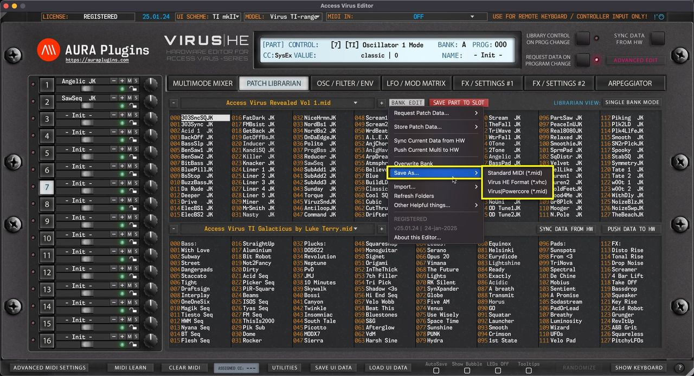

*Figure: saving banks - save as*

**NOTE #1** : You can always DISCARD any changes you’ve made in the Librarian by clicking the **DISCARD [1]** button.

**NOTE #2** : You can see an exclamation mark **[2]** right next to PATCH LIBRARIAN toggle in the main User Interface IF Librarian has any unsaved changes! This will disappear once save or discard is triggered.

**NOTE #3** : Librarian Mode toggle becomes unavailable IF there are any unsaved changes in the Librarian.

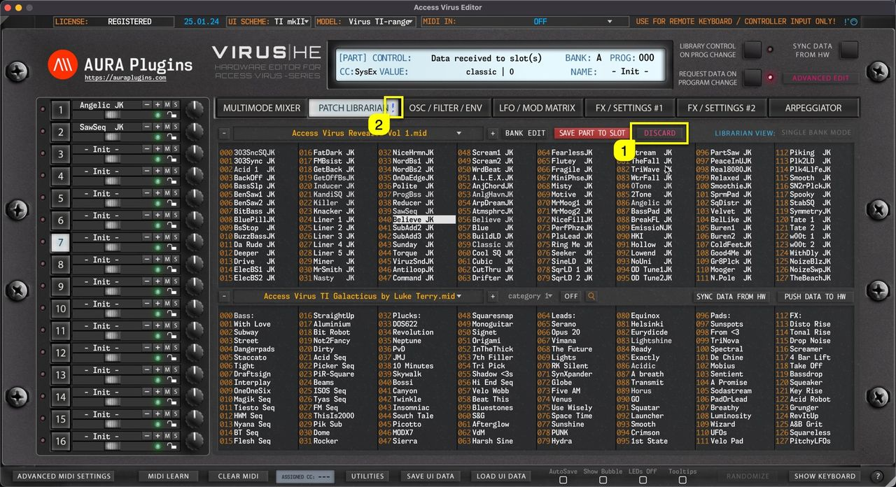

*Figure: saving banks - unsaved changes indicator*

## Importing Banks

Open the **BANK EDIT** menu and choose **Import …** to import Multi / Single Patch banks into the Librarian.

We have a variety of options to choose for import: MID, SYX and VHC file formats.

VHC files are basically SysEx files, but we’ve kept the format in to build our own “arrangement” data system in the upcoming update. To get full arrangement data, use Save / Load UI Data.

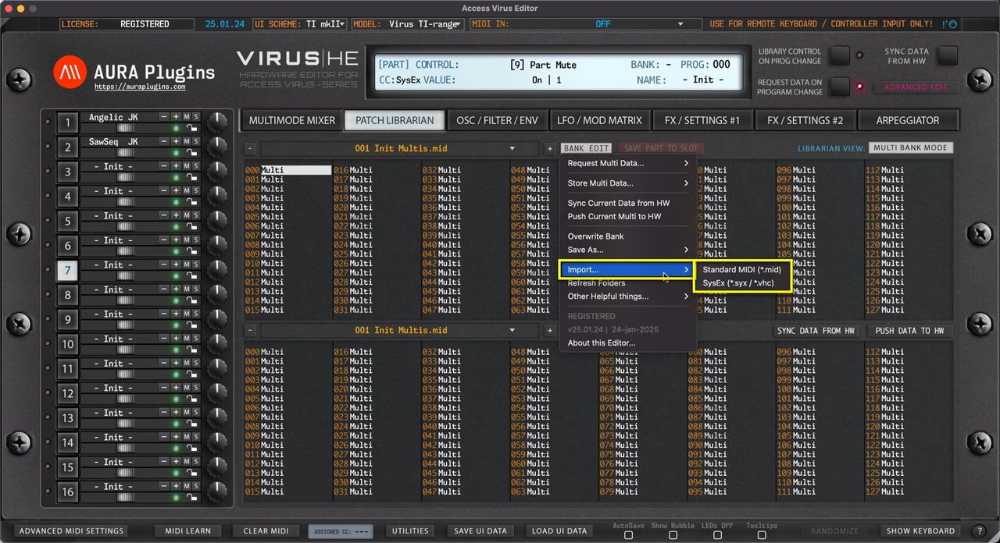

*Figure: importing banks to librarian*

### Standard MIDI (\*.mid)

Import Standard MIDI files that contain Access Virus Multis / Singles.

### SysEx (\*.syx / \*.vhc)

Import System Exclusive / vhc (Virus Editor) files which contain Access Virus Multis / Singles.

## Refresh Folders

Open the **BANK EDIT** menu and choose **Refresh Folders** to manually trigger PATCHES folder rescan. This is helpful in case you have copied files over or bought new content and placed it in but can’t see it when opening the Librarian View.

*With update 26.09.xx onwards, this function is completely automated and new banks dropped onto the Patches folder will be automatically added to the Librarian Database cache.*

*Figure: refresh folders to check file changes in system*

**NOTE #1** : If the Editor hangs or crashes while this action is in effect, see Enable LOG article from Utilities menu section to learn how to detect faulty banks.

**NOTE #2** : If you can’t see the file you have placed in the Patches folder, try toggling between Multi / Single Bank mode to see if the file is there.

## Other Helpful Things

Other Helpful things menu gives additional tools to speed up your sound-design work, ability to open your Data folder quickly & check for any updates from our server. Examples below.

### Initialize Bank

Open the **BANK EDIT** menu and choose **Other Helpful things … -> Initialize Bank** to initialize all slots from the bank. You can then overwrite or choose Save As from the BANK EDIT menu to continue working with bank edits. The result shown below after the initialization process has been processed.

*Figure: other helpful things initialize bank*

If you made this action by accident, you can always click the DISCARD button to revert any changes made to the bank.

### Open Data Folder

Open the **BANK EDIT** menu and choose **Other Helpful things … -> Open Data Folder** to open the root folder for the Access Virus Editor. In this folder you can find your license file, LOG file, PREFERENCES file and folders for UI DATA and PATCHES.

You can also see where the data path is as explained in the Data Locations article.

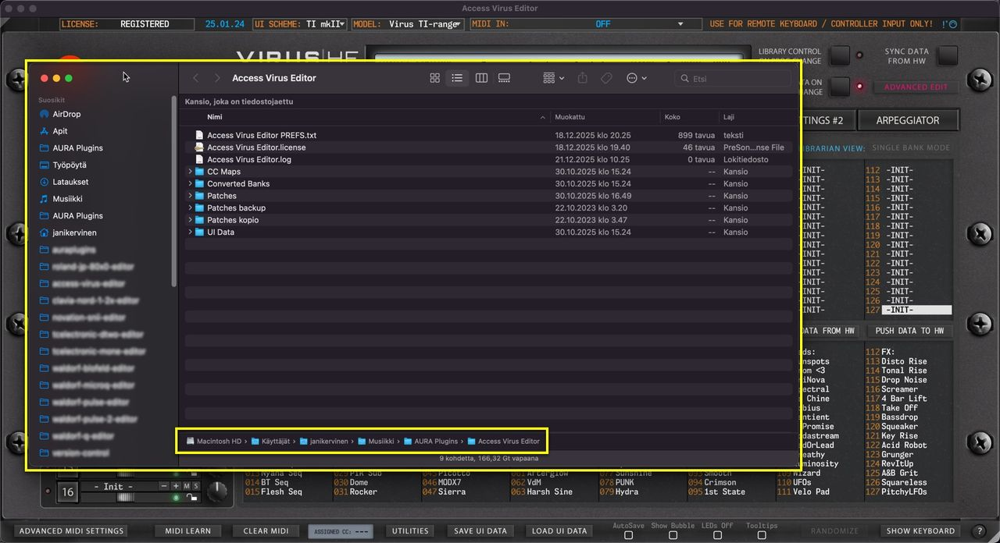

*Figure: other helpful things open data folder*

**NOTE:** Multi and Single Patch files are both located in the PATCHES folder.

### Check for Updates

This will check our online repository for version status. No personal data is sent on this action, only version number comparison is done and if it differs, then you’ll get notified if a new version is available along with changelog.

Usually when we have an update available, it addresses any issues reported to us via the Bug Report form (https://auraplugins.com/my-account/bug-report/) and/or Discord (https://discord.gg/TeG7ukYcVW) reports.

**NOTE:** Internet connection is required to handle this function!

## Rename Librarian Entities

If you want / need to rename items in the Librarian View, it can be done simply with **Right mouse click [1]** on a slot you want to rename and choose **Rename** …

*Figure: rename entities via right click menu*

This will open a small window, where you have to click on the **slot name [1]** to activate renaming. Keep in mind that name length is defined by the hardware specifications, in this case: 10 characters

*Figure: rename entities*

**NOTE:** New name is only applied by pressing ENTER on your keyboard. Clicking outside the box will cancel the renaming.
