# Access Virus Editor – Windows MIDI Configuration

**HEADS UP :** Windows 11 with multiclient MIDI drivers will enable MIDI devices to be shared between applications - If you are on Windows 11, you can skip creating Virtual paths if you don’t have use for them.

If you plan to route MIDI messages from your DAW to the plug-in channel and send it to the synthesizer from there, then you don’t need to read this, and you can proceed with the DAW guide that is relevant to you.

However, if you use the synth as a master keyboard in your rig or you want to delay compensate the MIDI output with the DAW, then check the advanced procedure below.

Windows **CAN NOT** share MIDI devices between applications (DAW & Editor), therefore virtual ports are the only way to to use the hardware within the DAW and the Editor at the same time.

**ATTENTION** : This is usually the step which is skipped and then you get connection timed out errors and such. Read the guide, it will save our time, your time and you will succeed with the setup!

## Additional Applications needed

Before we jump ahead to launch our DAW, let's do some tweaks in our system to ensure the plug-in can work with maximum efficiency. For that, we are going to need some additional tools.

- MIDI-OX for making routings behind the scenes and
- loopMIDI to create virtual MIDI ports.

We recommend installing an old but trusty MIDI-OX application for Windows to make some virtual routings behind the scenes.

You can download MIDI-OX from here: http://www.midiox.com/zip/midioxse.exe

OR go to MIDI-OX website http://www.midiox.com and download the installer there.

The second application is loopMIDI by Tobias Erichsen which is perfect for creating Virtual MIDI cables inside your workstation.

You can download loopMIDI from here: https://www.tobias-erichsen.de/software/loopmidi.html

**NOTE:** Windows remembers loopMIDI and MIDI-OX settings during each launch. If you do this once, that's all it takes!

## Install MIDI-OX and loopMIDI

Install both MIDI-OX and loopMIDI.

This will allow us to clone the MIDI data from the physical MIDI interface ports to virtual ports and then later on route it inside MIDI-OX back to your DAW while the main port is assigned to the plug-in.

**Example**: MIDI out from Virus -> Roland UM-ONE MIDI input -> MIDI-OX -> loopMIDI virtual port.

This configuration allows us to open the loopMIDI virtual port in the DAW while we use the Roland UM-ONE MIDI port with the plug-in itself. This way there won’t be a crash!

## Configure loopMIDI

Now that loopMIDI is installed, we can configure the ports. The reason why we are installing loopMIDI is so that we can loop back (clone) the MIDI data from the hardware MIDI port to the DAW via MIDI-OX.

*In the example below, we will add Virtual Ports for* ***Virus TI Keyboard*** *and* ***Virus C Desktop*** *. This is pretty straight forward, but we will guide you through.*

Open loopMIDI settings dialog from the Windows menu bar with right clicking the **loopMIDI icon [1]** and then choose **Configure loopMIDI [2]** .

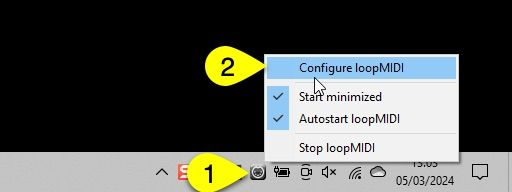

*Figure: Right Click and choose Configure loopMIDI*

Once loopMIDI opens up, it should look something like the image below.

*Figure: loopMIDI initial view*

## Create Virtual Ports (Virus TI Keyboard)

In the example below, we are gonna add our Virus TI Keyboard and Virus C Desktop ports to loopMIDI. Click the **New port name: field [1]** and type in “VirusTI vIn”. Click the **+ -sign [2]** to actually add it in.

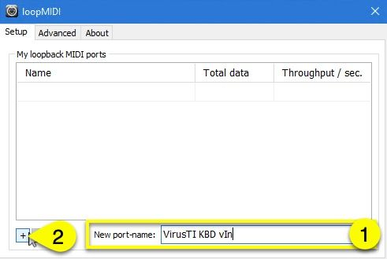

*Figure: win midi configuration vinput 1*

Next up we will add another port for output connection. Click the **New port name: field [1]** and type in your Virtual MIDI port connection name. Type in “VirusTI vOut” and click the **+ -sign [2]** to actually add it in.

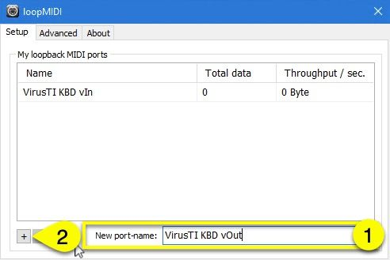

*Figure: win midi configuration vout*

## Create Virtual Ports (Virus C Desktop)

Since we have Virus C in our setup as well, we are going to add the virtual port for it. Click the **New port name: field [1]** and type in “Virus C vOut” and click the **+ -sign [2]** to actually add it in.

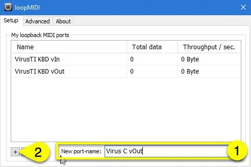

*Figure: win midi configuration vinput 2*

Since we are not using our Virus C to trigger notes or any other CC data to our DAW, we are only adding a virtual output port. There is no point in adding a virtual input port because it is not used in our case.

**NOTE:** If you have multiple Viruses in your setup, add ports accordingly. We have Virus TI Keyboard and Virus C Desktop, so we added both.

If you have two or more Virus Keyboards with same model, ie Virus TI Keyboards, then make the virtual ports naming obvious to yourself i.e. VirusTI #1 vIn, VirusTI #2 vIn etc.

## Advanced Settings

**Open the Advanced [1]** settings tab and change the **SysEx Buffer [2]** size to 512. This will ensure there is enough buffer for incoming data flow.

*Figure: Adjust SysEx buffer size*

## Finalize Setup

Right click on the **loopMIDI icon [1]** in the menu bar and toggle on “ **Start minimized** ” & “ **Autostart loopMIDI** ” **[2]** so you don’t have to worry about it during the next boot.

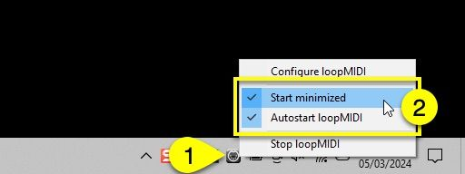

*Figure: Finishing touches to loopMIDI setup*

You can now close [1] loopMIDI configuration window.

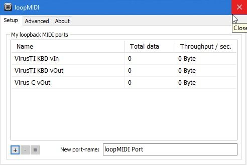

*Figure: win midi configuration done*

## Configure MIDI-OX

MIDI-OX is the second application needed in order to loop back the MIDI data to the DAW without crashing it. Windows / your DAW will crash if you try to open the MIDI ports twice since most MIDI devices don’t have multicast drivers available.

There are few steps to take in with MIDI-OX, but it will be worth the hassle to get data passing from the synthesizer to your DAW as well as in the plug-in without **crashing** your session.

**Search MIDI-OX [1]** from the Windows startup menu and **open [2]** the application.

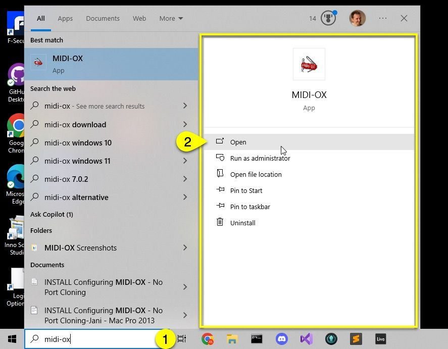

*Figure: Search MIDI-OX and open it*

The default view of MIDI-OX setup should look like this when you first open it. If not, close all the windows inside MIDI-OX to follow the guide.

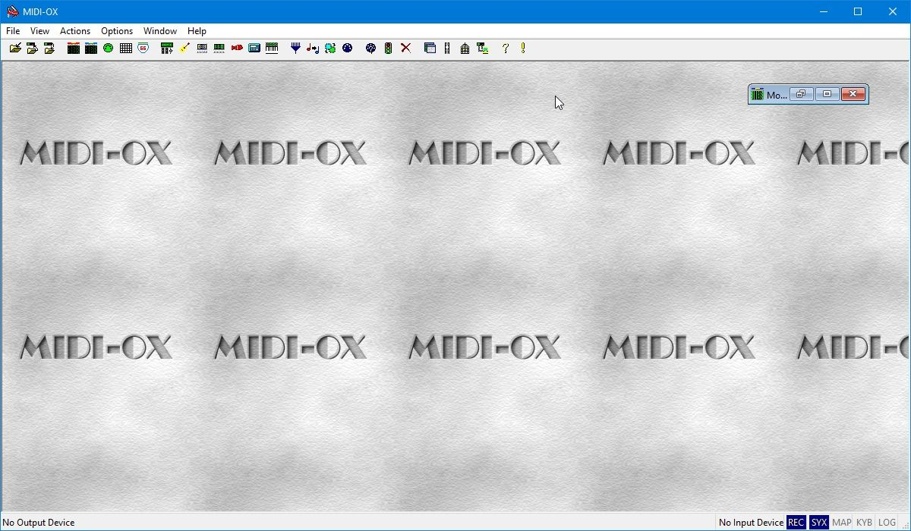

*Figure: MIDI-OX Initial state*

Click **View [1]** menu item and choose **Port Routings… [2]** . This should open a blank routing sheet where we will make our connections.

*Figure: Open Port Routings View*

After the Port Routings is opened, we need to open the **Physical** and **Virtual** MIDI ports for the MIDI-OX.

Click **Options [1]** and then choose **MIDI Devices… [2]** .

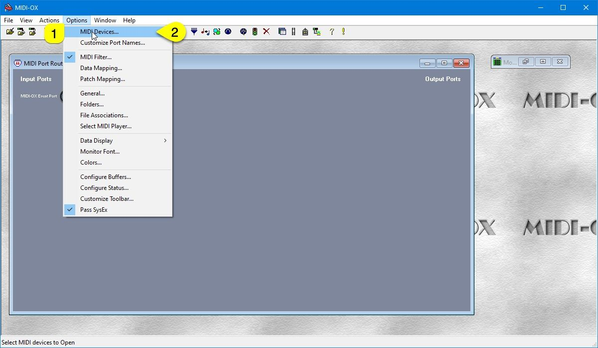

*Figure: Select MIDI Devices from the menu*

**NOTE:** There are no Input Ports and Output Ports defined yet in the MIDI Port Routing Window!

Now that the MIDI Devices config window is open, we can see all of your Physical and Virtual MIDI ports which are in our disposal. Before selecting any ports, **uncheck [1]** “ *Automatically attach Inputs to Outputs during selection.* ” or you will end up with a massive connection spaghetti which isn’t what we are making here!

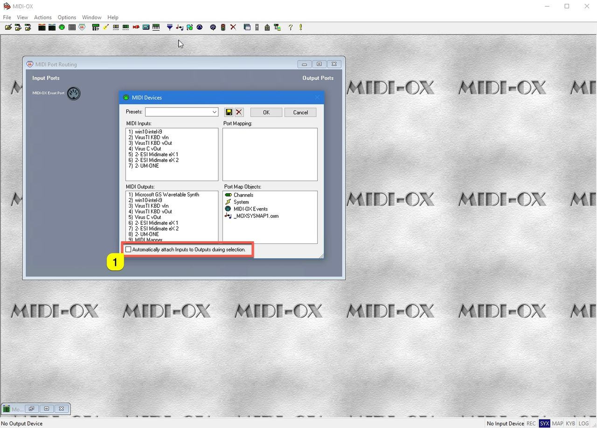

*Figure: midi-ox disable automatic connections*

## Open MIDI Inputs

Since we have a Virus TI Keyboard and Virus C Desktop in our setup, this is very simple.

**UM-ONE [1]** is where our Virus TI Keyboard is connected. **VirusTI KBD vOut [2]** connects to Virus TI via DAW and **Virus C vOut [3]** connects to Virus C via DAW.

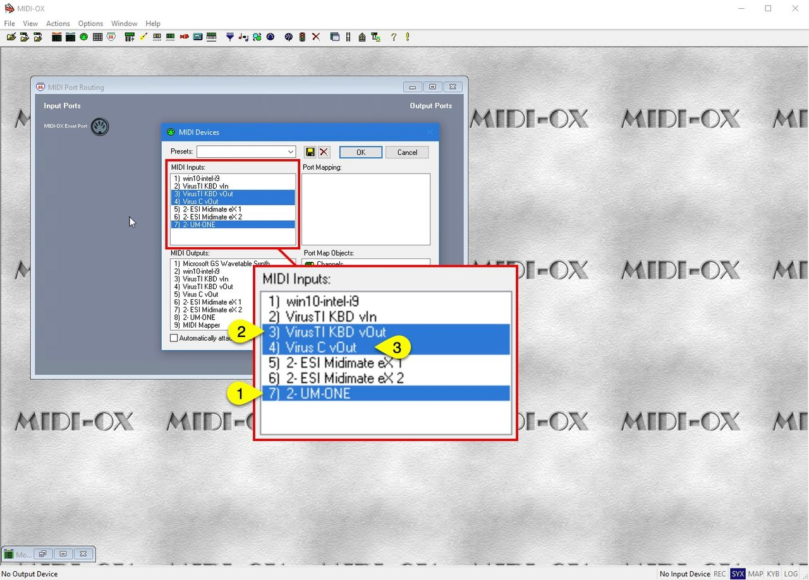

*Figure: midi-ox select input devices*

You might wonder why the “vOut” ports are opened in the INPUT area.. Once we do the routing in MIDI-OX, the port names will appear in opposite order, making it odd to choose VirusTI vOut in our DAW as a MIDI Input. That might not make sense at this point, but trust me, we’ve done this quite a few times now so follow along.

## Open MIDI Outputs

Now opening output ports is where this might get tricky. **UM-ONE [1]** is where our Virus TI Keyboard is connected. **VirusTI KBD vIn [3]** connects our Virus TI Keyboard to the DAW.

**ESI Midimate eX 2 [2]** is where your Virus C Desktop is connected.

Same rule applies here for vIn ports being opened on the opposite side. More details in the port routing section below.

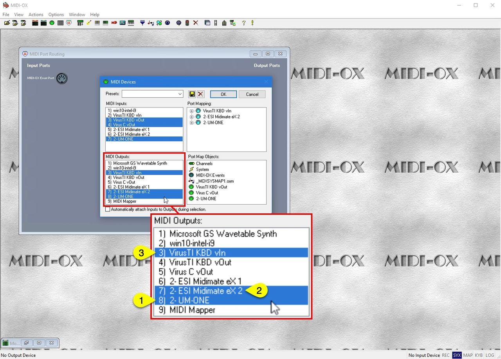

*Figure: midi-ox select output devices*

Click **OK [1]** after you have verified your port selections.

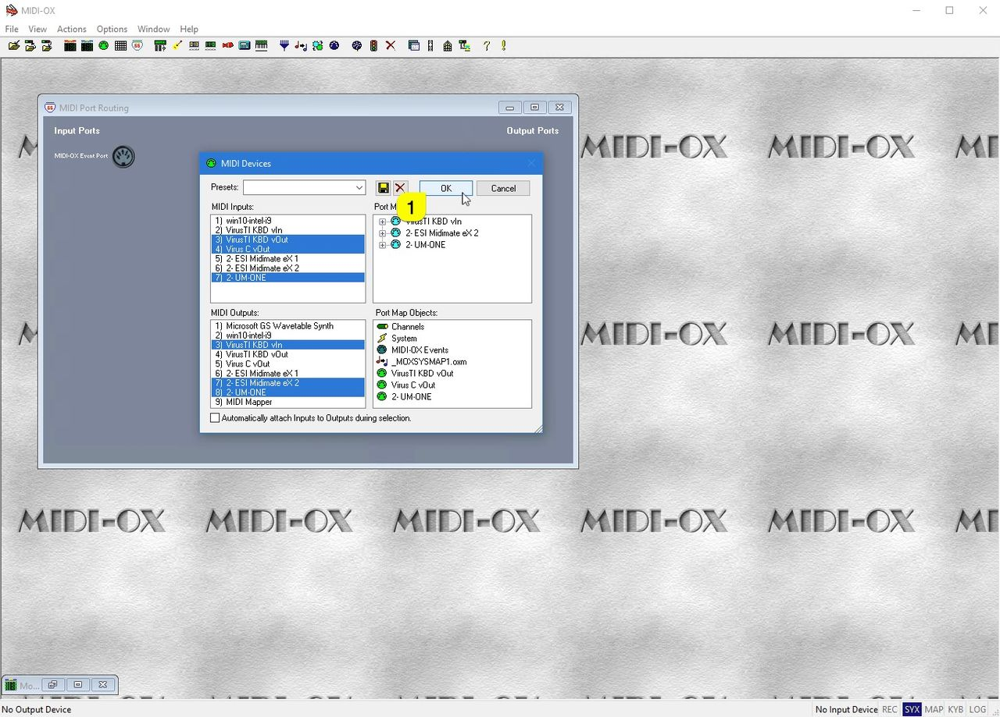

*Figure: midi-ox all done*

**NOTE:** Your MIDI input and MIDI output ports for your synth might be different to our example so we are only using them to refer where our Virus is connected.

Once the MIDI ports are defined, MIDI-OX might automatically assign “MIDI-OX Event Port” to any of the Output Ports chosen.

In case there are pre-made connections in the window, right click one of the **gray nodes [1]** in the wire and choose **Disconnect All [2]** . This will clear all the pre-made connections so we can start from fresh!

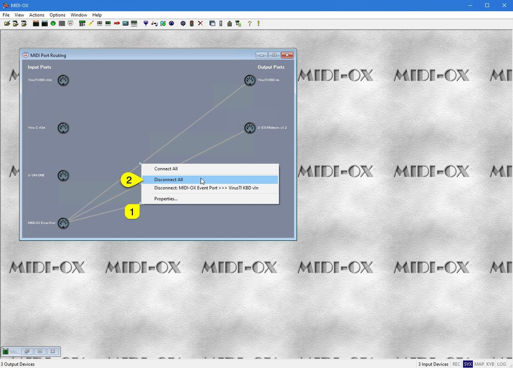

*Figure: midi-ox disconnect nodes*

## Cloning Devices (virtually)

Start by drawing the connection points from your vOut device input port to your MIDI-interface output port. Click and hold down the mouse button from **VirusTI KBD vOut port [1]** , start dragging the **cable [2]** towards your **MIDI-interface output port [3]** .

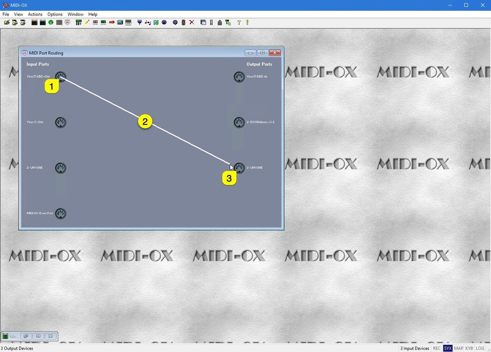

*Figure: midi-ox routing 1*

Apply the same procedure for the MIDI input port from your device towards your VirusTI KBD vIn output port. The final result should have both cables connected as seen below.

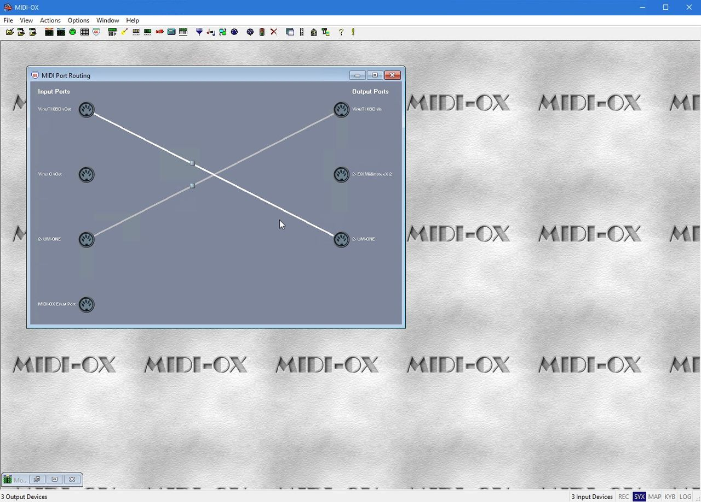

*Figure: midi-ox routing 2*

**NOTE:** In order to establish the connection, you must drag the wire on top of the MIDI plug icon!

## Filtering Virtual connection data

Next up, we will modify the connection properties so that we will block unnecessary data flow. Right click on the **gray dot [1]** at the connection to reveal the menu and choose **Properties… [2]** . You should apply this only for the physical hardware **input port [3]** .

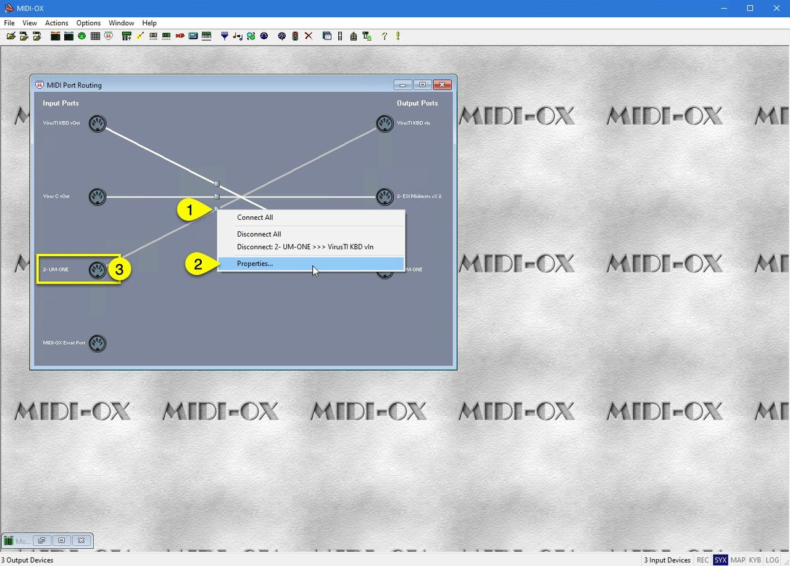

*Figure: midi-ox properties*

From the Properties window, let’s block **Common (MTC …)** , **Realtime (Clock, AS …)** and **Exclusive (SysEx)** message by unchecking the boxes in **System [1]** section.

We simply don’t need this data **unless** you send realtime clock info from your Synthesizer to the DAW!

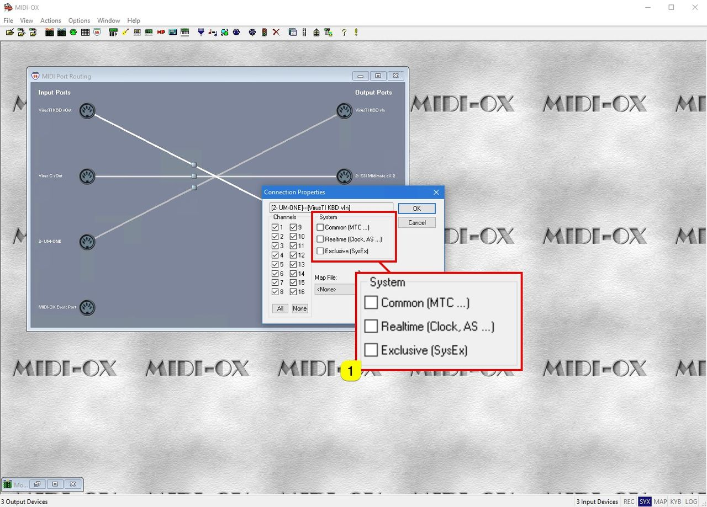

*Figure: midi-ox filters*

Click **OK [1]** to apply and close the properties window.

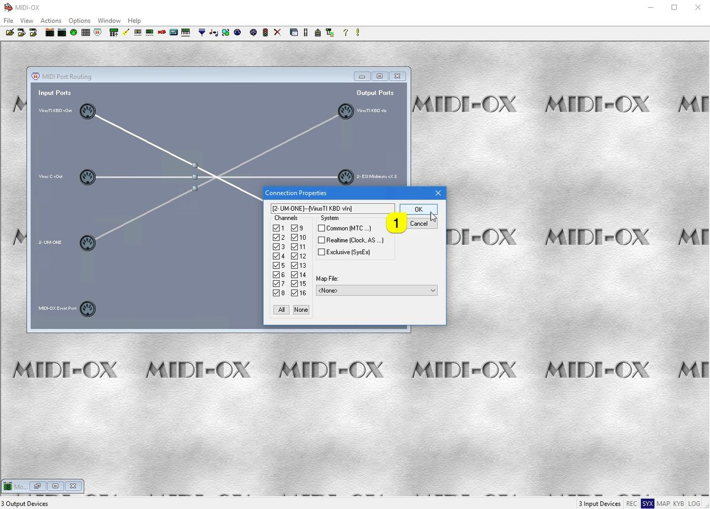

*Figure: midi-ox properties done*

## Finalize Setup

Here is our final connections:

1. VirusTI KBD vOut routed to Hardware port.
2. Virus C vOut routed to Hardware port.
3. UM-ONE routed to VirusTI KBD vIn port. (with data filter applied).

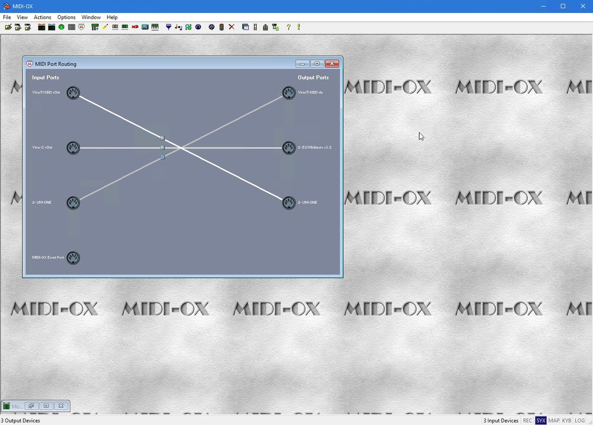

*Figure: midi-ox connections*

Now after all of the connections are done and we are ready to proceed, click the **traffic light [1]** icon in the MIDI-OX tool bar to toggle MIDI-OX in the taskbar tray.

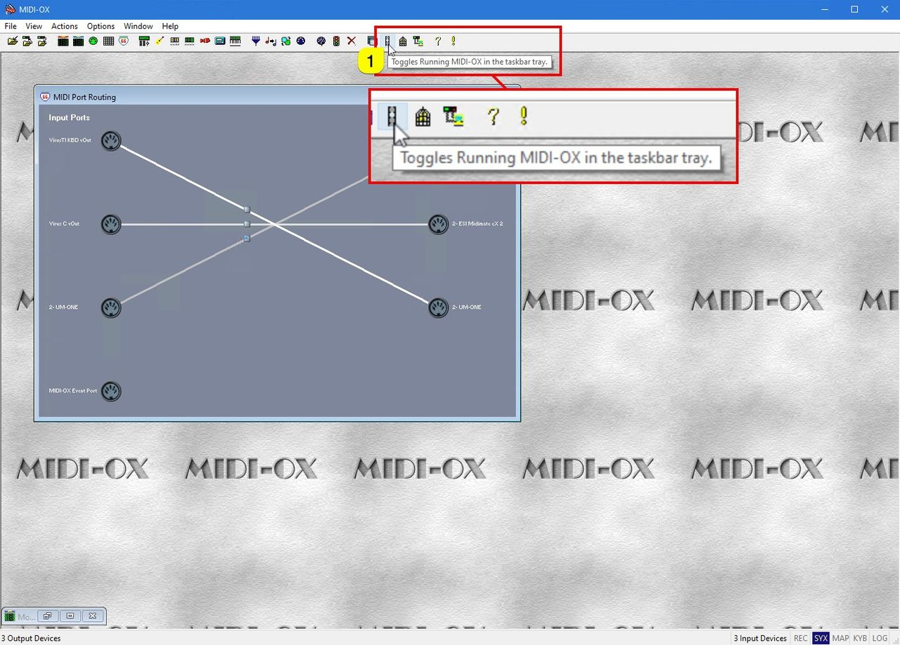

*Figure: midi-ox send to taskbar*

You can now **minimize [1]** the window so it is out of the way!

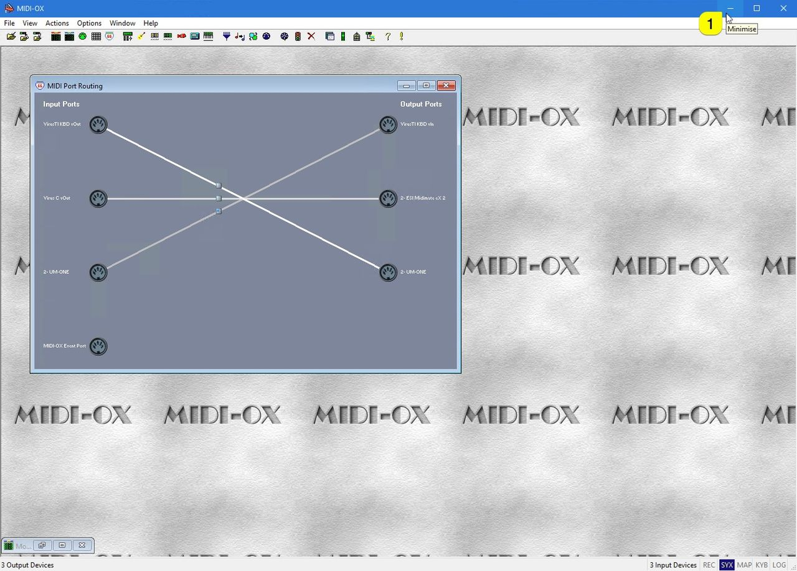

*Figure: midi-ox minimize*

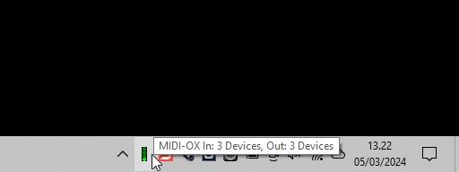

*Figure: MIDI-OX sent to taskbar tray*

**TIP** : You should be able to add MIDI-OX in the Windows start up menu so that it will launch automatically when you boot your OS. All the connections will remain, IF the MIDI Devices are connected as they were while making this guide.
