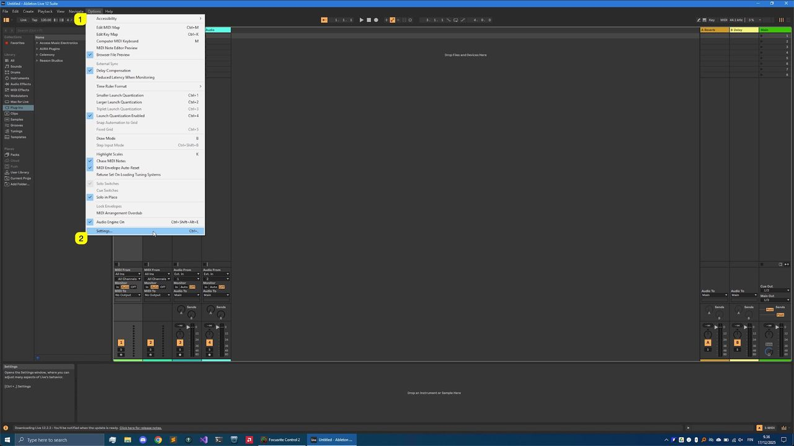
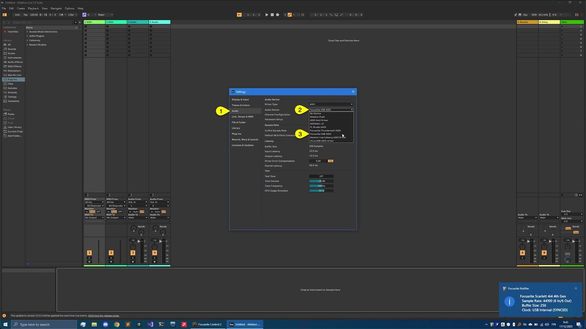
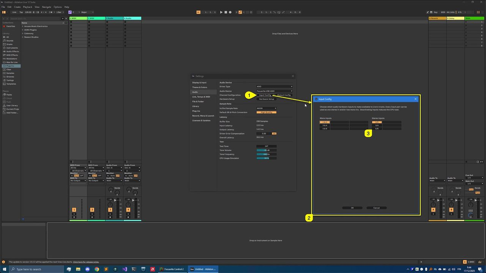
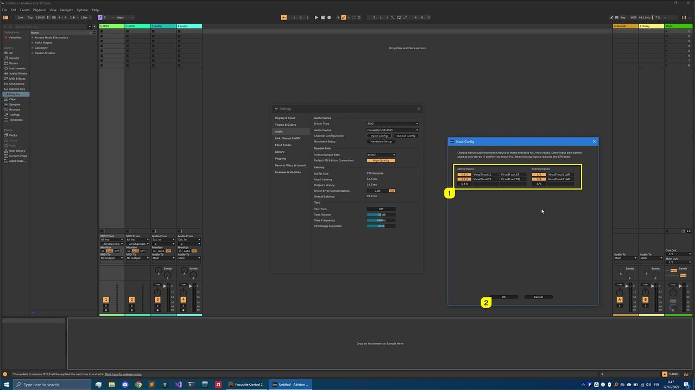
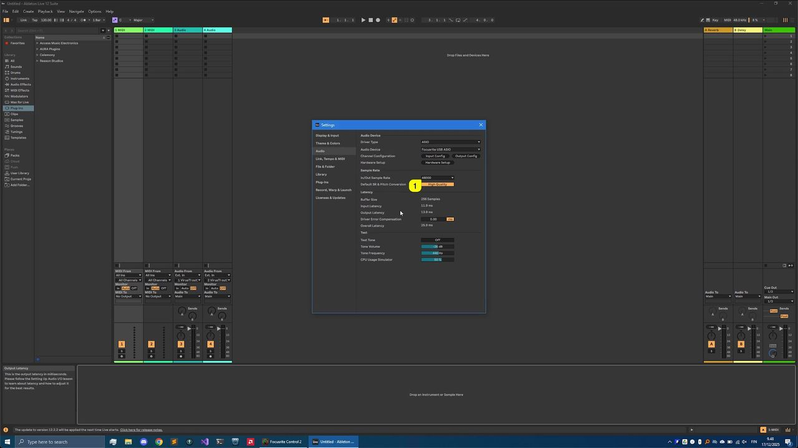
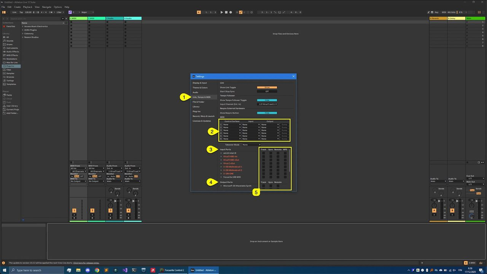
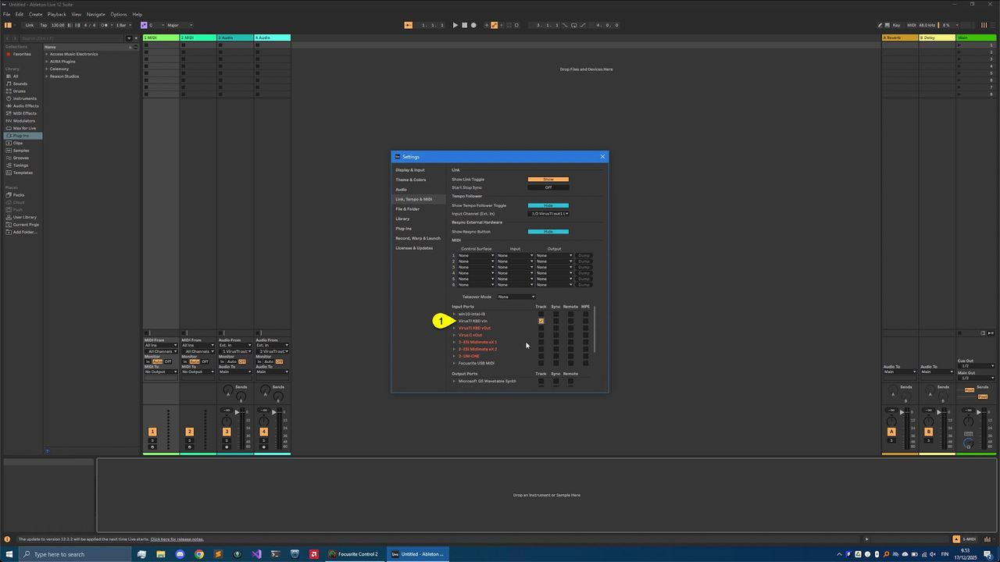
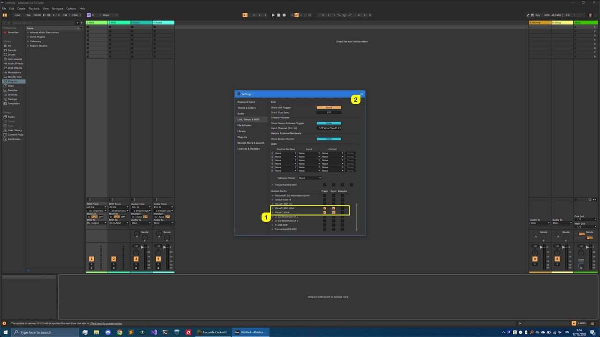

# Access Virus Editor – Ableton Live

DISCLAIMER

*Our company & product has nothing to do with Ableton AG. If there is an issue with our product, open a support ticket in your account page. You can find support details at the end of this document. Support and updates are free to anyone who has bought the license from our store*

## Audio Configuration

First, open **Ableton Live** , click **Options [1]** from the top bar and select **Preferences… [2]** – We are making adjustments to Audio and MIDI settings which are crucial for our Editor to work flawlessly.

*Figure: access virus ableton live preferences*

**Open Audio [1]** tab and select your **Audio device [2]** you use for your setup (if not set already). We are going to use **Focusrite USB ASIO [3]** .

*Figure: access virus ableton live pref audio driver*

After the Audio engine is initialized, click **Input Config [1]** . This will open a **new window [2]** with all inputs listed. **Enable input ports [3]** you use with your setup .

*Figure: access virus ableton live pref input config*

Our **input ports [1]** are now renamed accordingly. **Click OK [2]** to close the input config.

*Figure: access virus ableton live pref input rename*

Finally, adjust your **Sample Rate [1]** if needed. We are using 48000 for all projects.

*Figure: access virus ableton live pref sample rate*

## MIDI Configuration

Next we want to adjust MIDI ports and how they are shown in Live. Click on **LINK / TEMPO & MIDI [1]** to open it. Check and make sure that the hardware ports you want to use with the Editor are NOT enabled in the **MIDI Control Surfaces / Input / Output [2]** area.

Then move onto **Input Ports [3]** , **Output Ports [4]** and **disable all boxes [5]** that are directly connected to the hardware. In our case that is ESI Midimate eX and UM-ONE ports.

*Figure: access virus ableton live pref midi config*

**ATTENTION** : Our Editor uses DIRECT connection from MIDI interface to the hardware. Therefore the hardware ports need to be disabled from the DAW settings!

While we are at it, let's **enable virtual input ports [1]** created in loopMIDI / MIDI-OX guide for the Virus TI Keyboard so we can play any MIDI track in Live.

*Figure: access virus ableton live pref midi inputs*

Lets do the Output Ports: We are going to **enable virtual output ports [1]** assigned to Virus TI Keyboard and Virus C Desktop. Check “**tracking**” and “**sync**” . With sync toggled on, you can pass MIDI clock information from DAW to your hardware which is used when LFOs or Effects are clocked to incoming MIDI clock status.

Once these settings are dialed in, you can **close [2]** the preferences.

*Figure: access virus ableton live pref midi outputs*

**NOTE:** Virus TI is known to have ARP sync issues / notes drifting – This is something we can’t fix as it is a hardware issue out of our reach!
