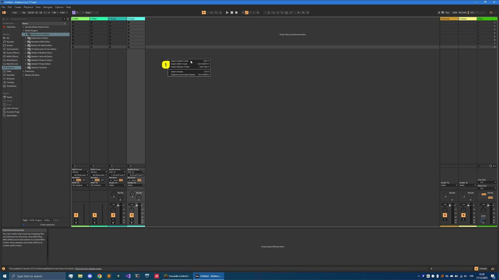
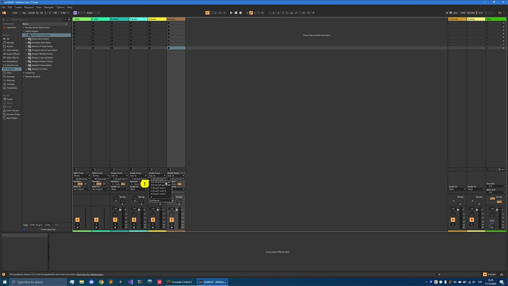
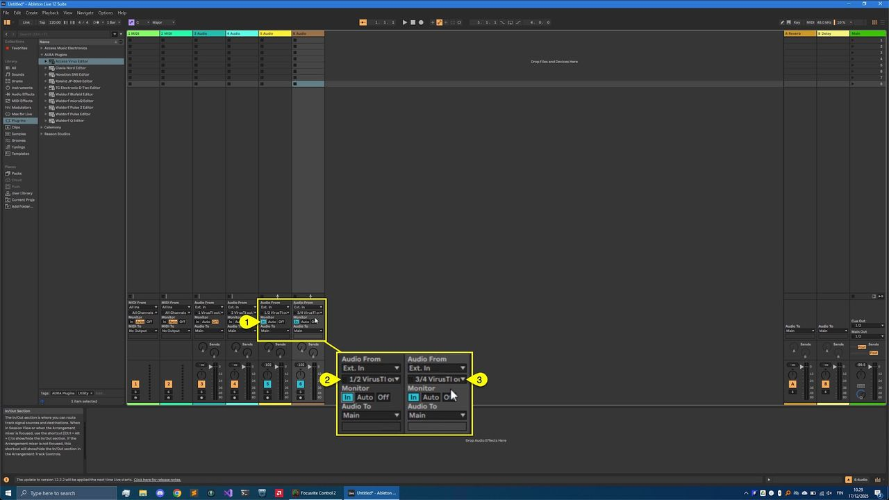
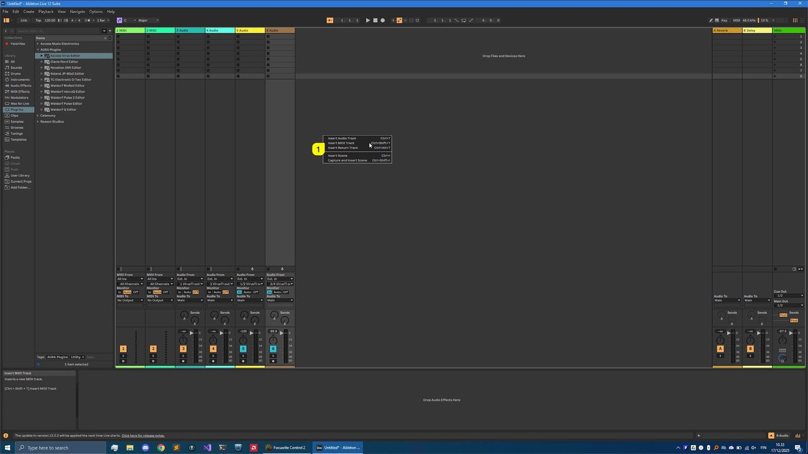
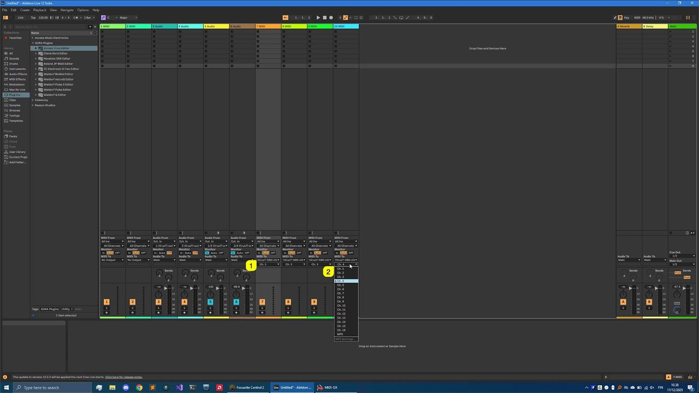
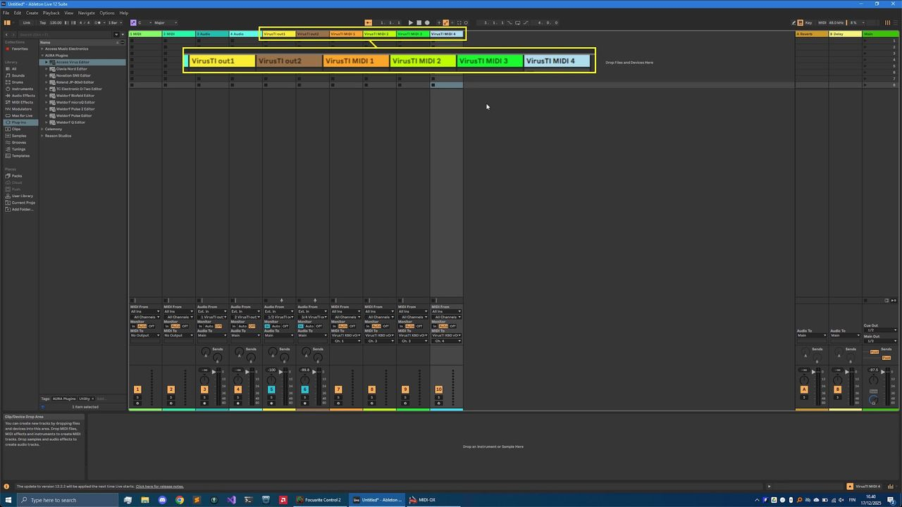

# Access Virus Editor – Creating Tracks

Before we add the Editor to the session, let's add AUDIO tracks and MIDI tracks for the Virus TI.

## Creating Audio track(s)

**Right click [1]** on the session view and select **Insert Audio Track** or use key command Ctrl+T.

*Figure: access virus ableton live add audio tracks*

I’ve added two Audio tracks since my Analog outputs 1 & 2 are routed to my soundcard inputs 1-4. Assign **input [1]** accordingly so that you get the Virus signal into Live.

*Figure: access virus ableton live select inputs*

Now you can enable **Input Monitoring [1]** to hear the Virus via Live. If you play any keys and you have your **inputs [2 & 3]** configured properly, you should get Audio in!

*Figure: access virus ableton live enable monitoring*

## Creating MIDI tracks

Now we are ready to create MIDI tracks which we are going to use for making sequences

**Right click [1]** on the session background and select **Insert MIDI Track** to create MIDI tracks or use Ctrl+Shift+T key combination.

*Figure: access virus ableton live add midi tracks*

I have added 4 MIDI tracks to my session for the Virus. Assign MIDI output port to **virtual Virus port [1]** for all MIDI tracks just created. Make sure each of the MIDI tracks have a unique **MIDI channel [2]** so that you don’t get double events.

*Figure: access virus ableton live midi channels*

## Renaming tracks for clarity

To finalize this part of configuration, rename tracks as you prefer. Here is a screenshot how we’ve done it

*Figure: access virus ableton live rename tracks*

Now we are ready to add the Editor (finally huh?!)
