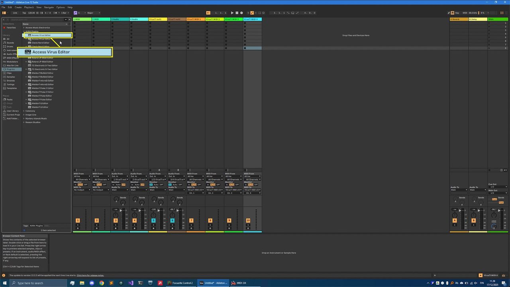
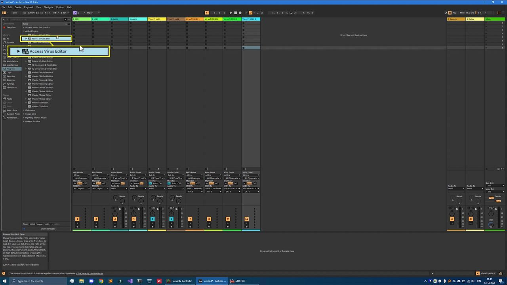
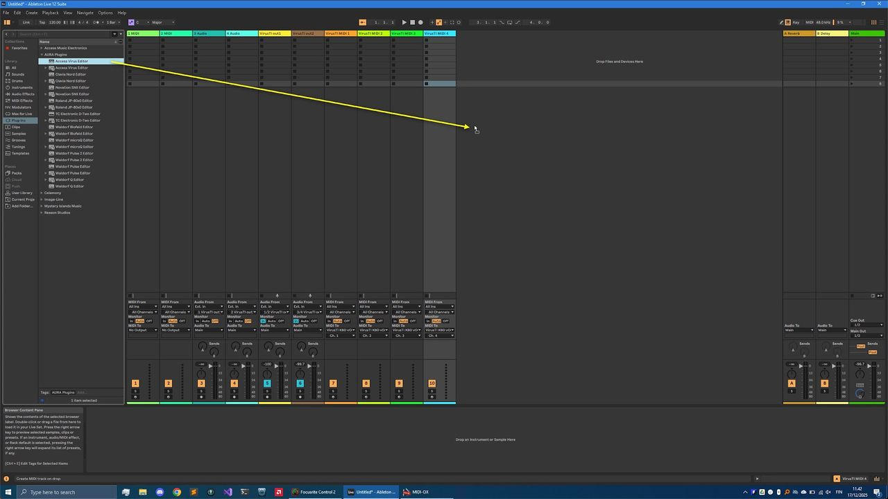
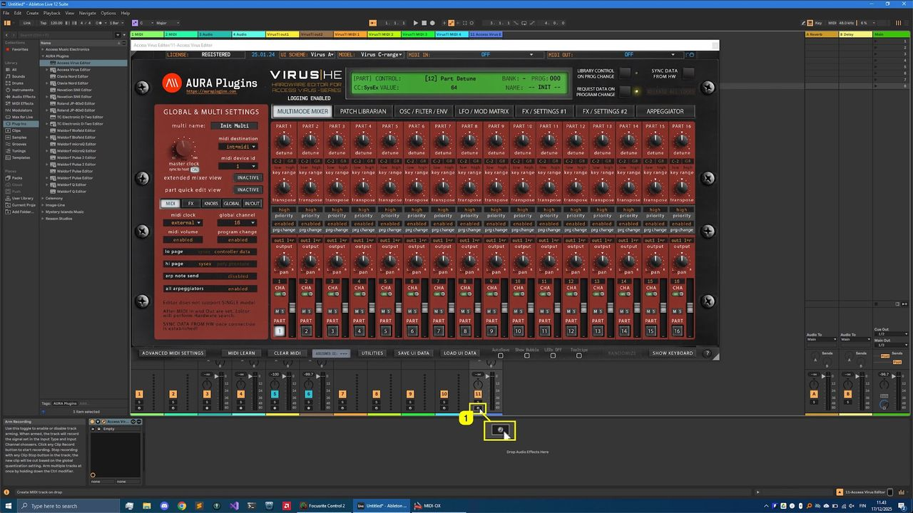
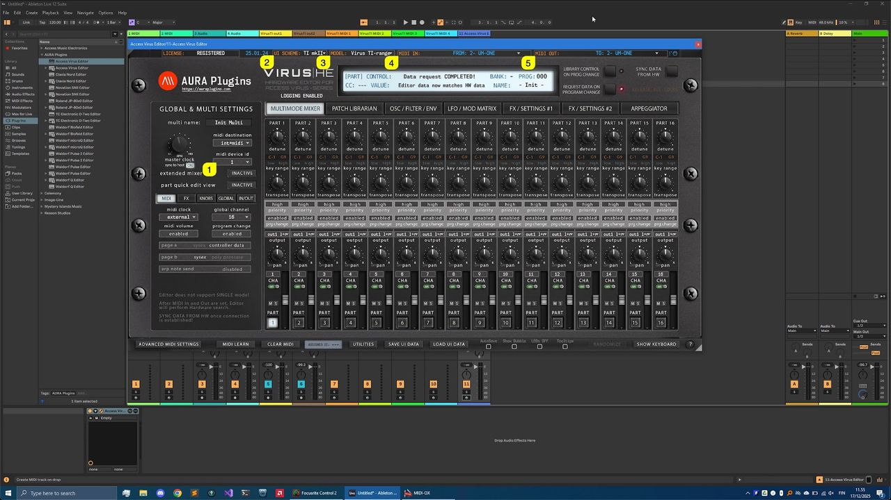
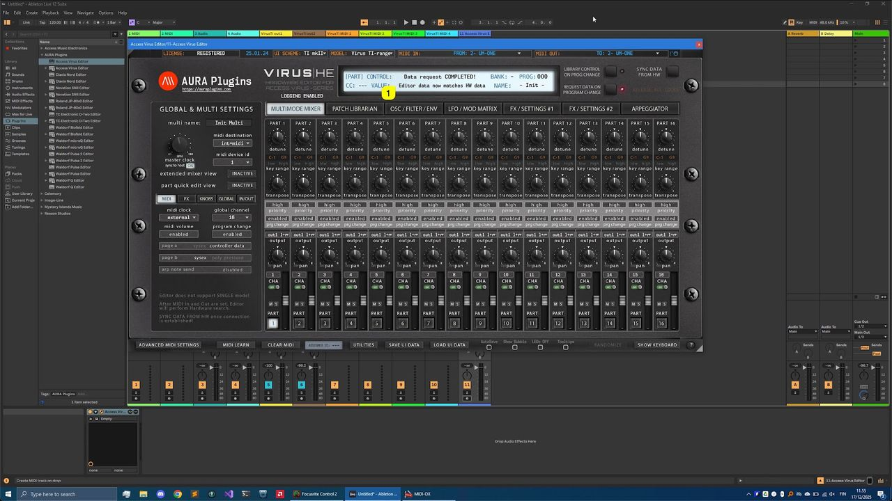

# Access Virus Editor – Insert Plug-in in Live

## VST2 (legacy)

You have the option to use the legacy VST2 format if you wish to do so. We would recommend using VST3 for parameter automation simplicity and it has a modern SDK (developer framework) under the hood. VST3 MIDI integration isn’t that great, but we can’t fix that.

You can find the VST2 version from the **VST -> AURA Plugins** folder.

*Figure: access virus ableton live vst2 plugin*

## VST3

You can find the VST3 version from **VST3 -> AURA Plugins** folder. In this guide, we are using VST3

*Figure: access virus ableton live vst3 plugin*

## Insert the plug-in to Empty track

Drag the Editor to the **empty area** in your Live session view.

*Figure: access virus ableton live add vst2*

Once the Editor is added to Live, the User Interface will open with Default settings. You should **disable arm record [1]** toggle, before you start messing around with the Editor!

*Figure: access virus ableton live disable arm record*

## Configuring Editor

BEFORE setting the MIDI ports, **double check the DeviceID** setting in your Virus and make sure it matches with the **Editor DeviceID [1]** . Next you can choose a different **User Interface scheme [2]** and your **hardware model [3]** .

**Set MIDI IN [4]** and **MIDI OUT [5]** ports to match the ones used with your MIDI Interface. In our example Virus TI is connected to the Roland UM-ONE mkII MIDI interface.

*Figure: access virus ableton live configure editor*

## Data request COMPLETED

If everything was set up correctly, you should see the **Data request COMPLETED! [1]** text in the Editor User Interface.

This means our Editor has requested global settings and 16 individual parts from the Virus hardware to the User Interface.

*Figure: access virus ableton live data request completed*

Check Main Functions and Librarian guides to learn more about the Editor usage.
