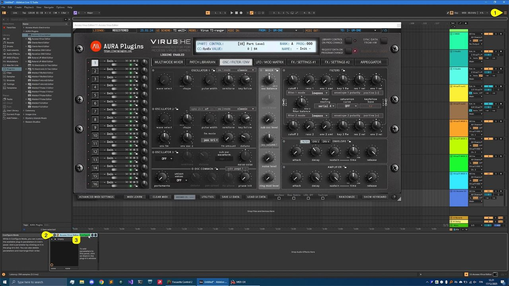
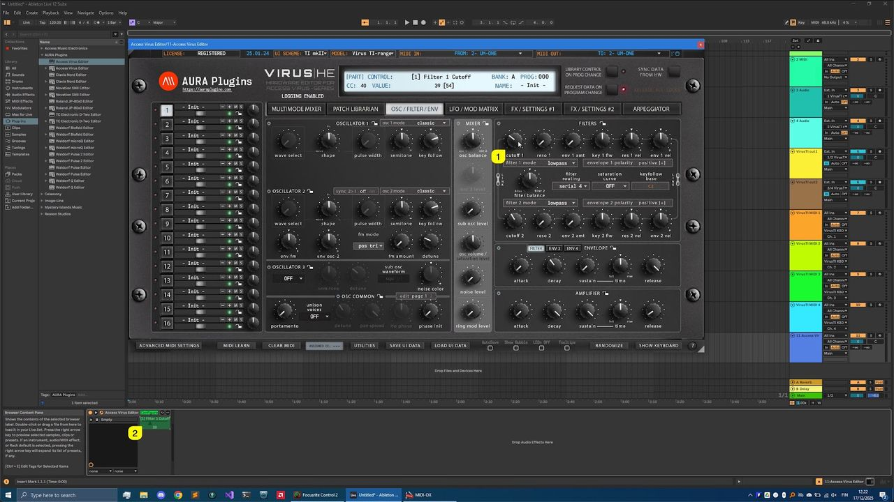
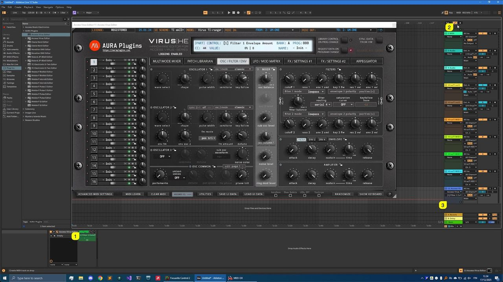
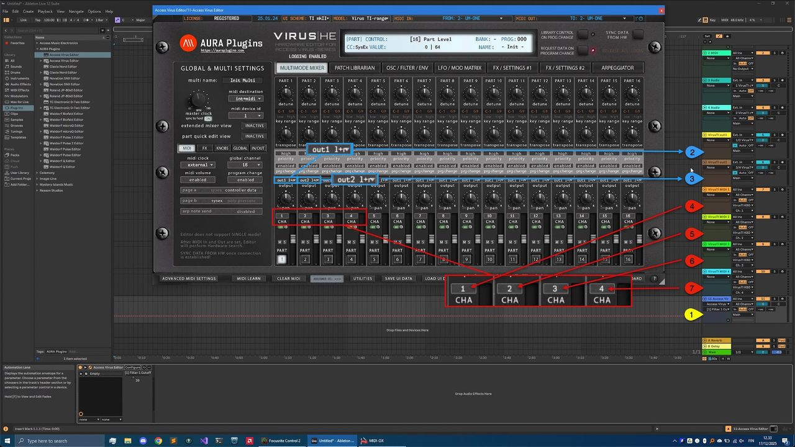

# Access Virus Editor – Automation in Live

## Learning Parameters for Automation

You can automate almost every parameter of your Virus with our Editor in DAW without having to remember CC numbers or have spread sheets constantly open on your screen.

**Click toggle [1]** to view the arrangement view. Now click the **Unfold Device Parameters [2]** button and enable **Configure [3]** so we can map the parameters we want for automation.

*Figure: access virus ableton live automation config*

**NOTE:** Parameters sent as **MIDI CC** can be automated smoothly. Automating **SysEx**-based parameters may make the Editor user interface or your DAW sluggish. We are looking into the cause. If you need to automate a SysEx parameter, automate a MIDI controller that the Virus accepts as a modulation source instead (for example Mod Wheel, Breath, Expression or Controller 12–16), and route it to that parameter in the Virus Mod Matrix (ASSIGN slots on Virus A, B and C; Matrix slots on Virus TI). See your Virus hardware User Manual for the Mod Matrix steps.

Now if you move parameters from the **Editor User Interface [1]** or Hardware, Live will register the **parameters [2]** .

*Figure: access virus ableton live learn parameters*

Once you have all the parameters learned that you need, click **Configure [1]** again to finish parameter assignments. Now if you toggle on **Automation [2]** , all of the parameters you assigned in Configuration mode will be shown in the **Editor track [3]** in Live.

*Figure: access virus ableton live view automation*

## Closure

Here is a summary of what is happening in Live now that everything is configured as they should be!

- **[1]** Track hosting our Editor.
    - Ideal for automation,
    - Patch change and value edits per layer,
    - Librarian Edits,
    - and Total Recall : Data is sent to hardware automatically when the project is loaded.
- **[2 & 3]** Stereo Audio tracks.
    - Audio Inputs from Virus out1 **L&R [2]** selected as source of audio.
    - Audio Inputs from Virus out2 **L&R [3]** selected as source of audio.
    - Input Monitoring is toggled on so that we can hear everything happening with the Virus.
- **[4 – 7]** MIDI tracks assigned to VirusTI KBD vOut Port.
    - MIDI channel is set to 1 **[4]** .
    - MIDI channel is set to 2 **[5]** .
    - MIDI channel is set to 3 **[6]** .
    - MIDI channel is set to 4 **[7]** . Now if we take a look at the Editor MIDI channels in the MULTIMODE MIXER area, we can see that channel 1 is assigned to Part 1 etc.
    - Best use for sending DAW clocked / timed MIDI notes to hardware.

*Figure: access virus ableton live summarum*

Check the rest of the Editor Functions from the Main Functions and Librarian sections.

If you have trouble with the Editor setup / configuration, check the troubleshooting section.
