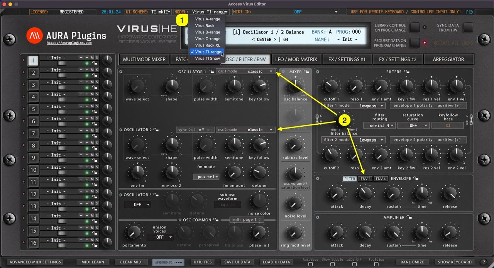
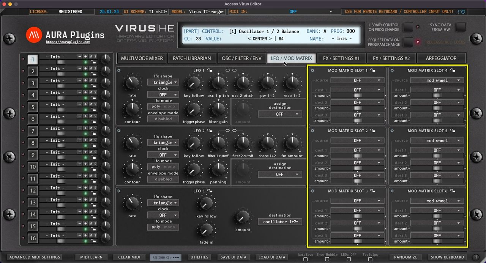
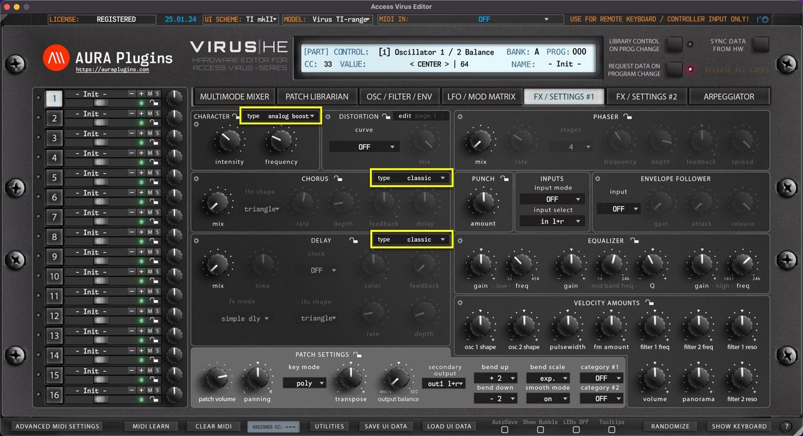
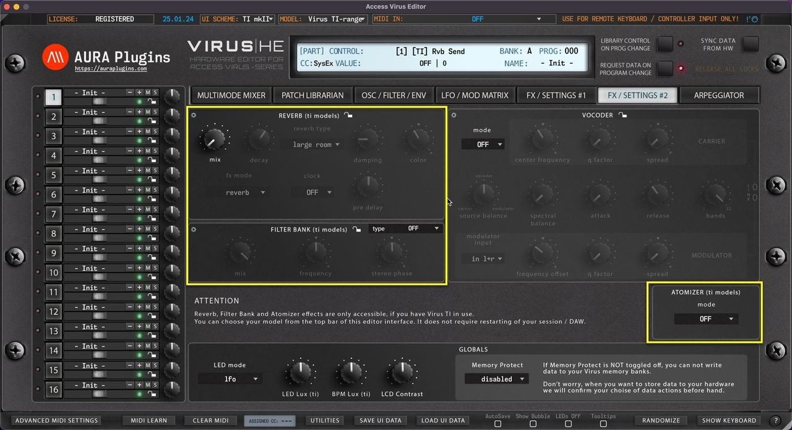
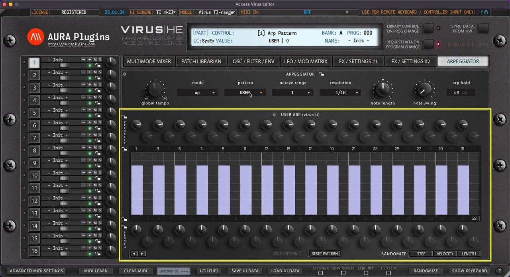

# Access Virus Editor – Model Comparison Chart

## HARDWARE DIFFERENCES

To understand how the menus work in Access Virus Editor, you need to understand the differences between the hardware models. Virus A – B/C – TI each have a unique sound.

Here are the key differences:

```
Spec         | A   | B/KB/Indigo/Classic | Rack | C/KC/Indigo2 | RackXL | TI/TI2-series | TI Snow
Polyphony    | 12  | 24                  | 16   | 32           | 32     | ~80/80+       | ~50
Parts        | 16  | 16                  | 16   | 16           | 16     | 16            | 4
Oscillators  | 2   | 3                   | 2    | 3            | 3      | 3             | 3
Envelopes    | 2   | 2                   | 2    | 2            | 2      | 4             | 4
LFOs         | 2   | 3                   | 3    | 3            | 3      | 3             | 3
FM Modes     | 1   | 5                   | 1    | 5            | 5      | 5             | 5
Mod
Sources      | 3   | 3                   | 3    | 6            | 6      | 6             | 6
Mod
Destinations | 6   | 6                   | 6    | 9            | 9      | 18            | 18
EFFECTS
EQ           | –   | –                   | –    | +            | +      | +             | +
Phaser       | –   | +                   | +    | +            | +      | +             | +
Chorus       | 4   | 16                  | 16   | 16           | 16     | 16            | 16
Analog Boost | 16  | 16                  | 16   | 16           | 16     | 16            | 16
Ring Mod     | –   | +                   | +    | +            | +      | +             | +
Rvb / Dly    | –/+ | +/+                 | +/+  | +/+          | +/+    | -/-           | -/-
Part Delay   | –   | –                   | –    | -            | -      | +             | +
Part Reverb  | –   | –                   | –    | -            | -      | +             | +
Filter Bank  | –   | –                   | –    | -            | -      | +             | +
Atomizer     | –   | –                   | –    | -            | -      | +             | +
HARDWARE
Outputs      | 6   | 6                   | 4    | 6            | 6      | 6+USB         | 2+USB
Inputs       | +   | +                   | +    | +            | +      | +             | +
Keyboard     | –   | KB, Indigo          | –    | KC, Indigo2  | –      | TI Kbd, Polar | –
```

## ADDITIONAL VIRUS TI MENUS, BUTTONS AND FUNCTIONS

When you have Virus TI synth in use, there are extra menus, buttons and features shown in the user interface. Select **Virus TI [1]** as your model and **new items [2]** will be updated to the user interface.



*Figure: oscillators tab*

## Mod Matrix

LFO / Mod Matrix tab has all the mod matrix destinations enabled for TI models.



*Figure: matrix tab*

## Effects 1

FX / Settings #1 tab has few changes: Character has different types, Chorus has different types and Delay area is dedicated only for Delay with different delay types.



*Figure: effects 1 tab*

## Effects 2

FX / Settings #2 tab has Reverb, Filter Bank and Atomizer enabled.



*Figure: effects 2 tab*

## Arpeggiator

The Arpeggiator tab has USER ARP editor functioning.



*Figure: arpeggiator tab*

## Loading patches between different models?

You can load single patches created on either model. When Virus TI patches are loaded to older Virus models, special features like OSC MODEs, FX and ARPs are adjusted to comply with pre-TI model specs.
