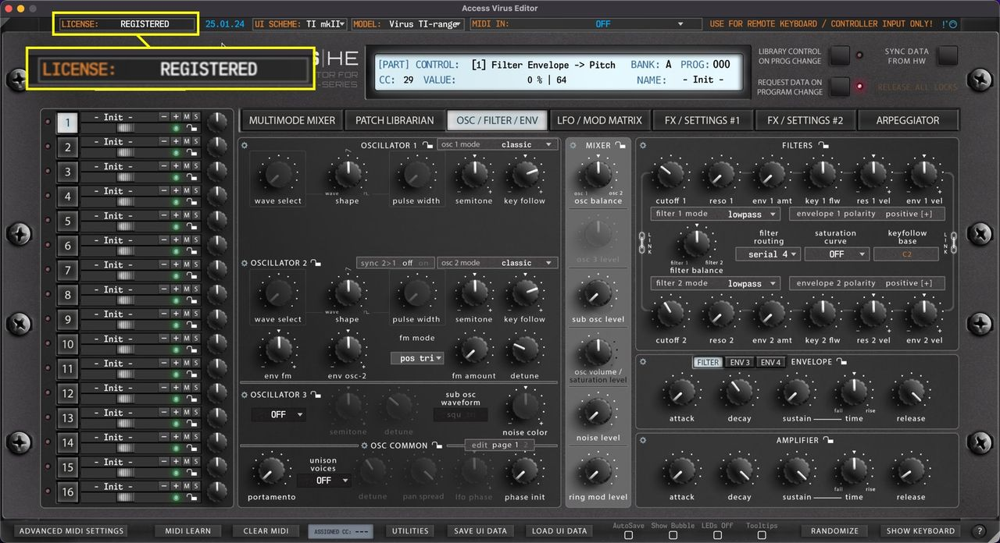
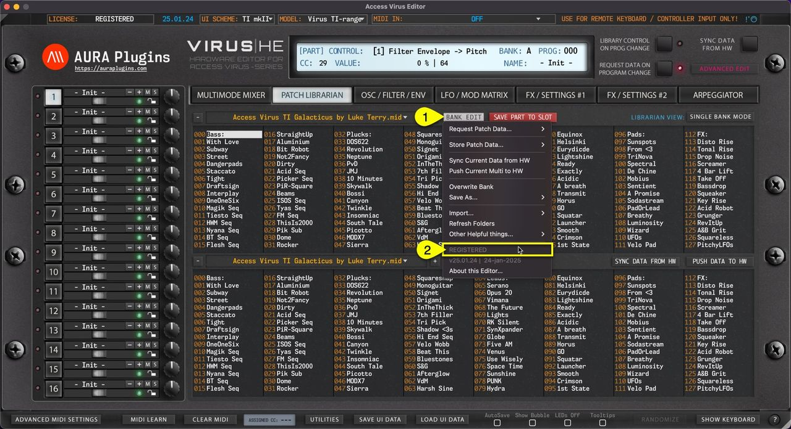

# Access Virus Editor – How To Check License Status

Displays current state of the Editor license. If DEMO version is installed, then display will show \*\*DEMO VERSION\*\*.

If the Full version is installed, then you will see RELOAD LICENSE or REGISTERED if license is applied. To learn more about registering our Editor, please use search above to find what you’re looking for.

*Figure: how to check license status from the top bar*

Editor license status is also shown in the PATCH LIBRARIAN tab if you click **Bank Edit [1]** menu. **Status [2]** is shown here.

*Figure: how to check license status from bank edit menu*
