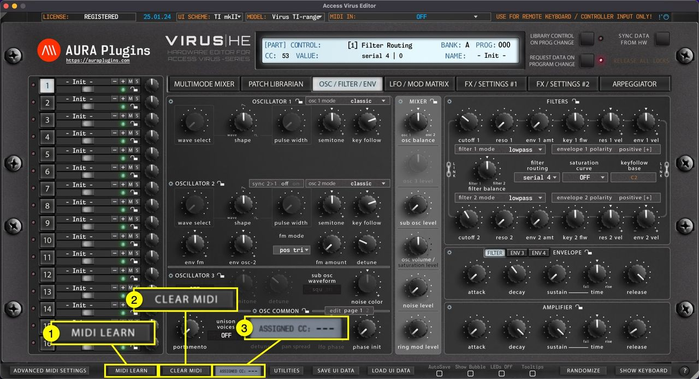
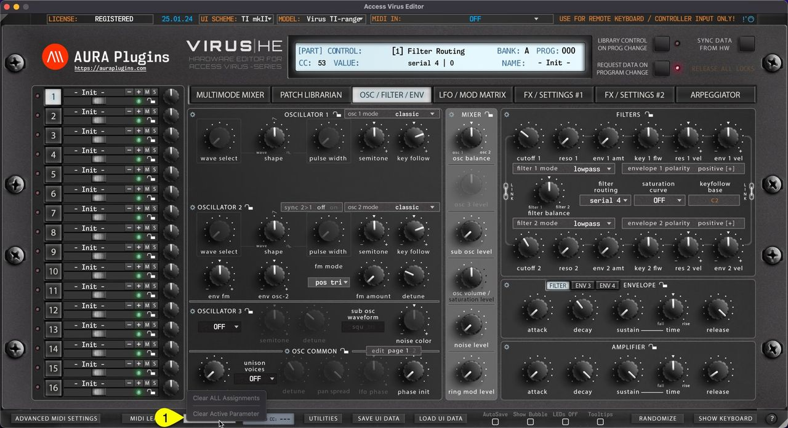

# Access Virus Editor – How To Use MIDI Learn

## MIDI LEARN (Map External Controller)

**MIDI LEARN [1]** allows you to map incoming MIDI CC control messages to certain controls of the Editor.

To activate MIDI LEARN, toggle on the button and follow instructions given in the Editor display.

- Move a knob or button on the Editor user interface.
- Move your remote controller slider, knob or button to assign CC.
- Toggle off **MIDI LEARN [1]** once completed.

Use the **Clear MIDI [3]** button to remove assignments. More details below.

The editor has an **Assigned CC [3]** display in the bottom bar to help you see what controller has been assigned to a selected parameter.

*Figure: how to use midi learn - toggles*

## CLEAR MIDI (mappings)

**CLEAR MIDI [1]** opens a popup menu, where you can choose to **Clear All Assignments** at once, or **Clear Active Parameter** to remove assignment for set parameter. Active parameter is the knob / button / menu you have last clicked from the Editor user interface.

*Figure: how to use midi learn - clear mappings*

Both options are greyed out in the sample, because there are no assignments for set parameter.
