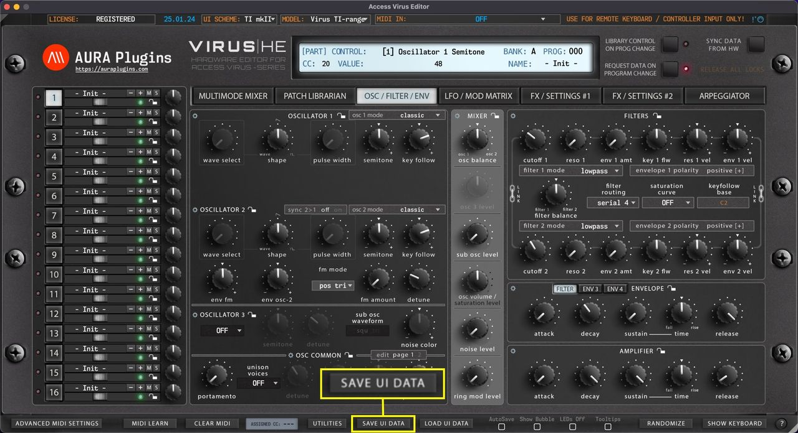
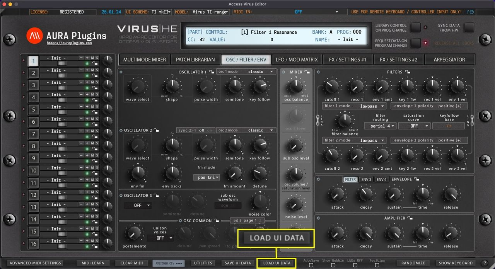

# Access Virus Editor – How To Save and Load UI Data

**Save UI Data** saves all the Editor settings in a single file, including global, multi and individual part settings.

This is the best option to back up your favorite settings per project and it gives you portability to share your settings with someone else, or use the saved data in other projects.

*Figure: how to save and load ui data 1*

**Load UI Data** loads all the Editor settings from a single file, including global, multi and individual part settings.

Once loading is completed, data will be automatically transmitted over to the Virus temp buffer. You can load any UI Data saved with previous sessions.

*Figure: how to save and load ui data 2*
