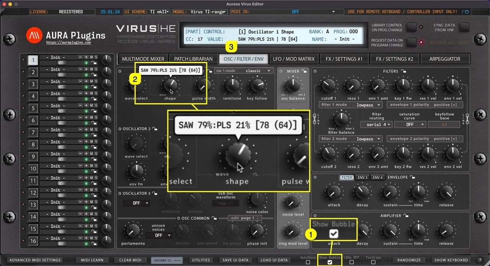

# Access Virus Editor – How To Use Show Bubble Function

**Show Bubble [1]** does what it says, when the parameter is adjusted with the mouse, a **bubble [2]** will pop up above the parameter displaying the parameter value as you change it. You can also see the parameter name and value in the **Editor control display [3]** .

*Figure: how to use show bubble function*
