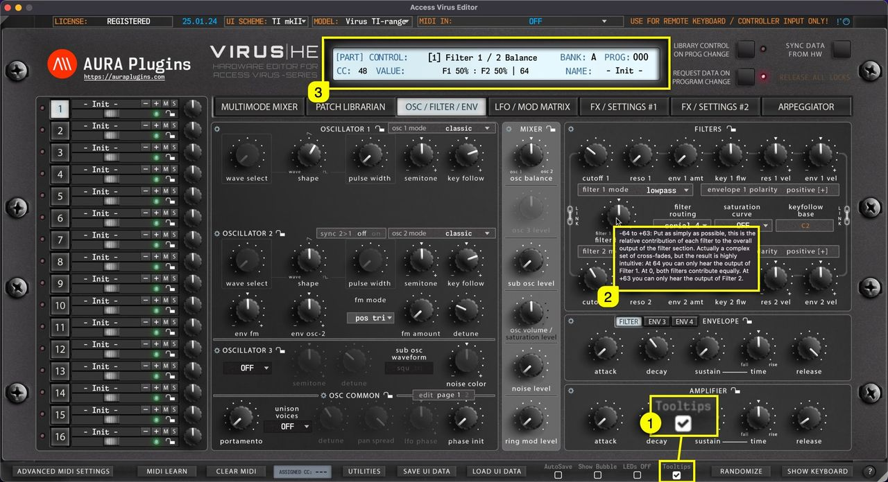

# Access Virus Editor – How To Display Parameter Tooltips

**When Tooltips [1]** is toggled on, **tooltip text [2]** will appear if you hold your mouse cursor steadily over the parameter. You also get parameter info displayed in the **Editor control display [3]** while hovering over parameters, like CC number assigned by default, parameter name and the current value.

*Tooltips are courtesy of Access Music GmbH and more details can be found from the Virus User Manual.*

*Figure: how to display parameter tooltips*
