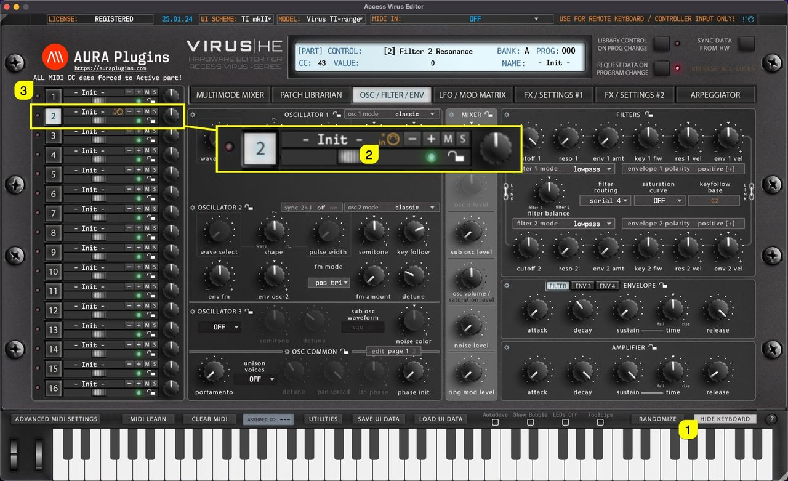

# Access Virus Editor – How To Show Keyboard (Part Focus)

Toggle on **SHOW KEYBOARD [1]** to display “on-screen” keyboard, **Pitch Wheel [2]** and **Modulation wheel [3]** . You can play individual keys with mouse click or you can use your computer “QWERTY”-keyboard, in other words: normal typing keyboard to play in notes.

Keyboard also features velocity sensitivity when played with a mouse.

- If you click closer to the “root” **[4]** of the key, the lower velocity input is given.
- If you click closer to the “end” **[5]** of the key, the higher velocity input is given.

*Figure: Screenshot*

Use keys **A, W, S, E, F, T, G, Y, H, U, J, K, O, L** to play the keyboard.

Use keys **Z** and **X** to adjust the octave range.

## SHOW KEYBOARD & PART FOCUS

When **SHOW KEYBOARD [1]** is toggled on, the Editor will focus all incoming MIDI data to the currently selected Part. Now when Part 4 is selected you see a **DIN indicator [2]** in set part warning that all MIDI is routed to part 4. You can also see a **text entry [3]** indicating that part focus is on!

*Figure: how to show keyboard (part focus)*

**NOTE:** When DAW playback is on, MIDI data is transmitted normally per part.
