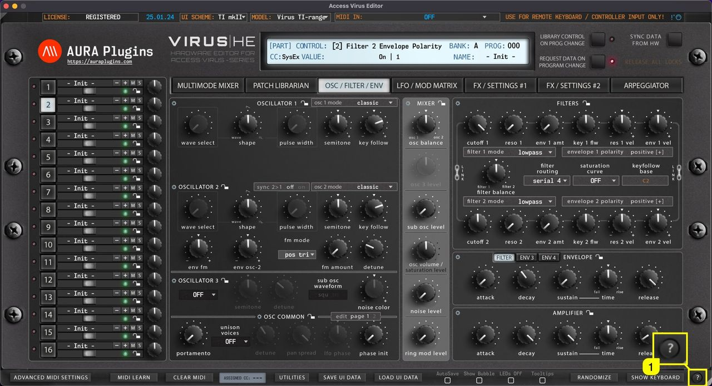
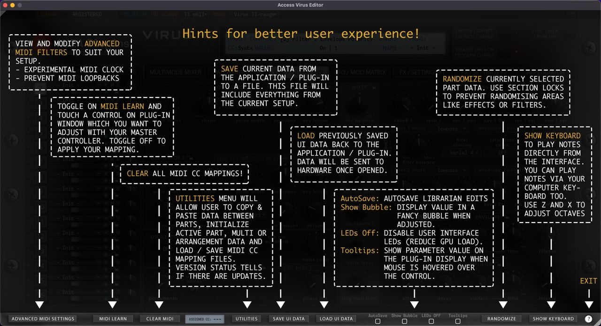

# Access Virus Editor – How To Show Quick Help

Get quick tips of the bottom bar functions when you click the **? [1]** mark in the bottom bar.

*Figure: how to show quick help - action toggle*

Use the same button to close the quick tips view.

*Figure: how to show quick help - quick tips*
