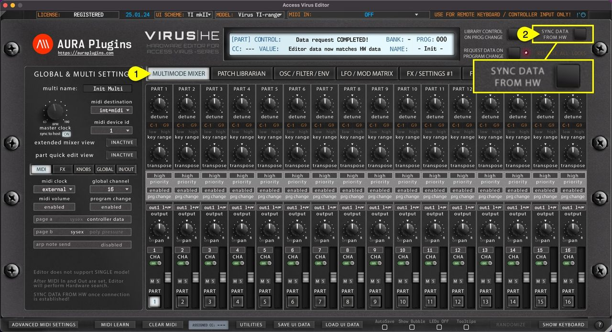
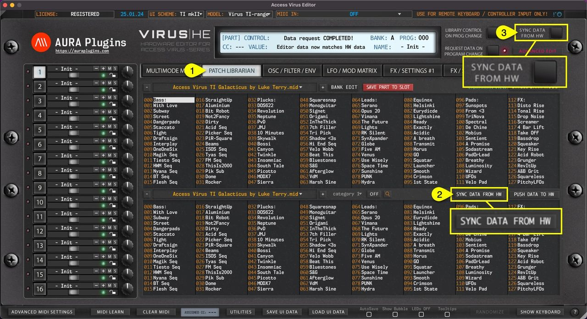
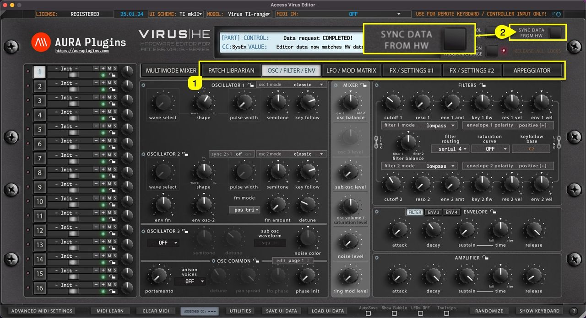
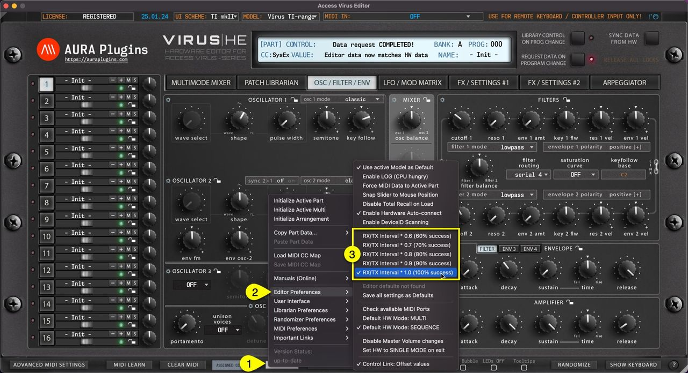

# Access Virus Editor – How To Sync Data From Hardware

## Multi data and individual parts

## Method #1

If **MULTIMODE MIXER [1]** view is toggled on, **Sync Data from HW [2]** button will request **MULTI** data and individual parts to the user interface like discussed earlier. This will take some time depending on the selected Virus model. Virus TI and Virus TI Snow requests take a bit longer due to differences in the data package. Virus TI USB sync is much slower than DIN sync.

*Figure: how to sync data from hardware - multi and parts*

## Method #2

If **PATCH LIBRARIAN [1]** view is toggled on, **Sync Data from HW [2]** button will request MULTI data and individual parts to the user interface just like the previous method. Data mode change doesn’t have a play here. **Sync Data From HW [3]** button will request single data to the selected part.

*Figure: how to sync data from hardware - data request via librarian*

## Individual Parts

You can also make a quick request for individual parts when the **TAB [1]** button is toggled between PATCH LIBRARIAN -> ARPEGGIATOR**. Sync Data from HW [2]** will request data from the currently selected part.

*Figure: how to sync data from hardware - sync single parts*

**TIP** : Be patient and do not disturb the data flow with any knob movements or so. This will ensure the data packages are being sent and received as expected and you are not going to receive any SysEx error messages!

If you feel like your MIDI device can do faster requests than what we have set, you can try to play around with the Request Interval multiplier. **Open Utilities [1]** menu, select **Editor Preferences [2]** and select first value from the **options [3]** available. The editor will automatically increase the value if it experiences drop-outs during the request process.

*Figure: how to sync data from hardware - sync settings*
