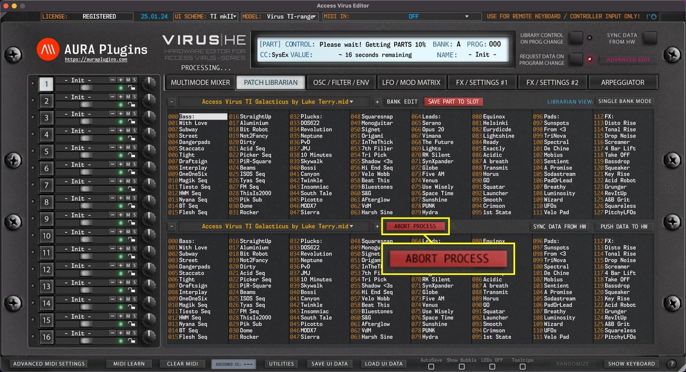

# Access Virus Editor – How To Abort Processes

Cancel current request / writing task by clicking **ABORT PROCESS** button, if the process is taking too long, or if you get constant Device ID checks while any data request is active.

*Figure: how to abort processes*

The Abort Process button will disappear after the Editor has scanned Device IDs and/or if the request process has timed out.
