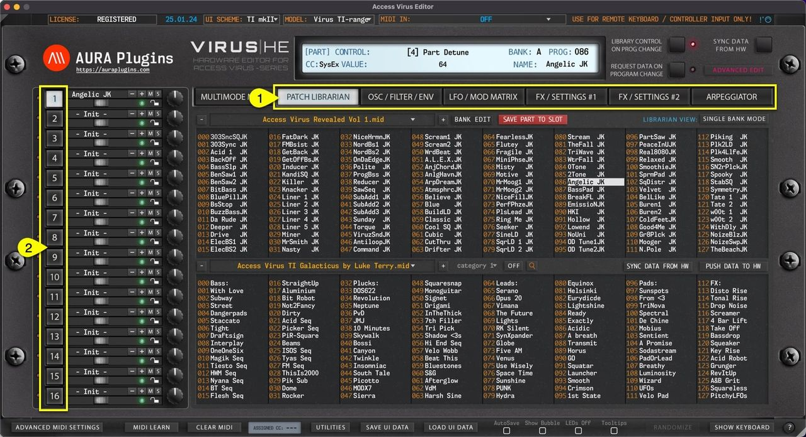
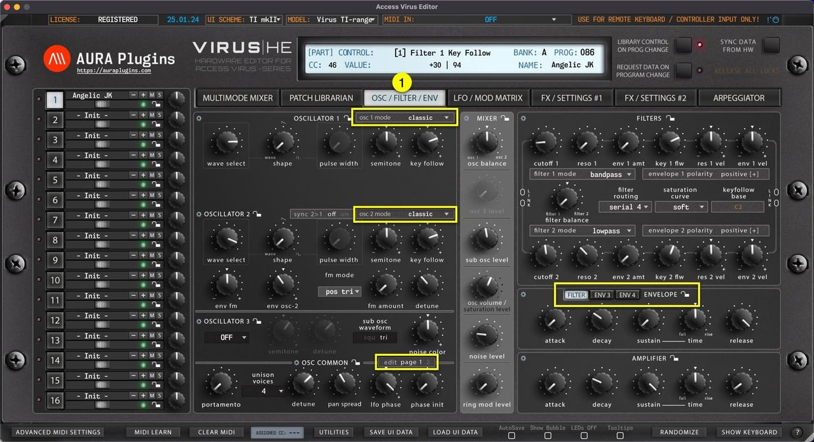
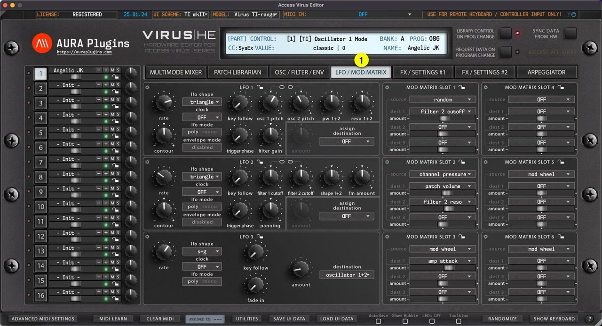
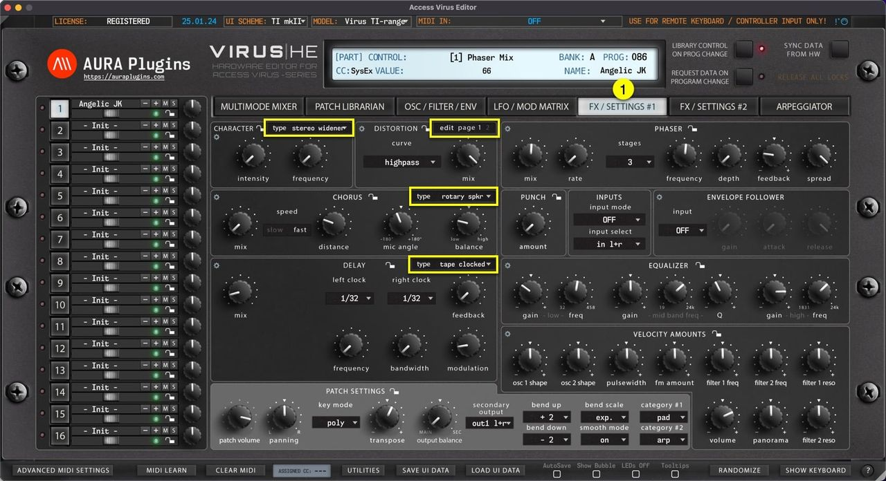
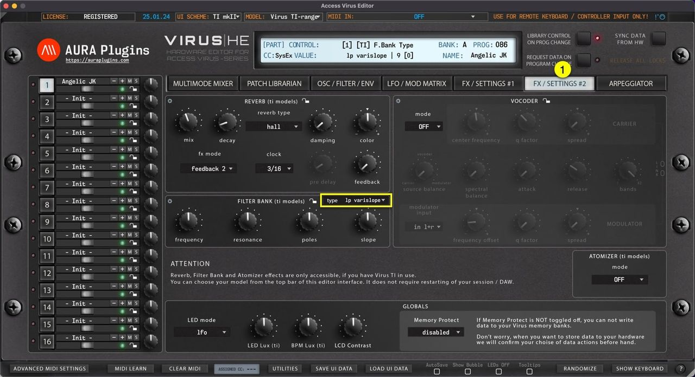
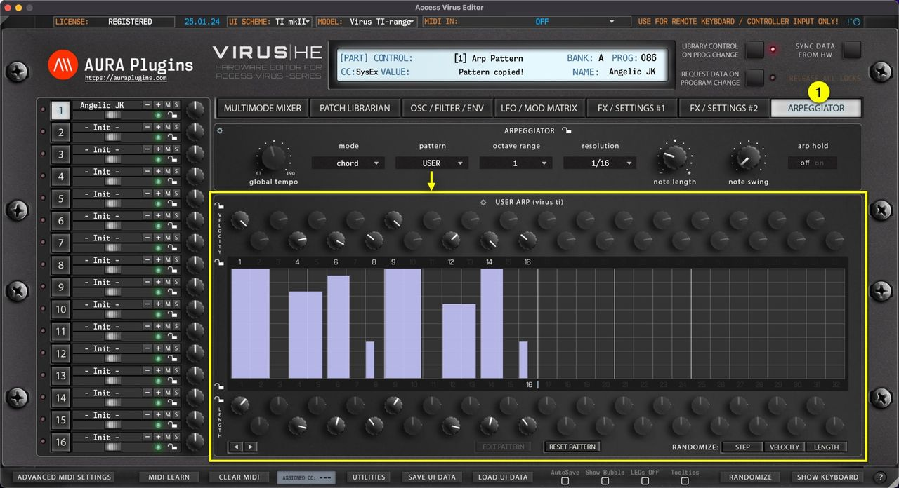
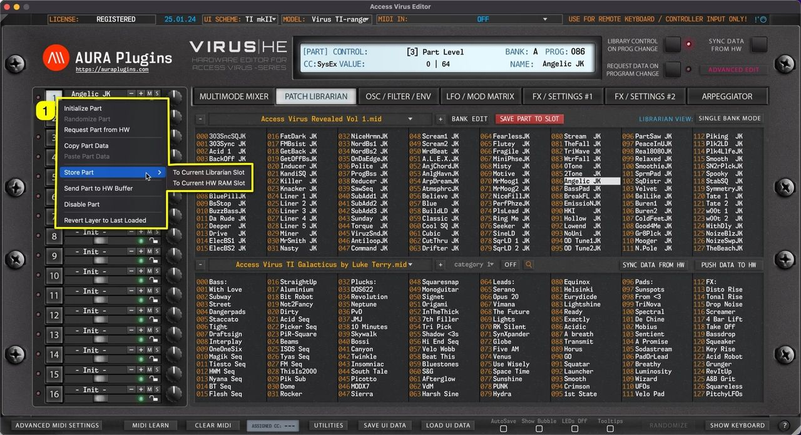
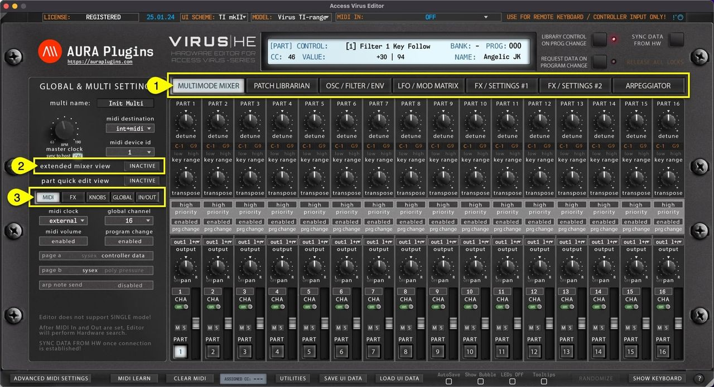

# Access Virus Editor – How To Change Parts

## PART SELECT

Virus has 16 multitimbral parts (except Virus TI Snow, which has 4). When **MAIN EDIT TAB [1]** is set to PATCH BROWSER -> ARPEGGIATOR, you can select different **PART [2]** by clicking the number toggles.

*Figure: how to change parts from the user interface*

## Main Edit Tab Content

Each edit TAB has a specific set of controls available for sound editing. You can access additional parameters via the highlighted toggles / menus found from each of the tabs. Appearance of these toggles / menus are model specific.

## OSC / FILTER / ENV tab

Contains mostly all of the Oscillator, Mixer, Filter and Envelope related parameters and some common voice parameters.

*Figure: how to change parts osc / filter / env tab content*

## LFO / MOD MATRIX tab

Contains LFO parameters and Modulation Matrix source / destination view.

*Figure: how to change parts lfo and mod matrix views*

## FX / SETTINGS #1 tab

Contains Character, Distortion, Phaser, Chorus, Punch, EQ, Envelope Follower and Velocity Assignment parameters as well as Patch Settings like key mode, patch volume, panning etc.

*Figure: how to change parts fx and settings #1 views*

## FX / SETTINGS #2 tab

Contains some Global parameters, Vocoder and Virus TI specific effects like Reverb, Filter Bank and Atomizer mode toggle.

*Figure: how to change parts fx and settings #2 views*

## ARPEGGIATOR tab

Contains only Arpeggiator related parameters and when you have Virus TI in your setup, you can use the USER ARP to modify the Arp Pattern content.

*Figure: how to change parts arpeggiator views*

## Active Part quick actions menu

With a right mouse click, you can open the Part Quick actions menu for active **part [1]** . Most of these are utilities menu items but they are faster to reach right after selecting a part.

*Figure: how to change parts quick menu*

## MULTI SETTINGS

When **MAIN EDIT TAB [1]** is set to MULTIMODE MIXER, you can view the Multi Mixer. There are additional Multi specific settings when **extended mixer view [2]** is enabled.

**MIDI** – **FX** – **KNOBS** – **GLOBAL** – **IN/OUT [3]** toggles contain mostly Global parameters which change how the hardware behaves.

*Figure: how to change parts multi settings*
