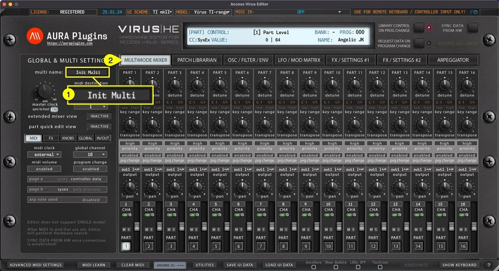

# Access Virus Editor – How To View Multi Name

You can view and Edit **MULTI NAME [1]** when Editor MAIN TAB is set to **MULTIMODE MIXER [2]** .

*Figure: how to view multi name*

**NOTE:** Renaming Multi from the “MULTI SETTINGS” view does not change the name in the librarian. If you want to rename librarian items, check Related Docs below or use search function.
