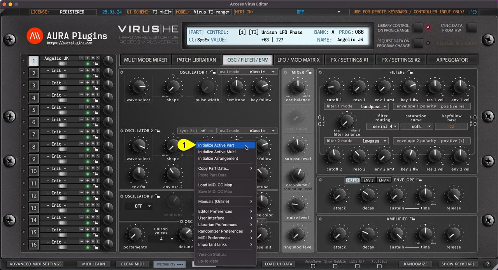
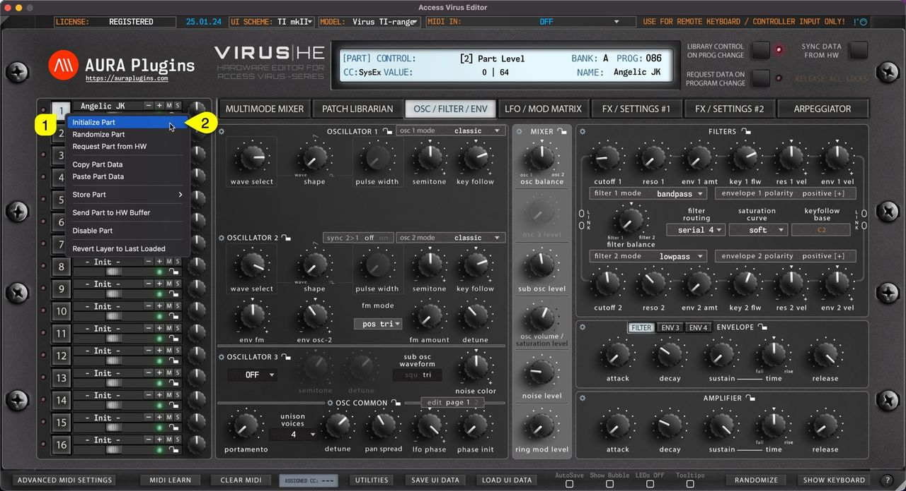

# Access Virus Editor – Initialize Active Part

You can Initialize Active Part by clicking **Utilities Menu [1]** and then **Initialize Active Part [2]** . This function will initialize whichever Part you have active at the moment.

All current part parameters will be initialized to default “init” patch values.

This is helpful if you load a multi which has a great patch on one layer, but the other one needs crafting from scratch.

*Figure: initialize active part via utilities menu*

You can achieve the same result if you right click on the currently selected **part toggle [1]** and select **Initialize Part [2]** from the menu.

*Figure: initialize active part via right click menu*
