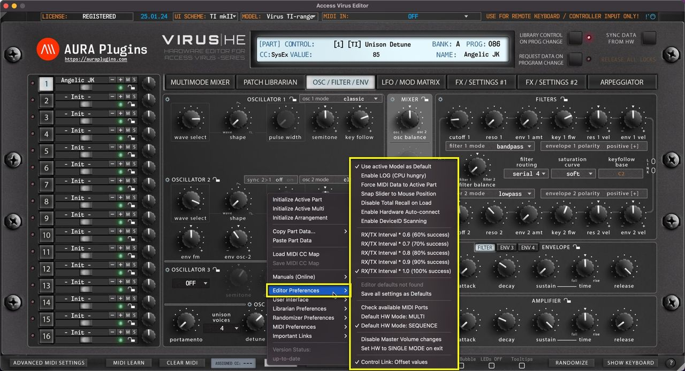

# Access Virus Editor – Utilities: Editor Preferences

*Figure: utilities editor preferences*

## Utilities Menu – Editor Preferences Breakdown

## Use active Model as Default

If you have only synth in your setup, you can toggle on “**Use active Model as Default**” AFTER you have chosen your model from the top row dropdown list.

This way each new instance is automatically set to a specific model, ie Virus TI-range.

## Enable LOG

If you have trouble loading the Editor, you enable the LOG function via the Access Virus Editor PREFS.txt file found in:

Change the line “log: no ” to “log: yes ” and the line with “ 0 ” (zero) to “ 9000 “. Save the file, close it and then re-open the Editor.

If any errors occur, open the Access Virus Editor LOG.txt found in the same place as above, see what the last line says. If the last line is saying

“ Loading bank x.mid ” and log ends there, the issue is with that specific bank. Send it over to us for inspection via the ticket form and we will fix it.

## Force MIDI Data to Active Part

This function routes all incoming MIDI CC data to the currently active PART.

This only applies while the DAW playback is OFF. If playback is toggled ON, then MIDI is routed normally from channels received.

Playback OFF: MIDI received from channel 4 is sent to currently active PART channel ie 2. Playback ON: MIDI received from channel 4 is sent to hardware channel 4 (which might be unaddressed).

## Snap Slider to Mouse Position

When toggled on, slider controls will snap to clicked mouse position. Otherwise you can start adjusting the slider control from the current click position (if within control range).

## Disable Total Recall on Load

This is a handy function if you DON’T want to send Editor data to hardware upon project load. You can always manually dump the Editor data to hardware via Patch Librarian -> Push Data to HW toggle.

## Enable Hardware Auto-connect

Allow Editor to automatically connect with the hardware after MIDI in and MIDI out are set. Connection usually succeeds with 100% rate IF Device IDs match in the hardware and in the Editor.

## Enable DeviceID Scanning

If enabled, it will take a bit longer for the Editor to find the hardware IF the hardware Device ID is not 1. Usually when the Editor is opened, we recommend to set Device ID, Model and then MIDI input & output ports.

## Adjust Request Interval

You can manually adjust the Request interval via the menu options as follows:

0.6 (60% success) to 1.0 (100% success). Usually 100% is enough and there is no further action needed from users. Some speedy pants like to experiment with faster rates but there might be errors occurring while experimenting.

## Save all settings as Defaults

Gets all the Editor MIDI I/O, Device ID and global settings and stores them as defaults.

Worth a note, if the MIDI interface is not connected or if the Editor core has changed, then this option is known to cause crashes.

## Check Available MIDI Ports

If you forgot to power on your MIDI device before inserting the Editor, you can rescan the MIDI ports with this function.

## Default HW Mode: MULTI / SEQUENCE

Sets default MODE which the Editor will attempt to set your hardware upon connecting. Sequence Mode has its benefits but it is also a bit limited.

You can learn more about the mode differences from the hardware user manual.

## Disable Master Volume change

Some models don’t have a master volume knob in the hardware, therefore master volume values are sent to hardware upon project load to have the sound coming out on a specific level. In some cases, disabling this function works out better.

## Set HW to SINGLE MODE on exit

Attempts to set the hardware in SINGLE MODE upon exiting Standalone App / DAW.

## Control Link: Offset values

When toggled on, all linked controls follow each other while respecting the offset they have on each other. ie, cutoff 1 is 40 and cutoff 2 is 80. Now if you move cutoff 1 down 20 steps, then cutoff 1 is 20 and cutoff 2 is 60.

When toggled off, linked controls follow the adjusted control value, ie, cutoff 1 is 20 and cutoff 2 is 60, now if you move cutoff 1 up 10 steps, both cutoffs are set to 70.
