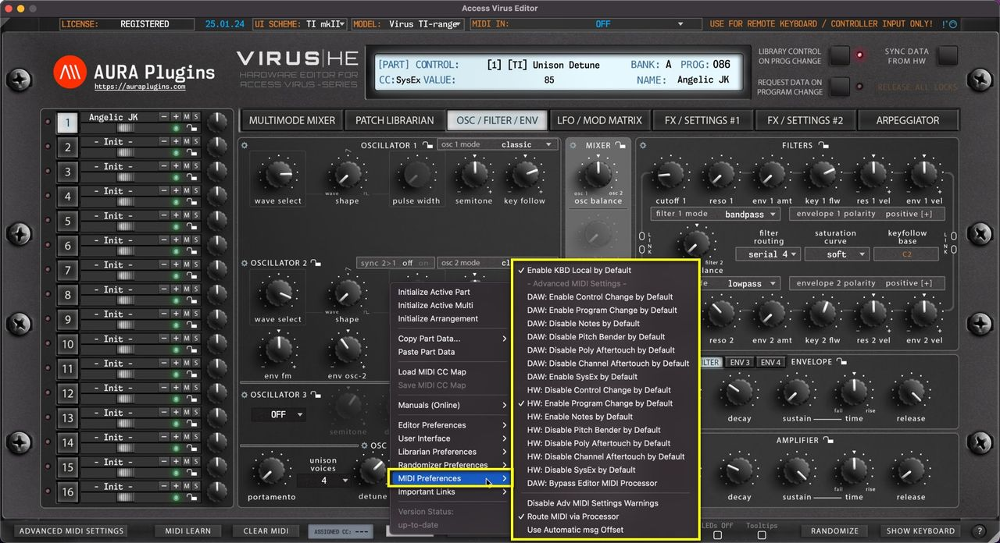

# Access Virus Editor – Utilities: MIDI Preferences

*Figure: utilities midi preferences*

## Utilities Menu – MIDI Preferences Breakdown

## Enable KBD Local by Default

Set Local KBD control on by default on new Editor instances – Use case, if you have Virus TI Keyboard in your setup and it is NOT your default MIDI controller, you can keep the local control on to play it “independently”.

## Advanced MIDI Settings Defaults

You can modify default Advanced MIDI Settings defaults here.

## DAW: Bypass Editor MIDI Processor

In case you don’t want certain events to reach the Editor, you can bypass DAW MIDI event processing to Editor with this option.

## Disable Advanced MIDI Settings Warnings

This will MUTE Editor control display messages indicating Advanced MIDI Settings filter actions. ie. If a note is received but events are filtered via Advanced MIDI Settings, then the control display will indicate a warning that the message is filtered.

## Route MIDI via Processor

This function will be deprecated soon, no point in using it.

## Use Automatic msg Offset

This function will be deprecated soon, no point in using it.
