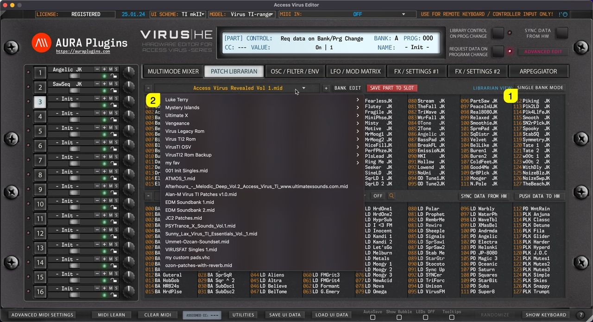
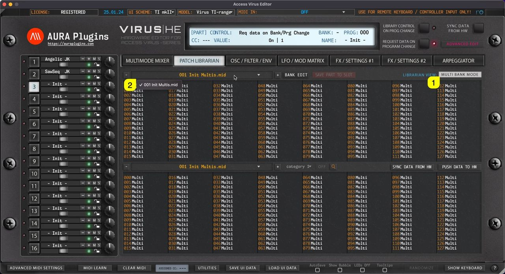

# Access Virus Editor – Browsing Banks

## Single Bank mode

When **SINGLE BANK MODE [1]** is selected, users can open a drop down menu by clicking the **bank name [2]** area with mouse click. With this drop down list, users can see all of the available banks detected by the Editor.

*Figure: browsing banks in single mode*

## Multi Bank mode

Same applies to Multi files when **MULTI BANK MODE [1]** is toggled on. Users can view all of the detected Multi Banks by clicking the **bank name [2]** area.

*Figure: browsing banks in multi mode*

**NOTE:** When a bank is selected, slot names are updated in the list view with corresponding program names.
