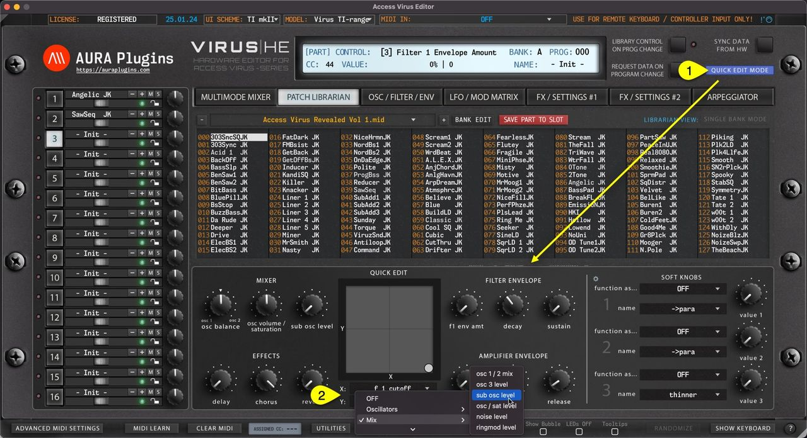

# Access Virus Editor – Quick Edit View

Patch Librarian has an additional view to make “ quick ” edits on SINGLE PATCHES while browsing them through the Patch Librarian: Quick Edit Mode.

Once **Quick Edit Mode [1]** is toggled on, LOWER list view is replaced with Quick Edit controls and customizable XY PAD.

You can choose different controls for the X and Y axis by clicking the **control name [2]** on each of the axes.

*Figure: quick edit view*
