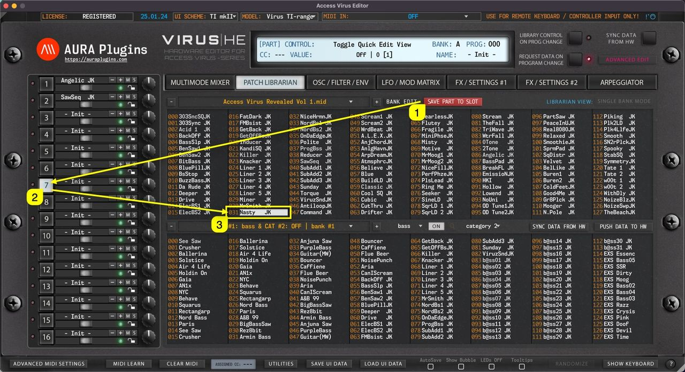

# Access Virus Editor – Save Part To Slot

Save Part to Slot gets current User Interface data and places it into the currently selected slot in the librarian.

In this case we click the **Save Part To Slot [1]** button while **PART 7 [2]** is selected. This will then get Editor data from Part 7 slot and place it into **Librarian slot 031 [3]** which is currently selected.

You can change the slot to your liking as long as it is in the upper (BUFFER) view. Otherwise the Save Part To Slot button won’t work.

*Figure: save part to slot*

**NOTE:** The user has to **overwrite** or choose a custom bank name via **Bank Edit -> Save As..** function in order to save bank changes. OR click the DISCARD button to cancel all the changes made.
