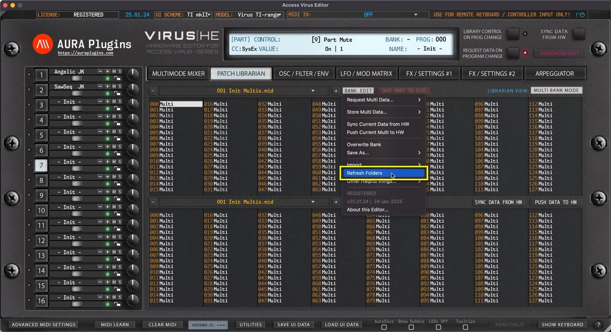

# Access Virus Editor – Refresh Folders

Open the **BANK EDIT** menu and choose **Refresh Folders** to manually trigger PATCHES folder rescan. This is helpful in case you have copied files over or bought new content and placed it in but can’t see it when opening the Librarian View.

*With update 26.09.xx onwards, this function is completely automated and new banks dropped onto the Patches folder will be automatically added to the Librarian Database cache.*

*Figure: refresh folders to check file changes in system*

**NOTE #1** : If the Editor hangs or crashes while this action is in effect, see Enable LOG article from Utilities menu section to learn how to detect faulty banks.

**NOTE #2** : If you can’t see the file you have placed in the Patches folder, try toggling between Multi / Single Bank mode to see if the file is there.
