# Ableton Live and Virus TI USB Audio with INJECT

### Selecting the right Audio Devices

Lets open Ableton Live and set everything up in it. First, click **Live [1]** menu and open **Preferences [2]**

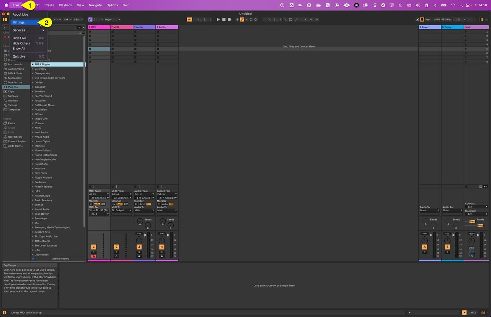

Open **Audio [1]** tab, select your main Audio Interface from the Audio **Input Device [2]** list. I am using my **Fireface 800 [3]** for input and output device in this guide.

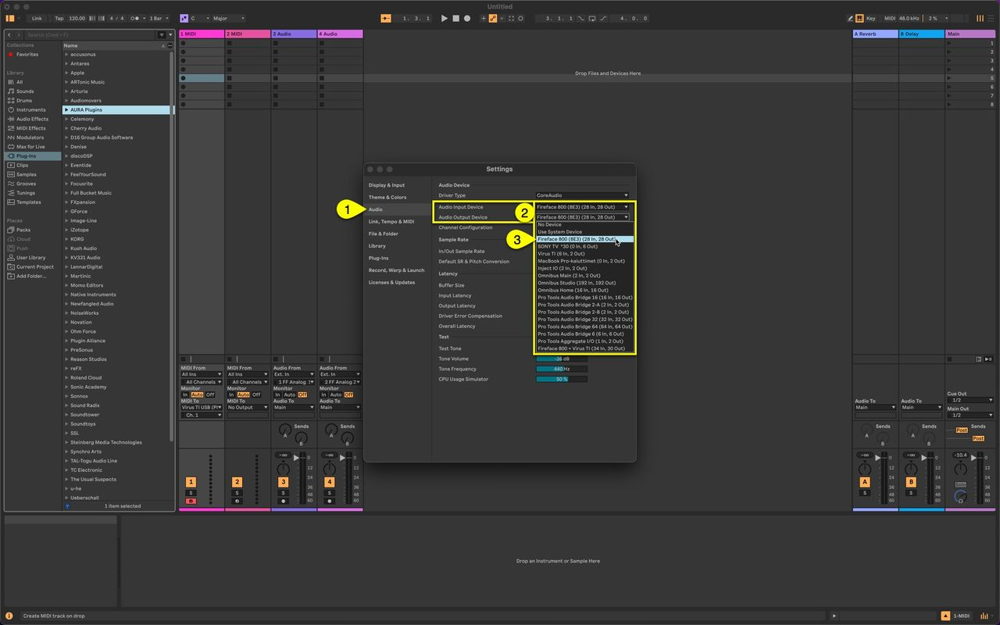

You can use any Audio interface you have in your setup, being it Aggregate Device, OMNIBUS device etc.

Now click **Input Config [1]** to open the inputs view and **enable [2]** all the inputs you need.

Here is how the inputs look after renaming the ports. These renaming are based on the routings on my hardware! Click **OK [3]** to close the input config.

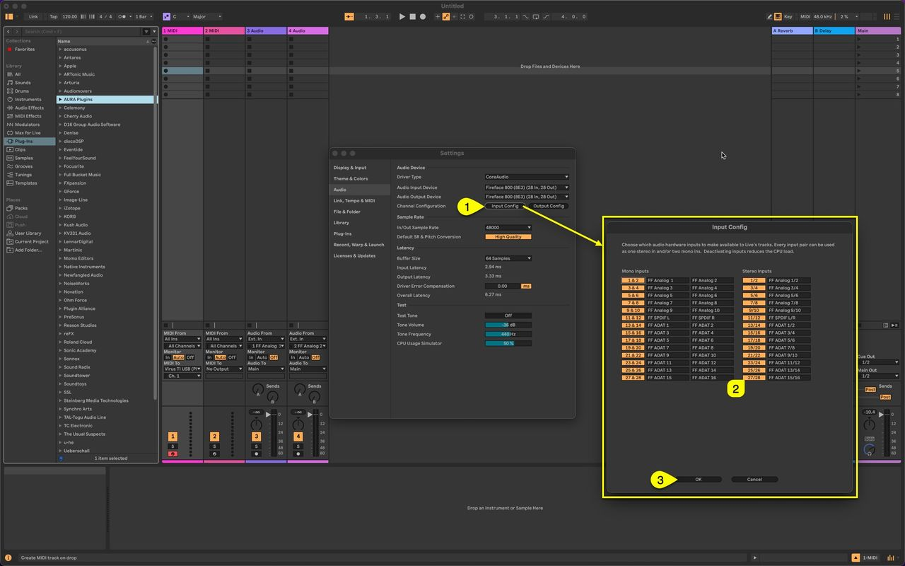

Final step before closing the Settings view is to make sure that you adjust your **buffer settings [1]**. I would personally start with lowest possible value you know your soundcard can handle. I’m setting mine to 64 Samples. Click **close [2]** toggle once you’re set!

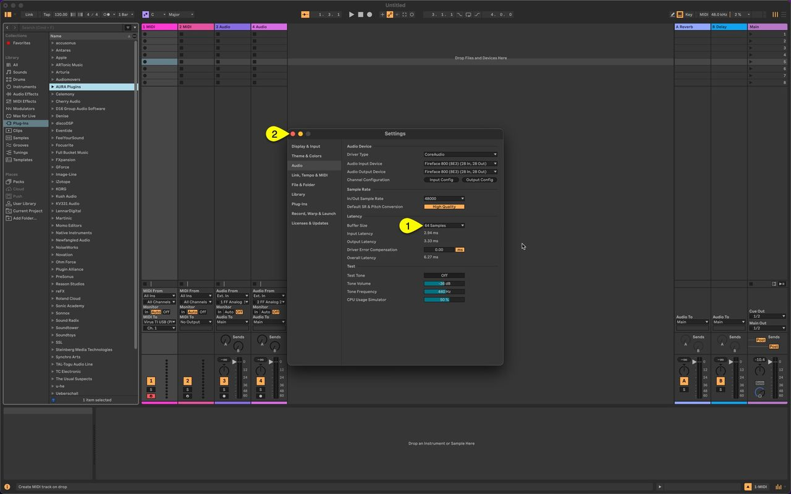

**NOTE**: If buffer setting is too low or too high, Virus TI USB stream will experience clicks and pops. You have to find a right balance for your setup by testing which works the best.

I personally don’t have any issues running 64 Samples with my M1 powered Mac. In fact, I can easily run 256 inputs in the studio with all channels being enabled for monitoring / recording.

### Insert the Access Virus Editor

Lets insert the Access Virus Editor into the project now. We are gonna use Audio Unit since it provides best macOS integration with best stability. VST3 is the worst with MIDI, especially with multi channel configuration.

**Drag’n’drop** the Editor to Live (we recommend Audio Unit).

After a few seconds, this will open the Editor user interface.

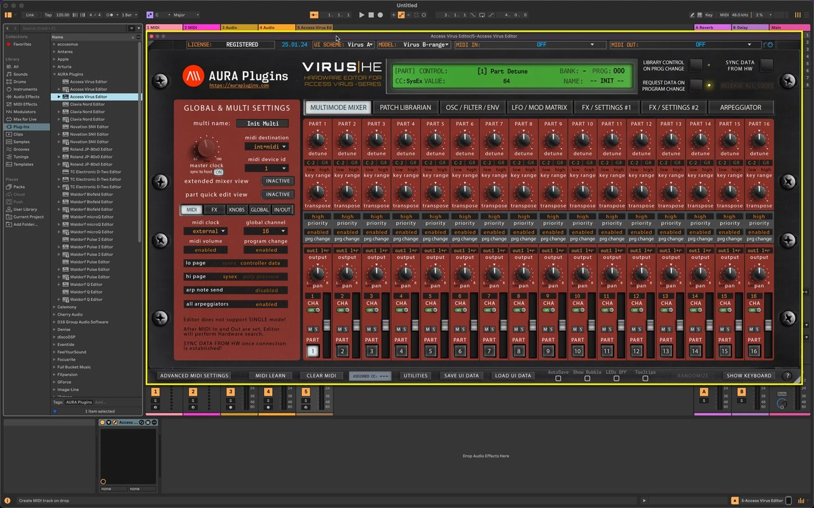

Lets adjust the User Interface and preferences before jumping into loading patches etc:

- 1) set **UI Scheme** to match your taste.
- 2) set **Model** to match your Virus TI model (**Virus TI-series** covers TI and TI2, **Virus TI Snow** is for TI Snow desktop users).
- 3) check **Device ID** and ensure it matches your Virus TI Device ID. (we recommend DeviceID 1).  
  *rest of the settings are requested from the Virus once MIDI input and output are set.*
- 4) set **MIDI IN** port **FROM: Virus TI USB Plugin I/O**.
- 5) set **MIDI OUT [5]** port **TO: Virus TI USB Plugin I/O**.
- 6) Editor will start **automatic sync with the hardware**, getting global settings and parts from the Virus to the Editor User Interface. Wait until it’s done.

And the final result after the request process has been completed:

Part 1 of the Editor setup is done, lets **minimize** the view with left mouse click on the **triangle at the top left corner [1]** and move to adding Audio and MIDI tracks!

**HEADS UP #1**: When using USB connection, our Editor works with the Virus TI ONLY via the Plugin I/O ports on macOS. Windows has other options available. We will cover that later on with another article.

**HEADS UP #2**: External I/O is used for additional gear, like keyboard to trigger DAW or additional sound modules like Novation Supernova II Rack etc.

### Create MIDI tracks

To get sample accurate MIDI from your DAW, we recommend to add MIDI tracks for each part used in your session. Our Editor is missing Audio DSP, therefore MIDI output is not compensated which might lead to timing errors.

**Right click [1]** on the Live mixer background and choose **Insert MIDI Track** or use key command **SHIFT + CMD + T**. I’ve added 4 tracks for this example – you can add up-to 4 channels with Virus TI Snow and 16 channels with other TI models.

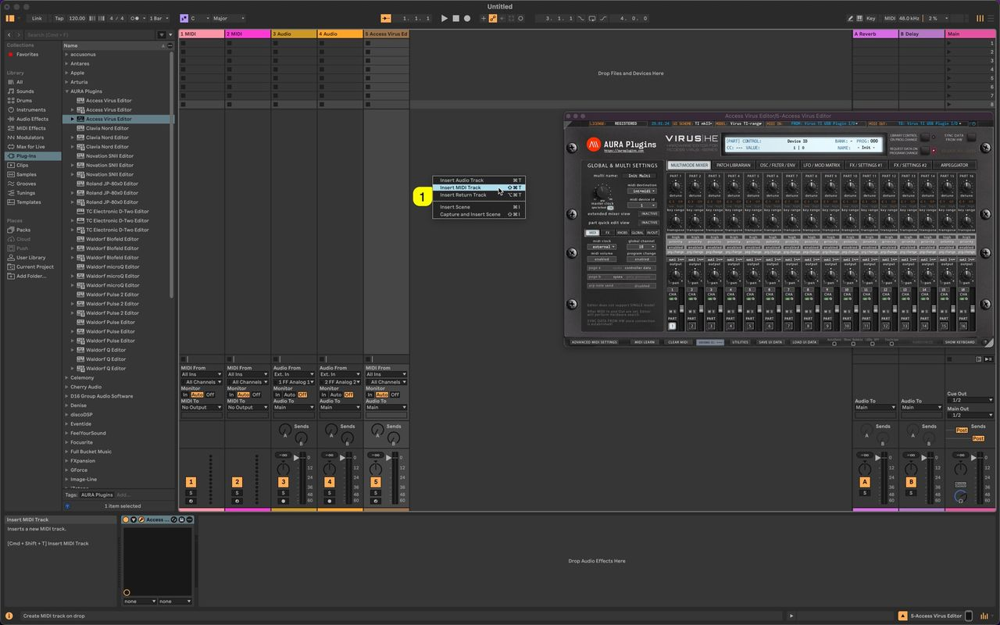

Now assign **MIDI To** pointing towards **Virus TI USB (Plugin I/O) [1]** for all channels you’ve created. Next assign each **MIDI Track channel [3]** to match the Editor/Hardware channels. As you can see from the image below, Part 1 has CHA 1 assigned to it, etc.

If you can’t see the MIDI port in the list, click **Configure… [2]** and see image further below how to make it visible.

MIDI port configure opens the Settings dialog MIDI settings page. Scroll down the list and Locate Virus TI USB (Plugin I/O). **Enable tracking [1]** and **sync [2]** for the port and close the window. Now the port name is visible in Live.

**NOTE**: After Initial sync is done with the Virus TI, you should double check the MIDI channels per parts. Virus TI doesn’t transmit the channel settings back to the Editor User Interface when Sequencer mode is toggled on.

### Create Audio tracks

**Right click [1]** on the Live mixer background and choose **Insert Audio Track** or use key command **CMD + T**. I’ve added 6 tracks for this example – if you use USB only, then you can add 3 tracks – I’m combining USB + Analog Outputs.

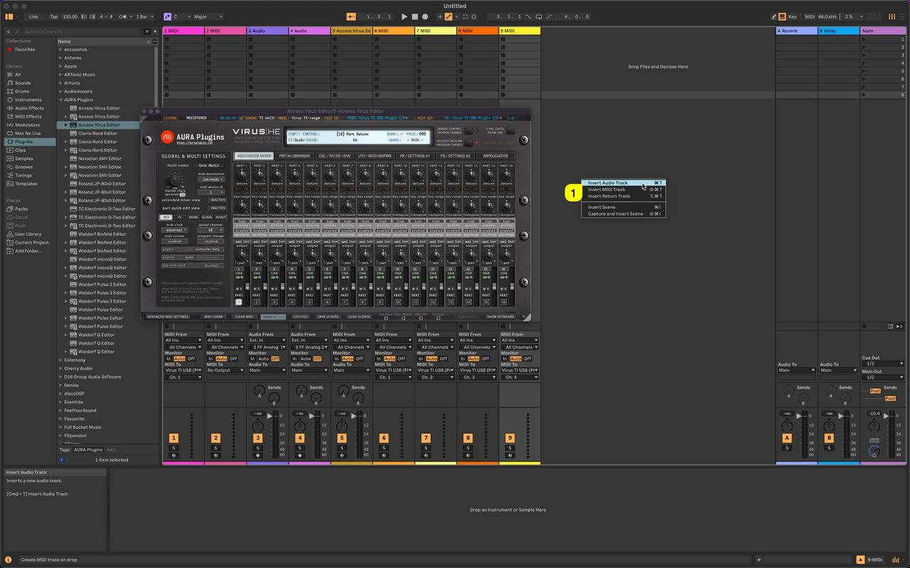

Assign **Inputs [1]** in the mixer view. Audio 10 has inputs **1/2 FF Analog 1/2** etc. After you’ve assigned all the inputs, toggle on **Input Monitoring [3]** to hear the Audio from the Virus TI once notes are triggered. **Audio 13 – Audio 15 inputs [2]** are not engaged since we are going to add INJECT to each of the Audio tracks for USB streaming. Select INJECT from the plugins view and drag it onto the Audio channel (15)

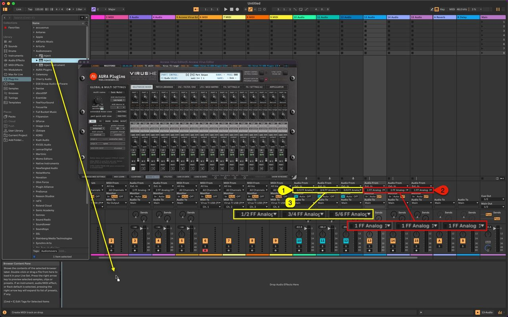

Once INJECT instance is loaded, click the **“sliders” [1]** icon to open the Inject External Input config window.

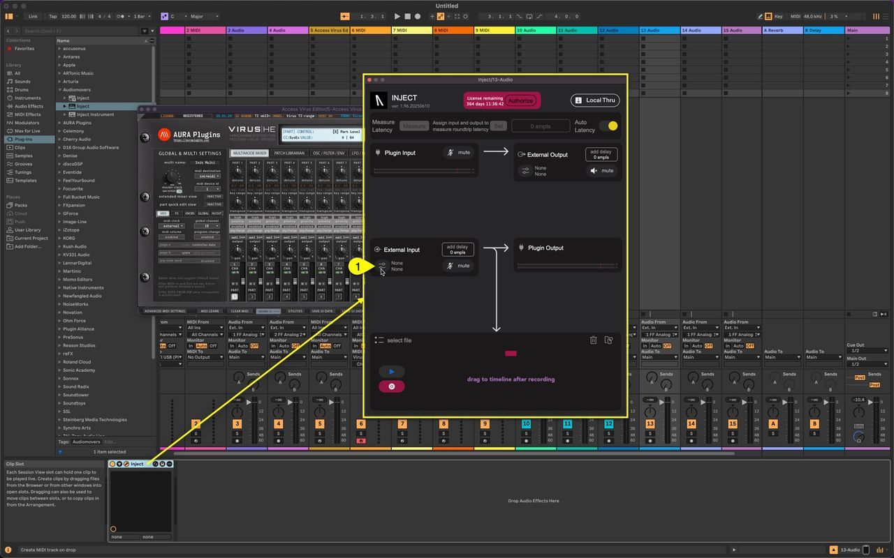

Click on **Device [1]** and locate & select **Virus TI [2]** from the Devices list.

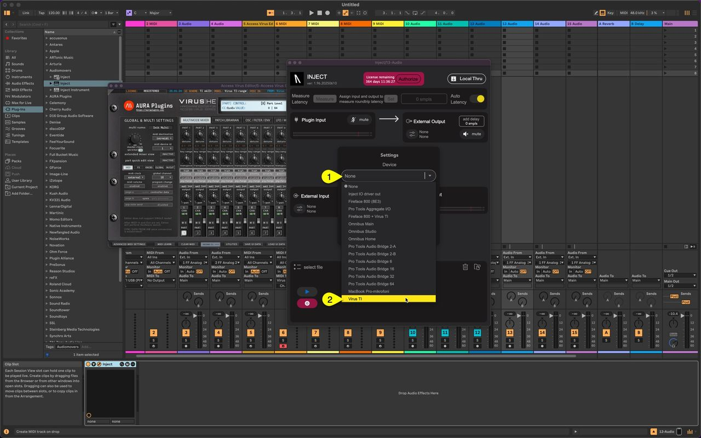

Now click on **Channel [1]** -> **Stereo [2]** (or mono, depending your routing) and choose **Input 3-4 [3]**.

Remember: **Input 3-4 [3] = usb1 L&R**, **Input 5-6 [4] = usb2 L&R** and **Input 1-2 [5] = usb3 L&R**.

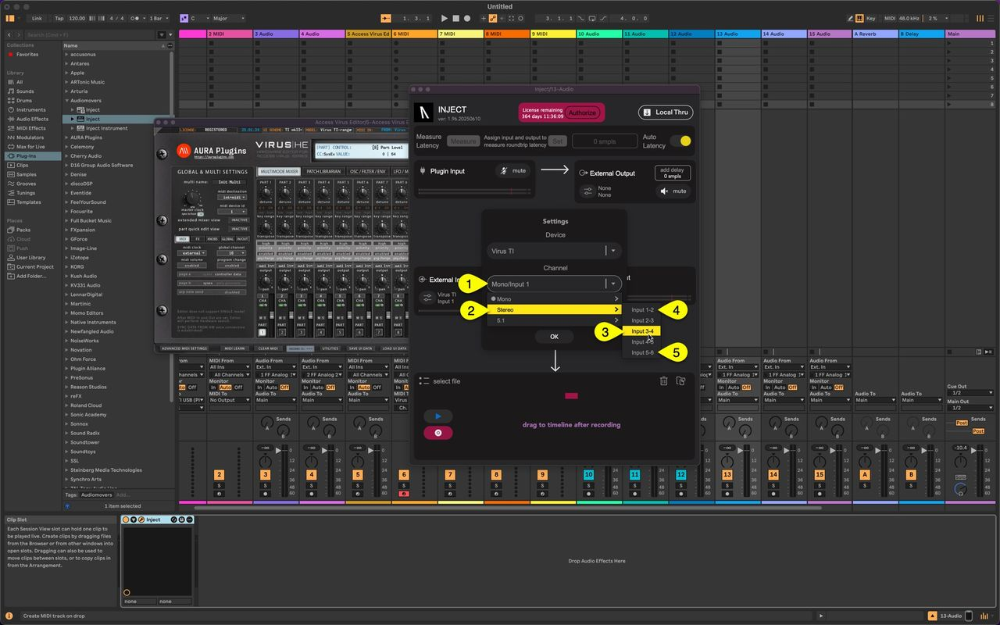

Finally adjust the **Hardware Device Buffer Size [1]** for the Inject instance. I’m setting mine at **64 [2]** samples.

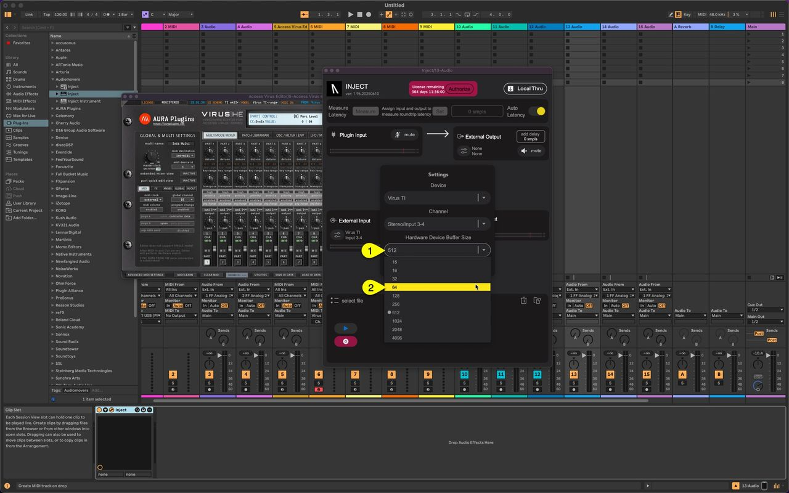

Now repeat this process for Audio 14 and Audio 15 if you want more than 1 USB output. Here is a screenshot of mine after setting them up. **Inject [1]** receives audio from Virus TI usb1 L&R, **Inject [2]** receives audio from Virus TI usb2 L&R and **Inject [3]** receives audio from Virus TI usb3 L&R.

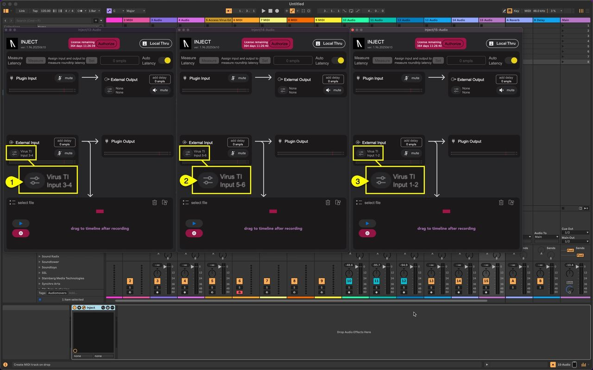

Now the final step is to MAKE SURE THAT THE EDITOR PART OUTPUT is routed to USB 1, USB 2 or USB 3 in order to hear the Audio!

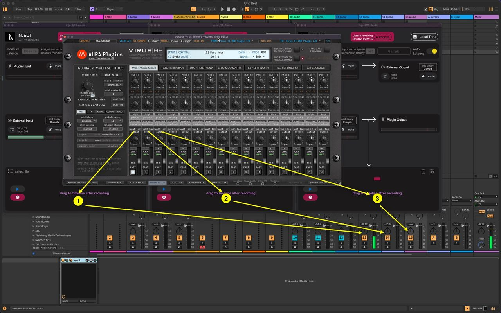

USB outputs from Virus TI are now routed to tracks 13-15 while Analog outputs are routed to tracks 10-12.

Now select a MIDI track you assigned for Virus TI and start playing! Make sure you have Input Monitoring enabled for the specific MIDI track to send the notes to the hardware.

**This is it!** Access Virus TI USB Audio with INJECT is working! It is really simple once you get it going – You can save the template after everything is configured, but keep in mind that you should check and make sure the Virus TI is enabled before you start your session.

## Conclusion

Audiomovers INJECT is a perfect tool for those who want to use various Audio interfaces, synths, effects etc inside their DAW. You can get pretty complex routings going with effect inserts and what not.

Caveat is that the Virus TI USB connection can get “killed” when the synth is powered off and the synth communication is VERY slow, especially when data is being requested from the Virus TI to the Editor.

Data flowing out from the Editor to Virus TI works out just fine.

Checkout our Access Virus Editor and spread the word – Its been a long road.

[Access Virus Editor](https://auraplugins.com/product/access-virus-editor/) Product page (requires Access Virus synthesizer or DSP56300Emulator with Virus OS) (DSP56300 Setup Guide is coming soon!)

[Access Virus Editor](https://auraplugins.com/downloads/access-virus-editor/) Downloads page (logged in customers can see full downloads, guests can see demo downloads).

Audiomovers INJECT: Amazing tool for making insane routings inside your macOS & PC.  
Learn more about Inject: https://audiomovers.com/products/inject

[Return](https://auraplugins.com/kb/article/access-virus-editor-virus-ti-usb-audio-connection/) to Virus TI USB Audio connection article
