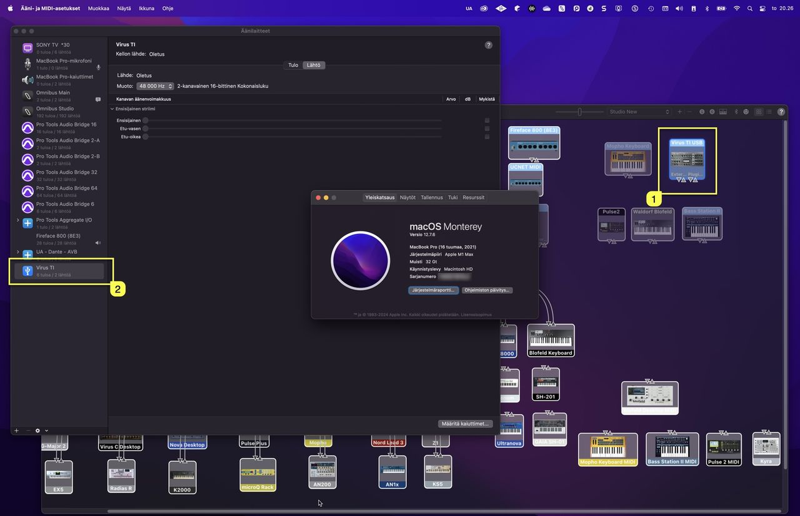
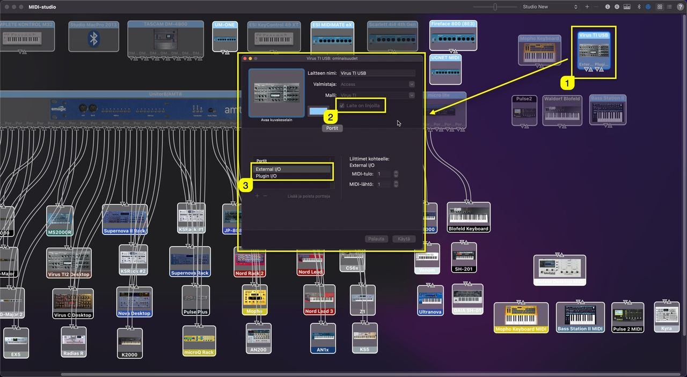
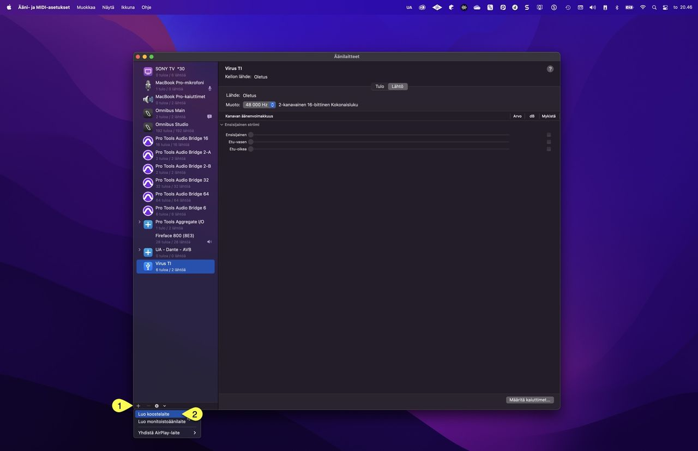
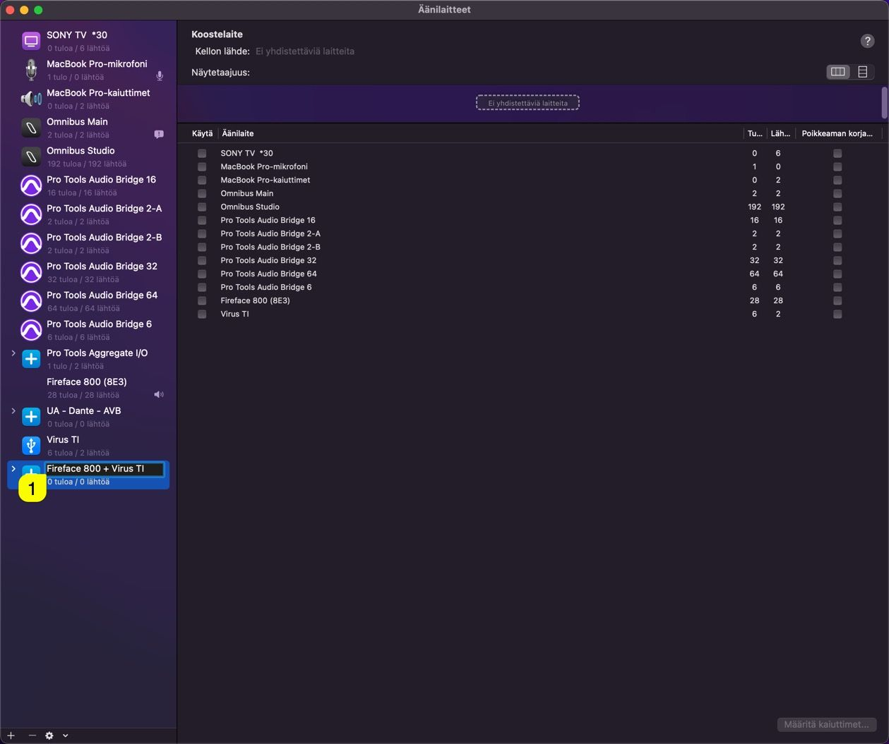
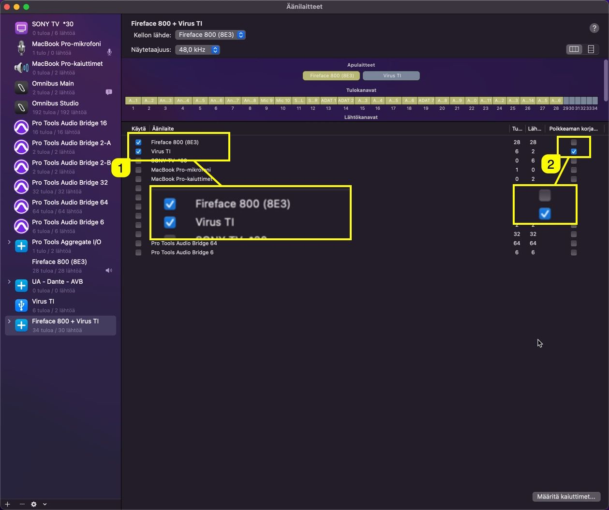
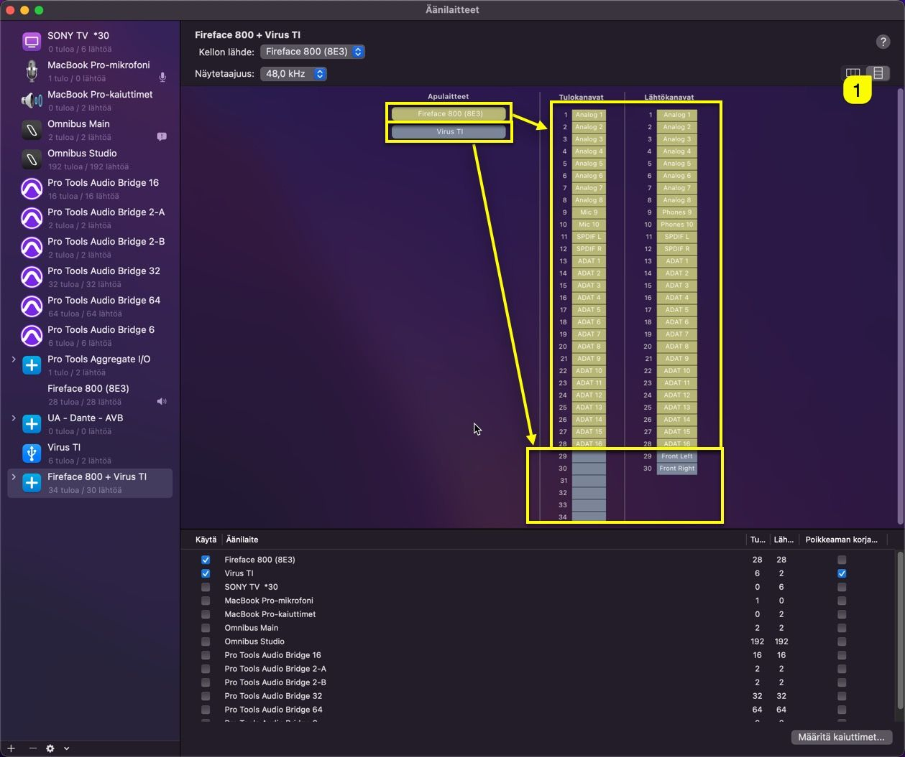
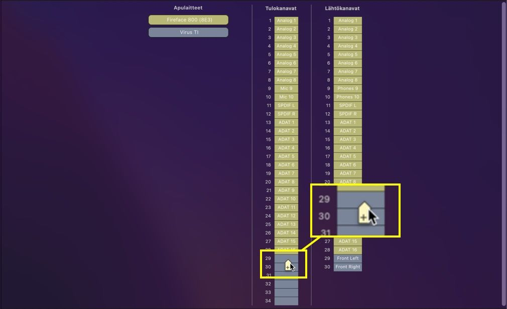
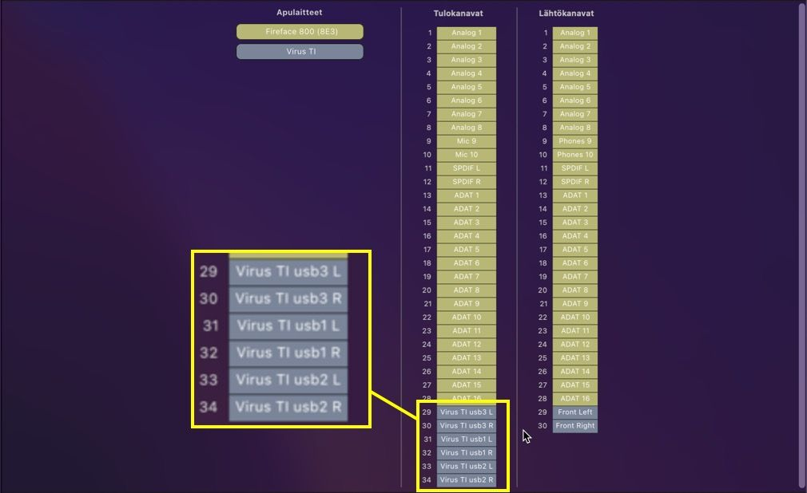

# Audio MIDI Setup

In order to get the Virus TI USB Audio with macOS working, we have to create aggregate device stack and make sure the device is online. This is all native macOS Apps, no 3rd party apps installed. Open **Audio MIDI Setup.app** from your macOS -> Applications -> Utilities folder. If you can’t see Audio Devices window, click “**window**” and “**show audio devices**”. You should also open MIDI-studio view from the same menu with “**show MIDI-studio**“.

- CMD + 1 (show / hide audio devices)
- CMD + 2 (show / hide MIDI-studio)

In MIDI-studio view, you can see that **Virus TI USB [1]** is now installed. In Audio Devices view you can see that **Virus TI [2]** is now showing up with 6 inputs / 2 outputs.

You can make sure that our driver works by double clicking the **Virus TI USB [1]** in the MIDI-studio view. New window will open up and you can see that the **device is online [2]** – Our driver has **ports [3]**

- External I/O
- Plugin I/O

You can close this window if everything is ok. If not, open a support ticket and we will help you out.

## Create Aggregate Device

Open Audio Device view – In this window we can create a stack of devices that will be unified within your DAW. In the lower left corner, there is a **+ [1]** sign, click that and choose **Create aggregate device [2]**.

### Rename Aggregate Device

Rename your newly created Aggregate Device by clicking the **device name [1]**. Give it a name you can memorize. In this case, I am renaming mine as **Fireface 800 + Virus TI**.

### Stack Devices together

Before you rush into adding the devices, ALWAYS make sure your master soundcard is the first option you select. This defines what the audio clock master is and which other devices will be clocked to. Virus TI should always be the last item in the list.

In the screenshot below, you can see that I have chosen my **Fireface 800 and Virus TI [1]** for this stack. You can add as many devices as you need. Virus TI has the **drift correction [2]** since Fireface 800 is our audio clock provider.

**Note**: As a safety measure, I have plugged Fireface 800 SPDIF output to my Virus TI SPDIF input. Virus TI should automatically sync to the incoming SPDIF clock. This can be defined from the Virus TI Config menu.

### Rename Input ports

To make the workflow smooth, I would rename my ports while at it, here is how to do it the easy way: Change view to **list [1]** view. You can now see that Fireface 800 channels are yellow’ish and Virus TI channels are gray.

Move your mouse over to the Virus TI Input channels and you can see a little + sign appearing. Click to add name for the Input channel.

Since Access built the USB streams for the Virus TI, their stream format goes as follows:

- stream 1: usb 3 L&R
- stream 2: usb 1 L&R
- stream 3: usb 2 L&R

So naming the channels should be done as you can see from the screenshot below.

You can ignore the channel numbers 29 – 34, since they are completely setup dependant. For example, if I was to do this guide in our studio, there would be 256 inputs + Virus TI inputs.. In your setup it can be 8 inputs + Virus TI inputs etc.

**Note**: Virus TI is the last device in the Aggregate Device stack for two reasons!

**1)** if Virus TI usb connection is dropped / not found during the boot, device names prior to TI will be intact.  
**2)** it is much easier to remember that Virus TI usb outputs are the last 6 channels in your DAW inputs list.

Before we will take a deep dive into **Ableton Live**, here is some thoughts and findings to-date:
