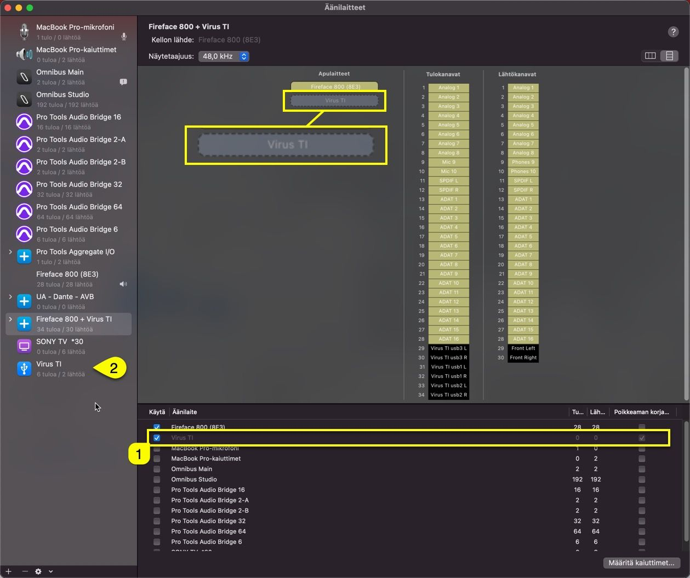

# Caveat with USB connection

Sometimes after Virus TI has been shut down, macOS nukes the USB connection and “kills” the Virus TI connection in the aggregate device list.

In the screenshot below, we can see that **Virus TI [1]** is disabled in the Aggregate Device list, while in the **Device tree [2]** it shows the device is available.

This can be easily fixed by **UNCHECKING [1]** and **CHECKING [1]** the Virus TI in the Aggregate device list.

This is why we recommend to put the Virus TI as a last item in the list. If the trick above won’t help, shut down everything and start by turning on the Virus TI and then your Computer.
