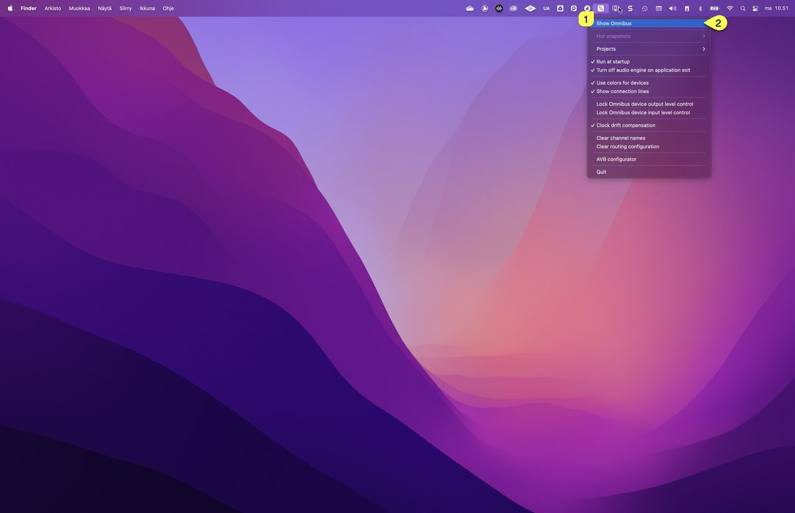

# Introduction

> **NOTE:** Video link to setup Virus TI USB Audio with Omnibus will available shortly!

## Access Virus TI USB Audio with Omnibus

We have covered [macOS Native USB](../usb-audio-macos-native/00-introduction.md) and [Audiomovers INJECT](../usb-audio-inject/00-introduction.md) connection with Access Virus TI, so lets jump to something different: **Audiomovers Omnibus**! What is Omnibus?

**Omnibus** is an application that lets you stack Audio devices together, just like with Apple native Aggregate Device, but this one works with macOS and Windows! There is more to it: Omnibus supports Network Audio connections with AVB (mac only) and NDI + you can build your Virtual routing as you prefer with recallable snapshots – Transfer audio between Apps & computers – with or without soundcards!

OK, let’s get into it. What do you need?

- Access Virus TI and/or Access Virus TI Snow (obviously)….
- USB cable.
- USB-C to USB 2 or USB 3 Hub.
- Access Virus Editor.
- Audiomovers Omnibus

Install our Access Virus Editor from the [downloads](https://auraplugins.com/downloads/access-virus-editor/) page. Demo works too, but you are missing a lot features with it ($69.95 is a very small fee for a fully working editor)! In macOS it is important to remove the original Access Virus Control software, [here is the uninstall instructions](../usb-audio-macos-native/00-introduction.md) (Steps 1, 2 and 3).

> **NOTE:** This Guide is written in macOS 12.7.6 – Windows App might be a bit different, but you’ll find the configuration is pretty much the same!

### Step 1

Visit Audiomovers OMNIBUS and download the DEMO if you haven’t purchased the App yet: https://audiomovers.com/products/omnibus

Install Omnibus and Reboot if needed.

### Step 2

Open OMNIBUS App. On macOS you can find Omnibus.app from the Applications folder and/or from the **main menu bar [1]**. This will open the Omnibus menu, click **Show Omnibus [2]** to open the window.

