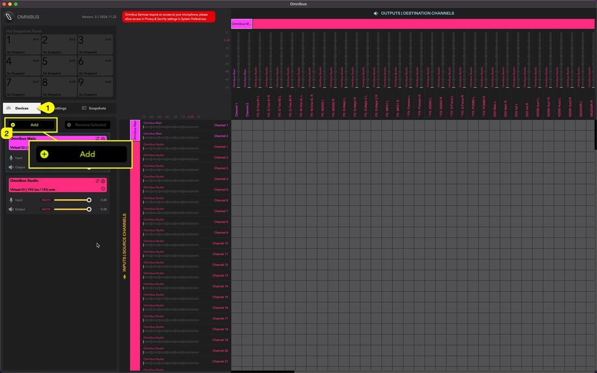
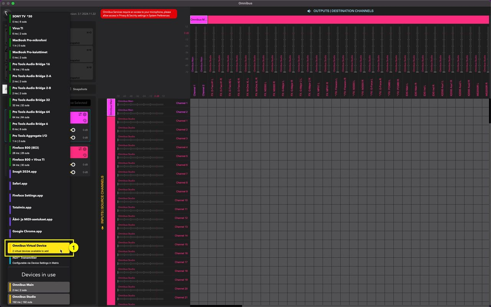
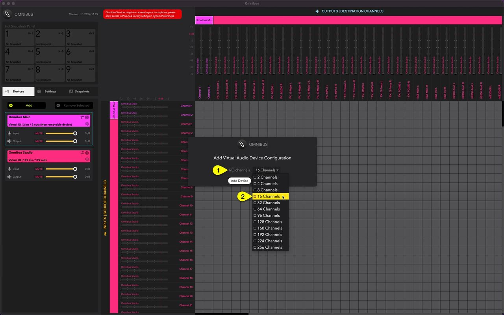
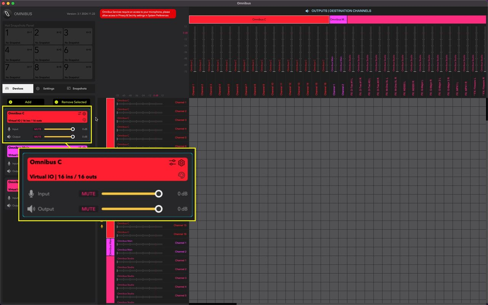
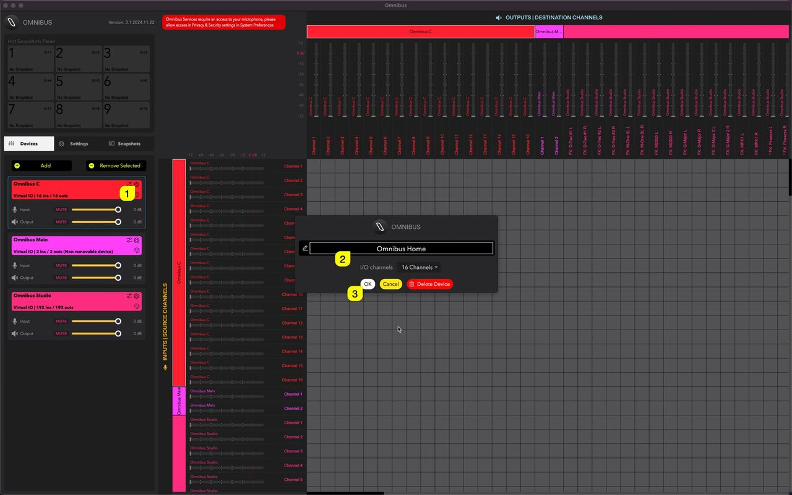
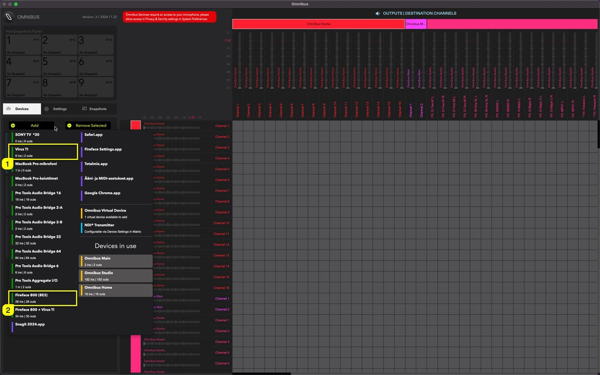
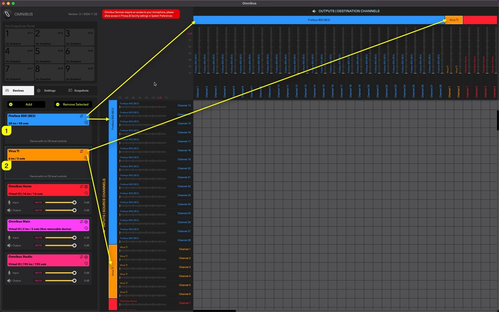
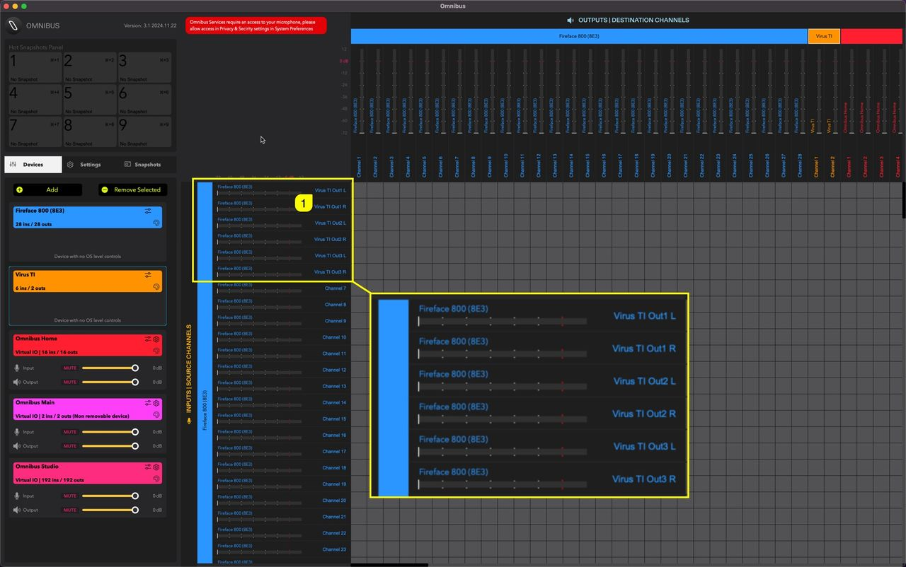
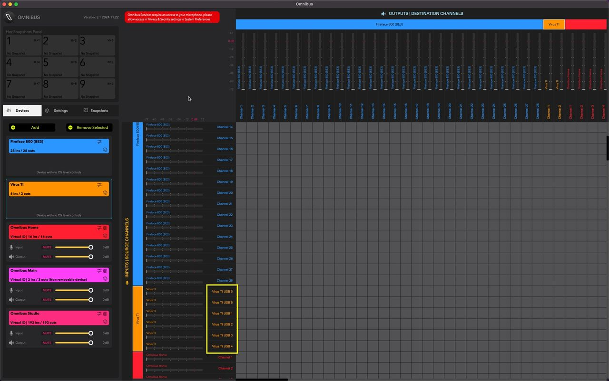

# Add New Virtual Device (if needed)

In OMNIBUS window, click **Devices [1]** tab, and click **Add [1]** to create a new Virtual Sound device.

This will open a popup menu showing all Audio Devices connected and Applications available for routing. In our example, we are going to add **Omnibus Virtual Device [1]** first.

A new window will open up, prompting for **I/O Channel [1]** count. We are going to use **16 Channels [2]** to keep the views clean. You can add as many channels you need, could be less, could be more. Click Add Device once you’ve figured out your need.

New virtual audio device is now created! Click the color palette to change the Device Color (helps while navigating in matrix view).

I am going to rename Omnibus C to something different. To do this, click the **Gears [1]** icon. You can now **input a new name [2]**, adjust number of Channels or delete the device. Click **OK [3]** once you’re happy.

## Add Virus TI and additional sources to OMNIBUS

I have **Access Virus TI [1]** and **RME Fireface 800 [2]** connected to my mac, so in this example we are going to add both of the devices to the routing.

Like in previous part, click **Add** button and choose devices you need. Repeat for each device.

Now the **Fireface 800 [1]** and **Virus TI [2]** has been added. You can see on the top row we have “OUTPUTS | DESTINATION CHANNELS” and on the left we have “INPUTS | SOURCE CHANNELS”.

### Rename Input Ports

Double click on the **input channel [1]** name to activate renaming. Fireface 800 inputs 1-6 are my Virus TI analog outputs.

Apply the same for the Virus TI channels, remember, Virus TI outputs are as follows: 5, 6, 1, 2, 3 and 4!

