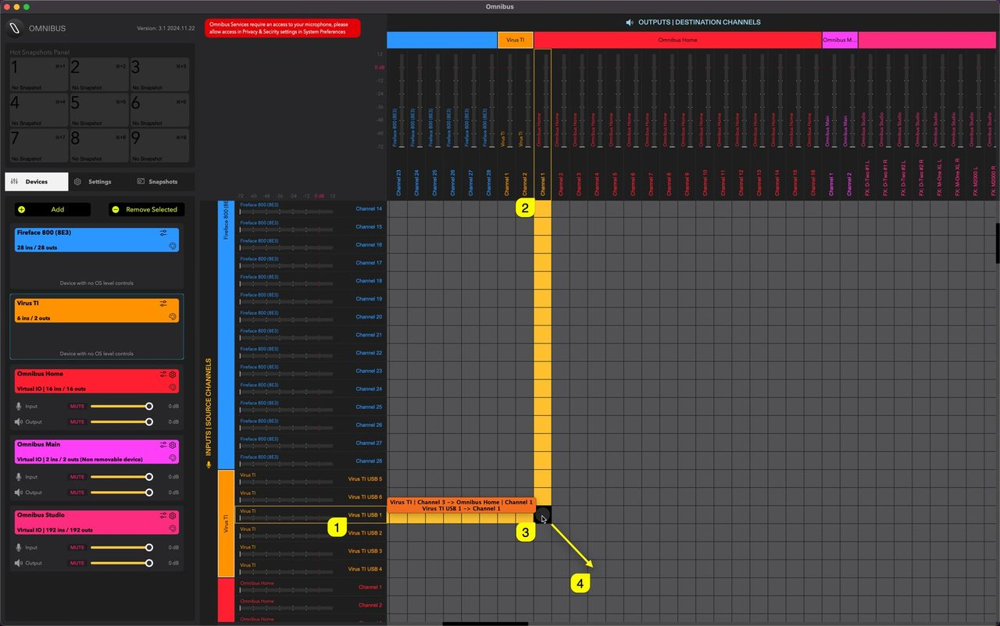
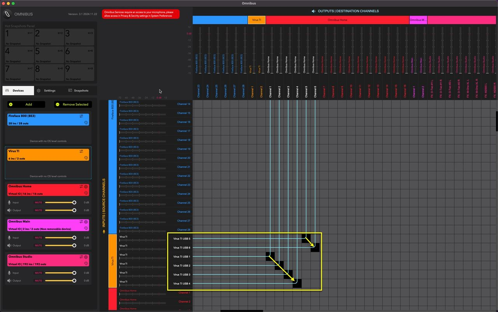
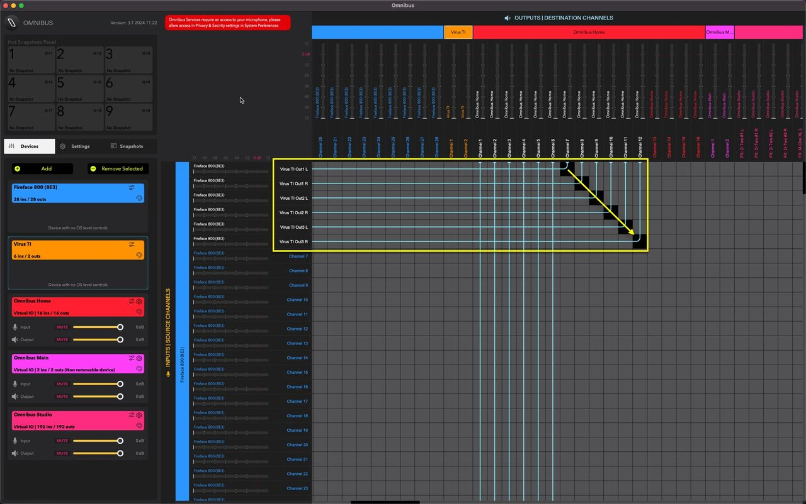
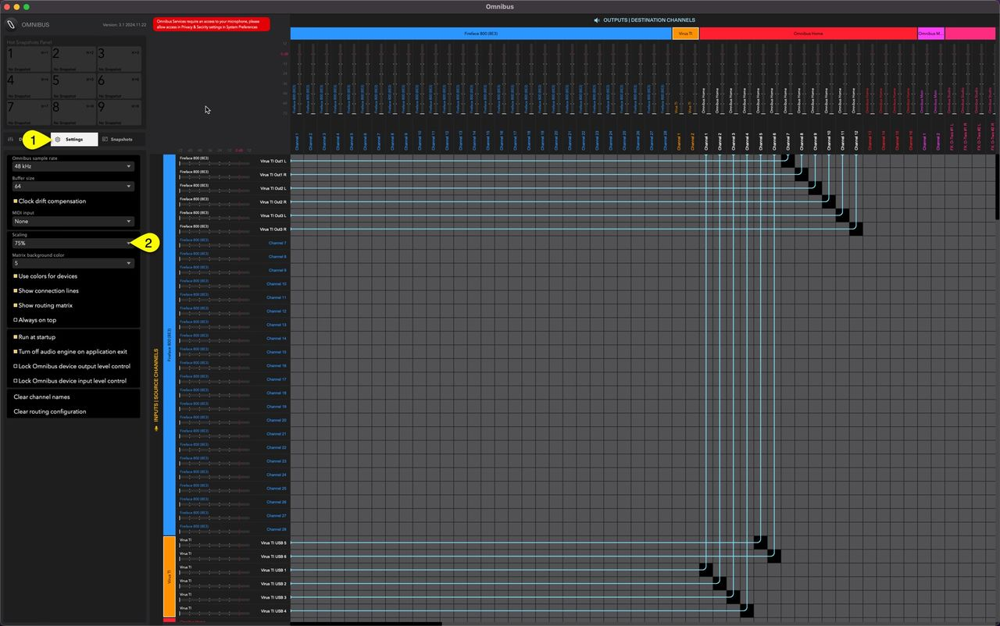

# Enter the Matrix

To route audio from **Virus TI usb1 [1]** to **Omnibus virtual soundcard [2]**, move your mouse to the **crossing point [3]** of these terminal and click to apply. **You can also drag’n’drop multiple connections at once my holding down the mouse and moving along the matrix [4]**!

Here is the result for my Virus TI usb connections. Starting from usb1 out to usb6 out, all in order.

Then this is the result from Analog connection points from Virus TI to Fireface and from Fireface to Omnibus!

If you find it hard to view the connections on your screen, click **Settings [1]** tab and change the **Scaling [2]** settings to your needs. At **75%** I can view all the routings at once.

