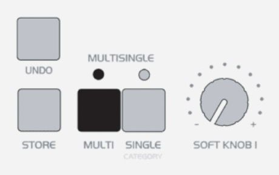
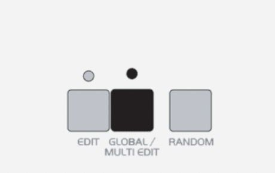

# Access Virus Editor – Configure Virus A, B, C, Rack and Rack XL

> **NOTE:** Menu and Button examples from Virus C user manual.



*Figure: access virus config 1*

Enter MULTI mode



*Figure: access virus config 2*

Enter GLOBAL settings -> Use PARAMETER buttons to navigate settings pages and VALUE buttons or VALUE knob to adjust following parameters:

```
MIDI DUMP RX        = Enable
Global Channel      = 16
Panel               = Int+Midi
SoftThru            = Off
ProgChange          = Ena
DeviceId            = 1
MIDI Control LoPage = Contr
MIDI Control HiPage = SysEx
System MemProtect   = Off
```

All set! We are now ready to open our plug-in in DAW or Standalone Application!

To get more information about how to adjust your synth, read the Access Virus User Manual.

> **NOTE:** Arpeggiator will not play unless your DAW is able to provide a MIDI Clock. Windows: Check our method of using MIDI OX and LoopBe together to provide MIDI clock from DAW to your synth.
