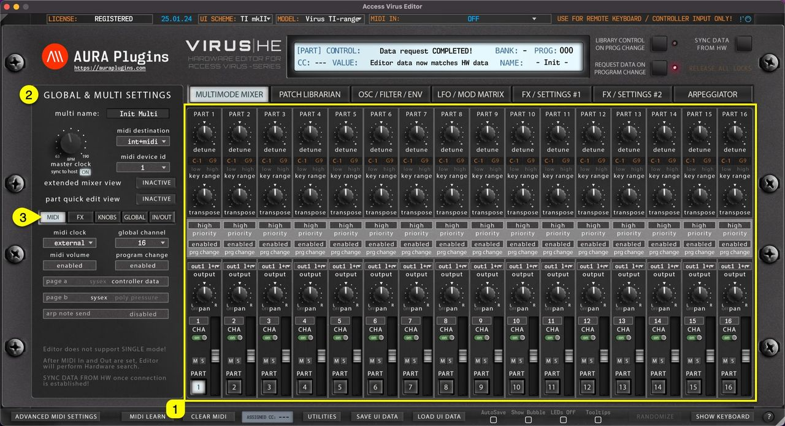

# Access Virus Editor – Sync Data From HW

This is the final step before you can start making your own adjustments IF “ **Enable Hardware Auto-connect** ” is disabled from the Utilities menu as explained in the previous section! Click **Sync Data From HW [1]** button to synchronize active MULTI data and individual PARTS from your Virus to the Editor user interface. This needs to be done only when a new instance is loaded so that the Editor and you know what was set in the hardware already.

*Figure: sync data from hw*

After the **“Sync data from HW**” process is completed, you should check the **MULTIMODE MIXER [1]** view. Verify part settings are what you expect them to be. Key range, outputs, midi channels etc.

Also check **GLOBAL** & **MULTI SETTINGS [2]** area for **Device ID** and **MIDI Destination**. Finally, check **MIDI**, **FX**, **KNOBS**, **GLOBAL and IN/OUT [3]** tabs for their settings.

*Figure: multi and global settings*

You can now pursue your own editing tasks, patch manipulations and experiments as you wish!

> **NOTE #1:** Be patient and do not disturb the data flow with any knob movements or so. This will ensure the data packages are being sent and received as expected and you are not going to receive any SysEx error messages!

> **NOTE #2:** All layers should ideally have individual MIDI channels to avoid control change conflicts. You can stack sounds together by setting the MIDI channel to the same value, just keep in mind that control changes affect both layers!

Issues with hardware data sync? Check our FAQ before opening a ticket.
