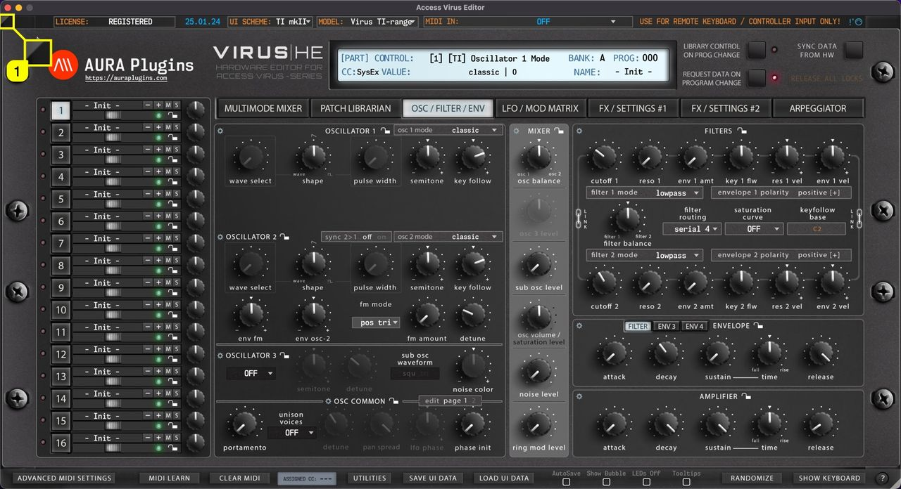
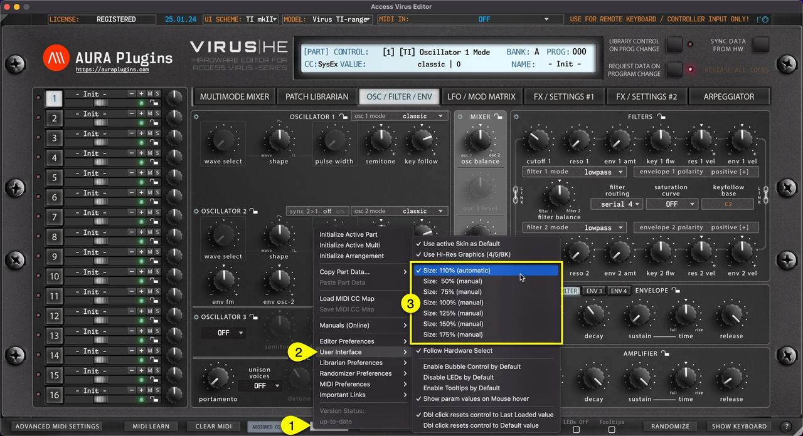

# Access Virus Editor – How To Resize User Interface

## Real-time Resize

You can resize the Editor user interface in real time by clicking and dragging the **gray triangle [1]** in the bottom right corner. Double click will revert the scaling level back to 100%. This setting is saved with DAW project data, but Standalone Application always reverts to “zero” resize stage when Application is launched again.

*Figure: resize ui freely*

## Minimize View

If the user interface is too big for your screen for some reason, a single click **gray triangle [1]** in the top left corner resizes the user interface to 50% of its size. Double click sets the view back to 100%.

*Figure: minimize ui*

## Setting Default Scaling Level

You can also set the “default” scaling level by opening the Utilities **[1]** menu -> **User Interface [2]** and **selecting the size [3]** that fits your setup the best.

*Figure: set ui defaults*

> **NOTE:** If your display cannot handle HD graphics and / or you have not enabled use of hi-res graphics, scaling results might look unpleasant. Adjust settings to your likings. Loading hi-res graphics takes longer for the Editor view to open.
