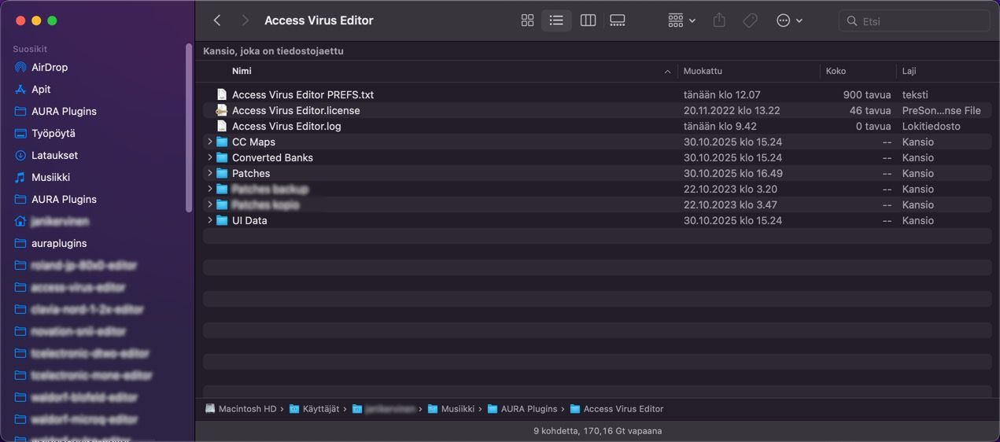
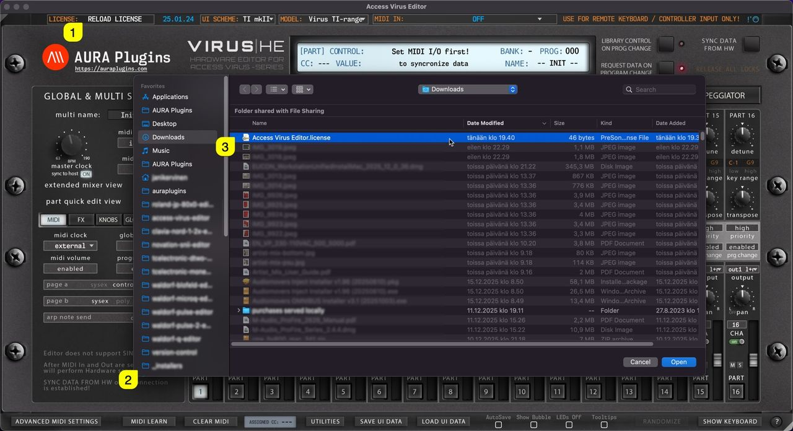

# Access Virus Editor – How To Register our Editor

If you made the decision to purchase the license for our Editor, you are the best! Just wanted to thank YOU.

License owners can enjoy the full advantages of the Editor, like:

- Plug-in parameters can be automated directly from your DAW.
- Librarian is fully functional and allows full editing capabilities.
- You can save your UI Data (full performance) to HDD.
- You can save your custom MIDI CC maps to HDD.
- Total Recall: Once you open your project after your last session, all the data used in your previous session will be automatically sent to your synthesizer.
- Get tech support and updates for the current major version for free!
- version information: yy(year/major).mm(month).dd(date)

If you purchased the Editor license from our store, download the license and the full installer from https://auraplugins.com/downloads/access-virus-editor/ after you login.

## Manually placing the license file

If you have a plug-in inserted to your project, now it is time to delete the track / plug-in instance from your DAW.

**Rename** license.key manually as “Access Virus Editor.license” and copy it to the Editor **data** folder (see location mentioned earlier). If all is good, you can now re-insert your plug-in to your DAW.

> **NOTE:** Right click the license file on macOS and select “show info”. After that make sure the file name is shown as above. If it has a .key or .txt extension in it, remove it!

*Figure: how to register our editor - license location*

## Register product from User Interface

## Method #1

Open the Editor Standalone Application and click the top left corner of the user interface where the Editor says, “ **RELOAD LICENSE [1]** ”. A new window will open to **prompt for license [2]** . Locate the **license [3]** and hit OK to register.

*Figure: how to register our editor - license display load*

## Method #2

Open the Editor Standalone Application and enter **PATCH LIBRARIAN [1]** , click **Bank Edit [2]** and choose **Register Editor… [3]** . A file prompt dialog will pop up just like in the image above.

*Figure: how to register our editor - license load bank edit menu*

After you have chosen the license file, close the application and reopen it. The editor display should now indicate “ **REGISTERED** ” in the top left corner.

IF the Editor shows “ **\*\* DEMO VERSION \*\*** ” you haven’t installed the FULL version yet or you might have the plug-in installed in several locations! Check the solution from the FAQ before you submit a ticket. You can submit ticket from My Account page once logged in
