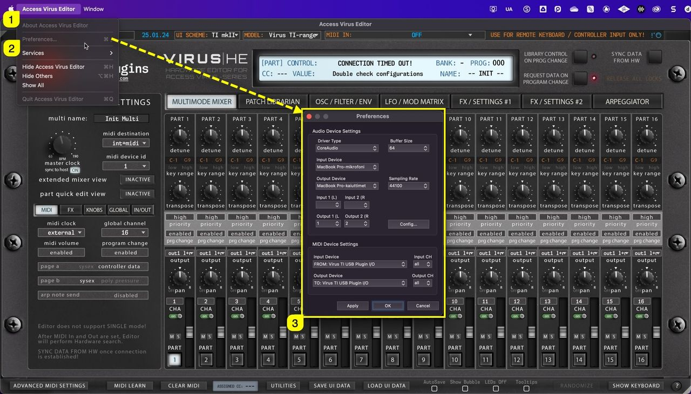
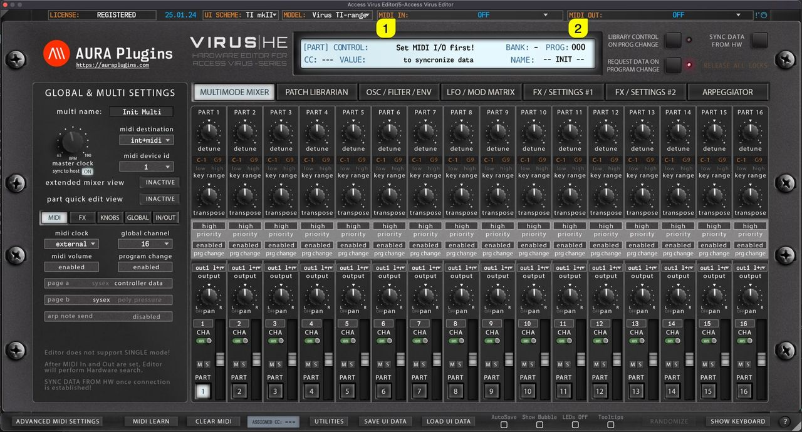

# Access Virus Editor – How To Set MIDI Input and MIDI Output ports

## Virus TI: MIDI DIN vs USB

**USB** can be used to establish connection with our Editor. In such case, use ports:

- **Virus TI USB Plugin I/O** on macOS
- **Virus TI Synth** on Windows

USB Audio has to be routed to your DAW with 3rd party software like Audiomovers Inject, Omnibus or something similar. On macOS you can achieve this without 3rd party applications.

**MIDI DIN** cables are good if you need rock solid connection with your Virus and your DAW (with all Virus models). Audio has to be routed with Audio Jacks.

## Set MIDI ports with Standalone Application

If you use the Standalone Application, click “ **Access Virus Editor [1]** ” from the top bar and choose **Preferences [2]** . This will open **Preferences dialog [3]** where you can set MIDI Input Device and MIDI Output Device .

On Windows machines, the same dialog can be opened from the File menu.

*Figure: application setup*

## Remote Keyboard Input

If you have an external MIDI controller you want to use with the Editor to trigger notes and tweak knobs with, you can select **MIDI IN** from the Editor top bar. This port won’t work with the synth itself and is only used for triggering MIDI events.

*Figure: Remote Keyboard Input available in Standalone App only!*

This port is only visible with Standalone Application.

> **NOTE:** Audio Device Settings in the preferences dialog does not have capability to transmit audio in this stage. Choose Audio Drivers, but keep in mind that audio has to go through Audio Jacks to console or sound card inputs.

## Set MIDI ports with the Plug-in

**Select MIDI IN [1]** , where your Virus MIDI Out is connected in at.

**Select MIDI OUT [2]** port which will send data to your Virus MIDI Input.

*Figure: how to set midi input and midi output ports - plugin i/o*

## Hardware Check / Ping

After setting MIDI OUT, our Editor will start scanning for the hardware. If there is no immediate response, the Editor will attempt 3 more times. If there is no response, you might get a “ **Connection Timed Out** ” message. If so, double check your hardware settings and make sure your cables are good!

> **NOTE:** MIDI ports for plug-in are set from the main window while Standalone Application MIDI ports are set from the Editor Preferences.

You can optionally enable Device ID probing function, which will check for the Device ID for you. This is good IF you have only one Virus model in your setup. Function can be enabled from **Utilities [1]** menu -> **Editor Preferences [2]** -> **Enable DeviceID Scanning [3]** .

*Figure: how to set midi input and midi output ports - device id scanning*

> **NOTE:** If you have Device ID set to 1 on the Virus and 1 on the Editor, our Editor will find and establish connection to your Virus if everything else is configured properly.
