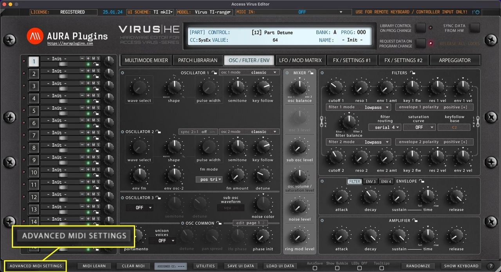
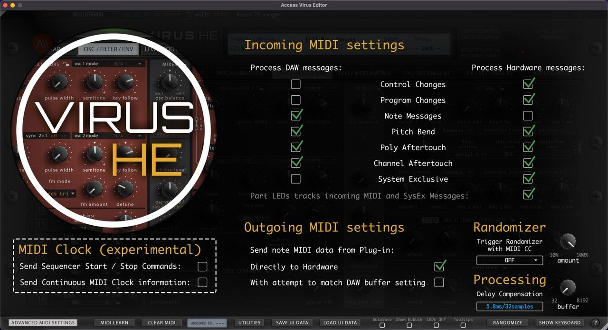
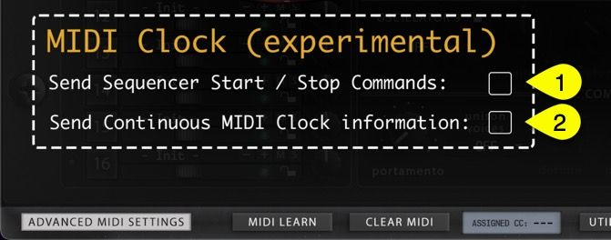

# Access Virus Editor – How To Adjust Advanced MIDI Settings

You can control which messages get processed and which do not. Open the Advanced MIDI Settings window by clicking **ADVANCED MIDI SETTINGS** button in the Editor user interface.

*Figure: how to adjust advanced midi settings - open filters page*

You can block messages being processed from DAW or from the Synthesizer itself. Settings seen in the image below are default values.

*Figure: how to adjust advanced midi settings - default settings*

## Advanced Incoming MIDI Settings

Allow certain MIDI messages to pass into the Editor processor within the Incoming MIDI setting section. Green check mark means it will be processed and when there is no check mark, it will be bypassed. **Process DAW messages [1]** and **Process Hardware messages [2]** has their own set of data “filters” **[3-9]** available as follows:

- **[3]** Control Changes
- **[4]** Program Changes
- **[5]** Note Messages
- **[6]** Pitch Bend
- **[7]** Poly Aftertouch
- **[8]** Channel Aftertouch
- **[9]** System Exclusive
- **[10]** Part LEDs tracks incoming MIDI and SysEx messages\
  When the green check mark is on, incoming data from DAW and Hardware ports is monitored and an LED indicator will flash when data is coming in. When the check mark is off, outgoing data is being monitored. Check LEDs Off function to disable.

*Figure: how to adjust advanced midi settings - details*

> **NOTE #1:** If you disable Control Changes and System Exclusive messages from the Hardware port, the Editor might stop responding to hardware knob movements completely.

> **NOTE #2:** In Standalone Application use, Remote Keyboard MIDI Input data is handled in the Process DAW messages section.

## Advanced Outgoing MIDI Settings

In the Outgoing MIDI settings section, you can adjust a few options to fine tune the Editor behavior.

Send note MIDI data from Plug-in:

- **Directly to Hardware [1]** = Send all MIDI related commands directly to hardware from the MIDI output port.
- **With attempt to match DAW buffer setting [2]** = experimental attempt to sync with DAW time.

*Figure: how to adjust advanced midi settings - midi out*

> **NOTE:** If the Editor MIDI note handling is out of time, we would advise NOT to adjust these settings at all. Check your DAW user guide to figure out how to delay or advance your MIDI note timing / delay compensation.

## MIDI Clock (experimental)

We are experimenting to add a general MIDI clock to the Editor by standard feature. This might crash on some systems on a specific setup, so be cautious when experimenting with it.

Check **Send Sequencer Start / Stop Commands [1]** if you want to send MTC start and stop commands.

Check **Send Continuous MIDI Clock information [2]** if you want to sync MIDI clocked Effects and Arpeggiator to the Editor tempo information.

*Figure: how to adjust advanced midi settings - experimental clock*

> **NOTE:** The clock with the Editor might be inaccurate, so if you have another solution to sync clock information from your DAW to the hardware, use that instead.
