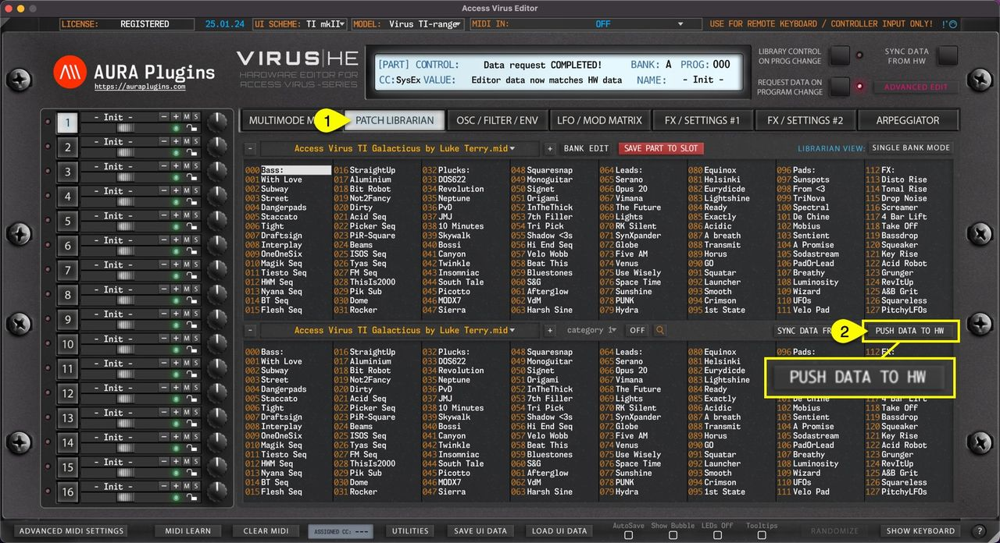

# Access Virus Editor – How To Push Data To Hardware

Another great feature we added is the ability to force data being sent to your synthesizer if needed. This could happen for couple of reasons:

1. MIDI interface ports are no longer available, and you have assigned new MIDI ports manually.
2. You open your session in a studio, where the studio Virus is connected to a different port.
3. Failure of Total Recall function.

Open **PATCH BROWSER [1]** tab and click **PUSH DATA TO HW [2]**. This will send current MULTI data and each individual parts data to the Virus.

*Figure: how to push data to hardware*

> **NOTE:** Data sending takes time depending which model you have in question. Let the Editor do its thing and don’t tweak any parameters during this time. It could potentially disturb the SysEx data sending process and you need to start again.
