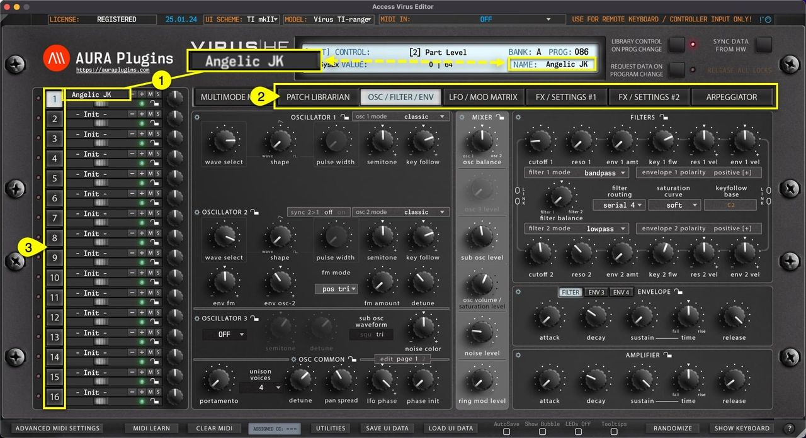

# Access Virus Editor – How To View Patch Name

**Single Patch Name [1]** can be viewed and/or set when the Editor **MAIN TAB [2]** is PATCH LIBRARIAN -> ARPEGGIATOR. You can also see the patch name in the Editor Control Display. Patch name is individual per part **[3]** . Rename part by clicking the patch name in the “Quick Mixer” area.

*Figure: how to view patch name*

> **NOTE:** Renaming a single patch from the “Quick Mixer” view does not change the name in the librarian. If you want to rename librarian items, check Related Docs below or use search function.
