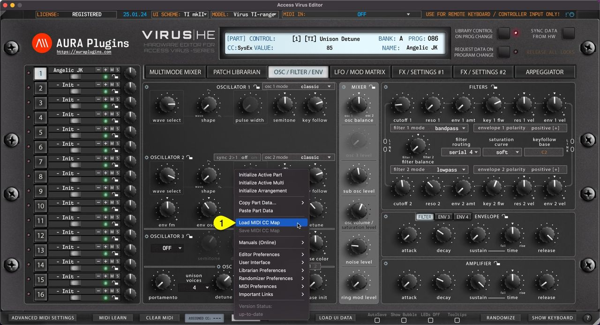

# Access Virus Editor – Save and Load MIDI CC Maps

## Load MIDI CC Map

This function loads your custom CC mapping to the Editor and over-rides the default CC assignments.

**Utilities** Menu -> **Load MIDI CC Map [1]** to open the file load dialog.

*Figure: save and load cc maps via utils menu*

## Save MIDI CC Map

If you have learned MIDI CC controls from your master controller you can save the mapping to HDD. Say you have General MIDI controls cc #12 assigned to filter cutoff 1 (40) and #13 assigned to filter resonance (41), you can save the current mapping to a file and open it every time you insert a new instance of the Editor.

**Utilities** Menu -> **Save MIDI CC Map [1]** to save the custom mappings. This option is grayed out if no assignments are present.

*Figure: save and load cc maps via utils menu*

> **NOTE:** Loading custom CC mappings does not over-ride hardware CC messages. ie. Cutoff 1 from hardware is still assigned to #40, while DAW (midi controller) CC is mapped to #12
