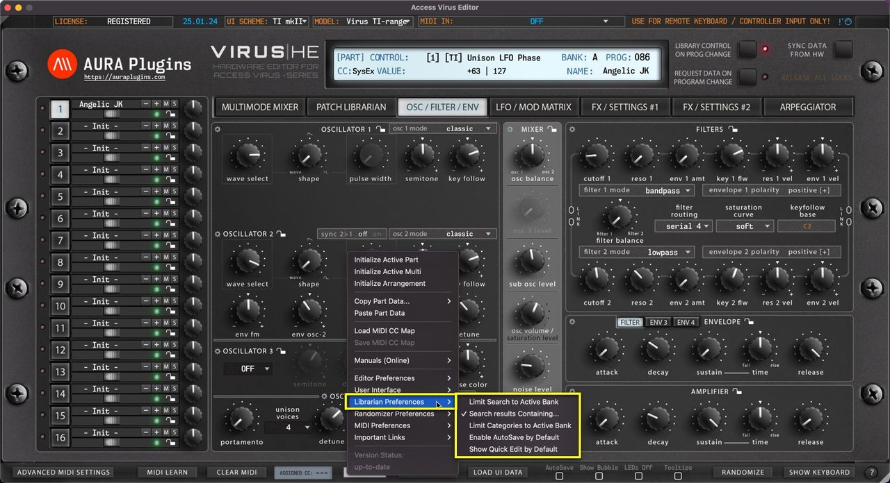

# Access Virus Editor – Utilities: Librarian Preferences

*Figure: utilities menu librarian preferences*

## Utilities Menu – Librarian Preferences Breakdown

## Limit Search to Active Bank

Execute search function to currently active bank only. This narrows down double entries (if any) while keeping the search results contained.

## Search results Containing…

Executes search so that if you type “ **bass** ” in the search field and the patch name is “my **bass** -sound01″, then search picks it up. Unchecking this will execute the search from the beginning of the names instead of containing words.

## Limit Categories to Active Bank

If category browsing is enabled, then this function limits the category filter to the currently visible bank. Otherwise all category results will be shown.

## Enable AutoSave by Default

This will by default write all the bank changes to the HDD up on action. ie if you paste data to the librarian slot, then data gets overwritten in HDD immediately.

> **NOTE:** Autosave Doesn’t have UNDO / REDO functions. Everything you do with Autosave toggled on are permanent changes!

## Show Quick Edit by Default

Defines if Quick Edit view is shown by default or not. If you don’t have plans to use search, or limit patches by categories / manipulate banks, then this could be toggled on so you can “quick edit” the patches you are auditioning.
