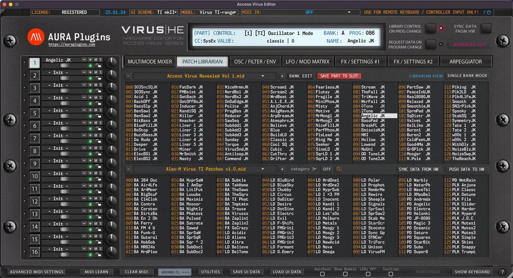

# Access Virus Editor – Patch Librarian

## Patch Librarian View

In this chapter, we are going to walk through the usage of the **Patch Librarian** and all its functions & possibilities. It might take some time to understand how it works, but for those who used **Emagic SoundDiver** in the past, this workflow is pretty much the same.

*Figure: patch librarian*

We have made the librarian look and feel the same across all our products. i.e., Waldorf Blofeld Editor has the same functions in the librarian, but every Editor has their own specialities.

But in general, you can request data from hardware to the librarian, store data from librarian to hardware, store banks to HDD as you make edits etc.

> **NOTE:** Librarian view is **not** synchronized with hardware memory. Librarian view displays **SINGLE** or **MULTI** data stored in your HDD ( [data folder]/Patches/ -folder ).

> **NOTE:** Keep your banks organized. If you have too many levels in your folder tree, the librarian is not able to solve it. Details below.

- [data folder]/Patches/sub folder 1/sub folder 2/my bank.mid – **this is OK**.
- [data folder]/Patches/sub folder 1/sub folder 2/sub folder 3/my bank.mid – **this is NOT OK**.

There is a lot to cover in this chapter, so it is the perfect time to get some coffee or tea.

## Layout and Functions

Let’s start with the definitions of basic layout and button / menu explanations.

*Figure: patch librarian labelled*

- **[1] & [8]** = Select previous SINGLE or MULTI bank from the bank tree.
- **[2] & [9]** = Display popup menu of SINGLE or MULTI banks. Menu displays banks from the data folder .
- **[3] & [10]** = Select next SINGLE or MULTI bank from the bank tree.
- **[4]** = Bank Edit menu, SINGLE or MULTI request functions, write functions, overwrite & save as functions and import functions.
- **[5]** = Save Data from currently selected PART TO currently selected librarian slot.
- **[6]** = Display SINGLE or MULTI programs in the Librarian View.
- **[7]** = Upper data view, also used as EDIT BUFFER. Data can be edited only in the upper data view.
- **[11]** = Category drop down menu to view patches from certain categories.
- **[12]** = Category browsing toggle. On or Off.
- **[13]** = Toggle on Search function. Search results will be shown in the right data view. Check Utilities menu functions earlier to learn more about Librarian Preferences regarding Search settings.
- **[14]** = Sync Data From Hw toggle to get data from the hardware to the Editor User Interface.
- **[15]** = Push Data To Hw toggle to send Editor User Interface data to the hardware.
- **[16]** = Lower data view. This view can be changed while the upper data view is locked due to unsaved data changes.
- **[17]** = Show Quick Edit View to adjust parameters without leaving the Librarian View.

Now that we understand the basic layout, we can dive into more specific details per function.
