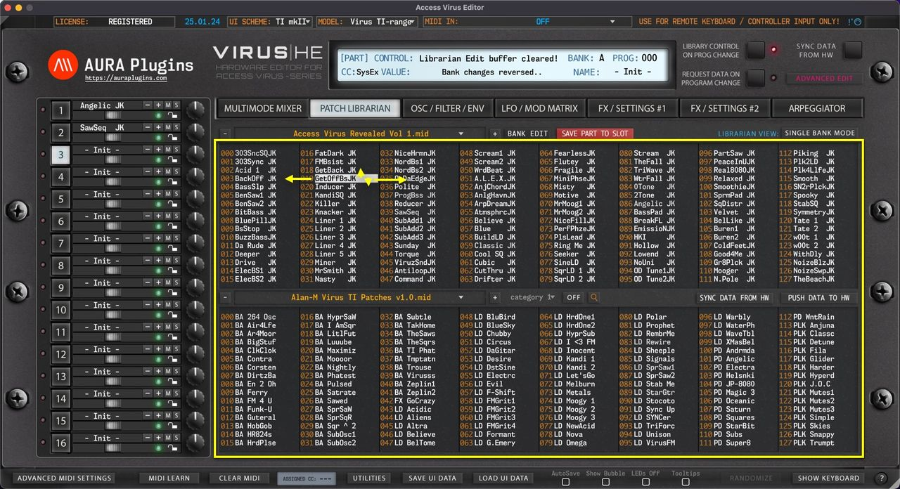
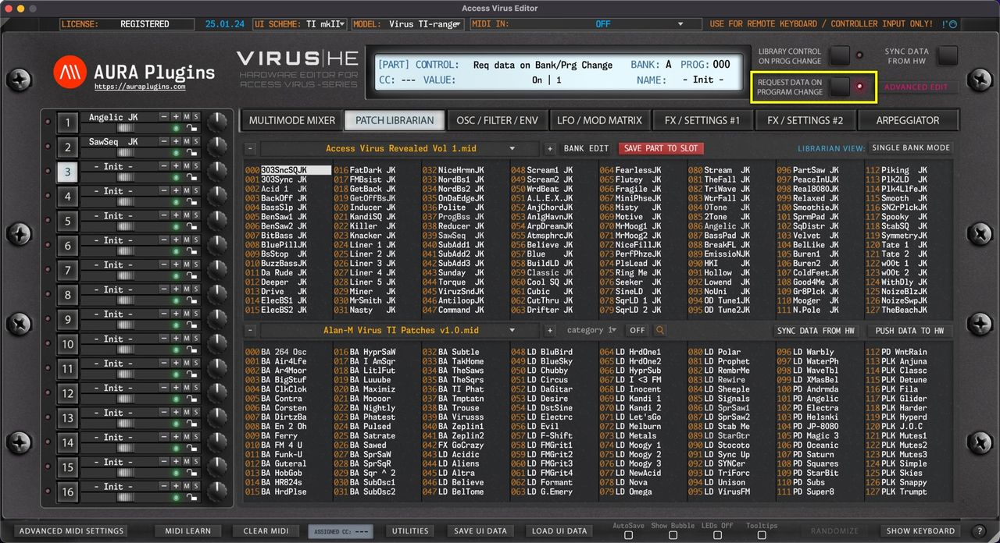

# Access Virus Editor – Sending Data To Hardware

## Double Click

You can send any **slot data [1]** from the Librarian view to a selected **Part [2]** by **double clicking** the item.

In SINGLE BANK mode this data will be sent to the **currently selected [2]** Part.

In MULTI mode the data will only replace the MULTI settings, not individual parts. When MULTI is sent from the librarian to the hardware, each of the parts will be requested from the hardware to the user interface. This is because the MULTI data only holds reference to Bank and Program from the hardware, not the actual part data. If you want to send specific parts with MULTI, use our Save / Load UI Data function to achieve this.

*Figure: sending data to hardware with double click*

## Arrow Keys

You can use the computer keyboard arrow up, down, left and right keys to navigate librarian slot content as long as the mouse cursor is above the librarian view.

Data is sent to the currently active part in the hardware while Librarian View is in SINGLE BANK mode.

*Figure: sending data to hardware with arrow keys*

## Program Change Buttons

Program Change – / + buttons have two functions:

1. If **LIBRARY CONTROL ON PROG CHANGE [1]** is toggled on, then data from the Librarian View is sent to currently active part on **Program – / + [2]** trigger, ie. – is clicked, then TheBeachJK is sent to the currently active slot.
2. If **LIBRARY CONTROL ON PROG CHANGE [1]** is toggled off, then Program Change command is sent to hardware based on **BANK and PROG menu [3]** values, ie. if PROG is 11 and 14 is clicked, then PROG 14 is requested from hardware to the currently active part.

*Figure: sending data to hardware with program - / + buttons*

## MIDI Program Change

Similar to User Interface Program Change – / + buttons, incoming MIDI Program Change has the same effect. You can optionally disable incoming MIDI Program Change commands from the Advanced MIDI Settings view.

Data is either sent to hardware from the Librarian View based on the incoming Program Change value or requested from the hardware to the Editor User Interface based on the same Program Change value.

> **NOTE:** When user toggles between LIBRARY CONTROL ON PROG CHANGE states, REQUEST DATA ON PROGRAM CHANGE button gets disabled. Engage the button again if you want to request hardware programs to the Editor User Interface after MIDI Program Change is sent. See image below.

*Figure: sending data to hardware with midi pc*

## PROG menu

Users can also send Programs to the hardware by clicking the **PROG [1]** menu and selecting an item from the list. Note that **LIBRARY CONTROL ON PROG CHANGE [2]** is on, so data is sent to hardware from the Librarian View and PROG menu items are populated with the currently active Librarian View program names.

*Figure: sending data to hardware via program menu*

## and BANK menu…

Another option is to change BANK via the **BANK [1]** menu. Note that in this case the **LIBRARY CONTROL ON PROG CHANGE [2]** is toggled off, which results in renaming menu items with hardware bank locations. Also, **REQUEST DATA ON PROGRAM CHANGE [3]** is on, which means data is requested to the User Interface instead of sending it to the hardware.

*Figure: sending data to hardware via bank menu*
