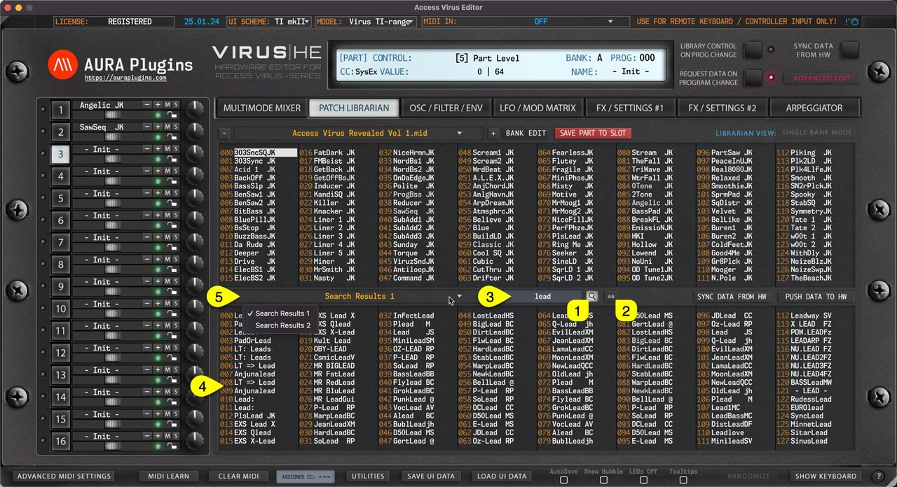

# Access Virus Editor – Search Filter

Search Filter can be toggled on by clicking the **SEARCH [1]** icon in the Patch Librarian View. Before entering the search term, you can define if search is taking character caps into account by clicking the **“ aa ” [2]** toggle.

Now once the **search term [3]** is input and you hit enter, you’ll see that **Lower (SOURCE) [4]** list view gets updated with all programs containing the search term.

More search results are shown by clicking the **bank name [5]** area to reveal how many banks of search items were found.

*Figure: search filter toggles*

Search follows the current Librarian View mode, ie. SINGLE BANK mode shows results only from Single banks, while MULTI BANK shows only results from Multi banks.

> **NOTE:** To adjust how search works, use the Utilities Menu -> Librarian Preferences to determine how search works.
